<table style="width:100%; border:none; margin-bottom:20px;">
<tr>
<td width="120" align="center" style="border:none;">

</td>
<td align="right" style="border:none; padding: 20px 10px;">
<h1 style="color:#c2185b; font-family: Georgia, serif; letter-spacing: 2px; margin-bottom:5px;">EL ÁRBOL DE HIGOS</h1>
<p style="color:#ad1457; font-style: italic; font-size: 15px; margin:0;">Semana 06 — CRUD 🌸🌸🌷🌸🌸💐completo: crear, consultar, editar y eliminar</p>
<p style="color:#e91e8c; font-size: 13px; margin:0;">Desarrollo de Aplicaciones Web</p>
</td>
</tr>
</table>

<br>

<table style="width:100%; border-collapse: collapse;">
<tr style="background-color:#c2185b; color:#ffffff;">
<td style="padding:8px;"><b>Alumna</b></td>
<td style="padding:8px;">Patricia Segura Resendiz</td>
</tr>
<tr style="background-color:#fce4ec;">
<td style="padding:8px;"><b>Institución</b></td>
<td style="padding:8px;">Instituto Tecnológico Superior de Rioverde</td>
</tr>
<tr style="background-color:#c2185b; color:#ffffff;">
<td style="padding:8px;"><b>Carrera</b></td>
<td style="padding:8px;">Ingeniería en Sistemas Computacionales</td>
</tr>
<tr style="background-color:#fce4ec;">
<td style="padding:8px;"><b>Docente</b></td>
<td style="padding:8px;">Ing. José de Jesús Collazo Reyes</td>
</tr>
<tr style="background-color:#c2185b; color:#ffffff;">
<td style="padding:8px;"><b>Entorno</b></td>
<td style="padding:8px;">WampServer · Apache 2.4.59 · PHP 8.2.18 · MySQL 8.0.42</td>
</tr>
</table>

<br>

<h2 style="color:#c2185b; border-bottom: 3px solid #f48fb1; padding-bottom: 6px;">🌸🌸🌸🌷🌸🌸💐 Objetivo</h2>

<blockquote style="border-left: 4px solid #f48fb1; background:#fff0f5; padding: 10px 15px; color:#333;">
Construir un módulo funcional para crear, consultar, modificar y eliminar las reseñas de mi tienda de libros, sobre el mismo proyecto de las semanas anteriores. Además de que las cuatro operaciones funcionen, el objetivo fue hacerlas de forma segura: usando consultas preparadas, validando en el servidor y evitando que un enlace pueda borrar datos.
</blockquote>

<br>

<h2 style="color:#c2185b; border-bottom: 3px solid #f48fb1; padding-bottom: 6px;">🌷 Entidad que administro</h2>

<table style="width:100%; border-collapse: collapse;">
<tr style="background-color:#fce4ec;"><td style="padding:8px;"><b>Proyecto</b></td><td style="padding:8px;">El Árbol de Higos (tienda de libros 🌸🌸🌷🌸🌸💐)</td></tr>
<tr style="background-color:#ffffff;"><td style="padding:8px;"><b>Entidad</b></td><td style="padding:8px;">Reseñas de libros</td></tr>
<tr style="background-color:#fce4ec;"><td style="padding:8px;"><b>Base de datos</b></td><td style="padding:8px;"><code>arbol_de_higos</code></td></tr>
<tr style="background-color:#ffffff;"><td style="padding:8px;"><b>Tabla</b></td><td style="padding:8px;"><code>resenas</code></td></tr>
<tr style="background-color:#fce4ec;"><td style="padding:8px;"><b>Clave primaria</b></td><td style="padding:8px;"><code>id</code> (AUTO_INCREMENT)</td></tr>
<tr style="background-color:#ffffff;"><td style="padding:8px;"><b>Campos principales</b></td><td style="padding:8px;"><code>nombre</code>, <code>correo</code>, <code>libro</code>, <code>calificacion</code>, <code>comentario</code>, <code>fecha</code></td></tr>
</table>

<blockquote style="border-left: 4px solid #f48fb1; background:#fff0f5; padding: 10px 15px; color:#333; margin-top:10px;">
<b>¿Por qué elegí esta entidad?</b> Porque ya existía desde la Semana 05 y tiene sentido dentro de mi tienda: las reseñas son lo que dejan los lectores, y quien administra la tienda necesita poder corregirlas o quitarlas.
</blockquote>

<br>

<h2 style="color:#c2185b; border-bottom: 3px solid #f48fb1; padding-bottom: 6px;">💗🌸🌸🌷🌸🌸💐 Revisión de la Semana 05</h2>

<blockquote style="border-left: 4px solid #f48fb1; background:#fff0f5; padding: 10px 15px; color:#333;">
Antes de agregar nada copié los archivos de <code>semana05</code> a <code>semana06</code> y comprobé desde esa carpeta que todo siguiera funcionando: el formulario, JavaScript, el guardado en MySQL y la tabla de reseñas.
</blockquote>

<div align="center">
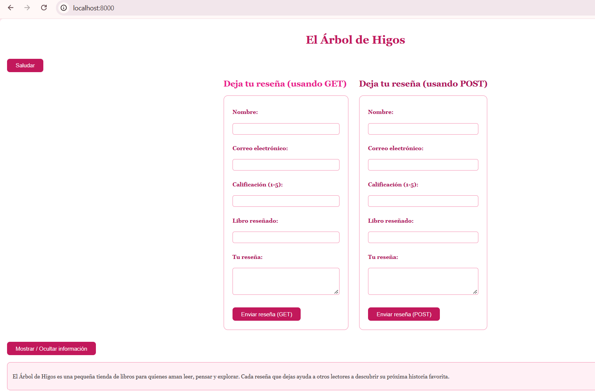
<p style="color:#c2185b; font-style:italic; font-size:13px;">La versión de la Semana 05 funcionando desde semana06</p>
</div>

<br>

<h2 style="color:#c2185b; border-bottom: 3px solid #f48fb1; padding-bottom: 6px;">🌺🌸🌸🌷🌸🌸💐 Funcionalidad implementada</h2>

<table style="width:100%; border-collapse: collapse;">
<tr style="background-color:#c2185b; color:#ffffff;"><th style="padding:8px; text-align:left;">Operación</th><th style="padding:8px; text-align:left;">Archivo</th><th style="padding:8px; text-align:left;">Qué hace</th></tr>
<tr style="background-color:#fce4ec;"><td style="padding:8px;"><b>CREATE</b></td><td style="padding:8px;"><code>crear.php</code></td><td style="padding:8px;">Registra una reseña nueva, validando antes de guardar</td></tr>
<tr style="background-color:#ffffff;"><td style="padding:8px;"><b>READ</b></td><td style="padding:8px;"><code>listar.php</code></td><td style="padding:8px;">Muestra las reseñas con botones de editar y eliminar</td></tr>
<tr style="background-color:#fce4ec;"><td style="padding:8px;"><b>UPDATE</b></td><td style="padding:8px;"><code>editar.php</code></td><td style="padding:8px;">Carga una reseña por su id, la modifica y guarda los cambios</td></tr>
<tr style="background-color:#ffffff;"><td style="padding:8px;"><b>DELETE</b></td><td style="padding:8px;"><code>eliminar.php</code></td><td style="padding:8px;">Elimina una reseña, solo por POST y con confirmación</td></tr>
</table>

<br>

<h3 style="color:#ad1457;">CREATE — registrar una reseña</h3>

<blockquote style="border-left: 4px solid #f48fb1; background:#fff0f5; padding: 10px 15px; color:#333;">
El cambio más importante de la semana es cómo se arma el SQL. Antes pegaba las variables directo en la consulta (<code>VALUES ('$nombre', ...)</code>), lo cual permite inyección SQL. Ahora la consulta lleva signos <code>?</code> y los datos se envían por separado con <code>bind_param</code>, así MySQL nunca los interpreta como código.
</blockquote>

```php
$sql = "INSERT INTO resenas (nombre, correo, libro, calificacion, comentario, fecha)
        VALUES (?, ?, ?, ?, ?, CURDATE())";
$stmt = $conexion->prepare($sql);
$stmt->bind_param("sssis", $nombre, $correo, $libro, $calificacionInt, $comentario);
$stmt->execute();
```

<blockquote style="border-left: 4px solid #f48fb1; background:#fff0f5; padding: 10px 15px; color:#333;">
En <code>"sssis"</code> cada letra es el tipo de un dato, en orden: tres textos, un entero y un texto. La fecha se guarda automáticamente con <code>CURDATE()</code>, usando el campo que agregué con <code>ALTER TABLE</code> en la Semana 05.
</blockquote>

<div align="center">
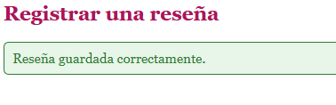
<p style="color:#c2185b; font-style:italic; font-size:13px;">Reseña guardada correctamente</p>
<br>
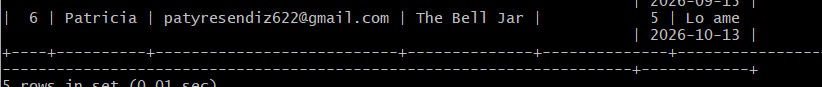
<p style="color:#c2185b; font-style:italic; font-size:13px;">El registro confirmado directamente en MySQL</p>
</div>

<br>

<h3 style="color:#ad1457;">READ — consultar y listar</h3>

<blockquote style="border-left: 4px solid #f48fb1; background:#fff0f5; padding: 10px 15px; color:#333;">
<code>listar.php</code> consulta MySQL y genera una fila de tabla por cada reseña. Todo valor que se imprime en HTML pasa por <code>htmlspecialchars()</code>, para que si alguien escribe código HTML en un comentario, se muestre como texto y no se ejecute. Lo comprobé guardando un comentario con <code>&lt;b&gt;prueba&lt;/b&gt;</code>: se vio literal, sin negritas. Si no hay reseñas, la página muestra un mensaje en lugar de una tabla vacía.
</blockquote>

<div align="center">
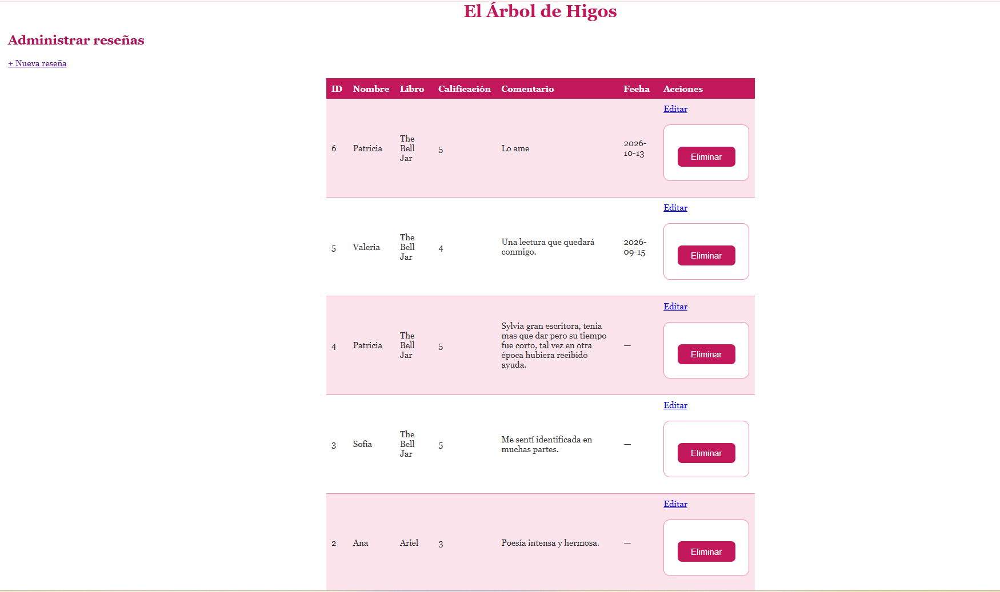
<p style="color:#c2185b; font-style:italic; font-size:13px;">Lista de reseñas con sus acciones</p>
<br>
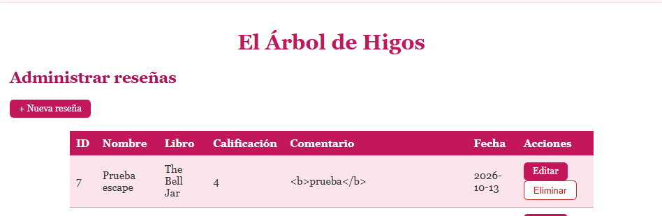
<p style="color:#c2185b; font-style:italic; font-size:13px;">El HTML escrito en un comentario se muestra como texto</p>
</div>

<br>

<h3 style="color:#ad1457;">UPDATE — editar una reseña</h3>

<blockquote style="border-left: 4px solid #f48fb1; background:#fff0f5; padding: 10px 15px; color:#333;">
<code>editar.php</code> recibe el id, lo valida y busca la reseña en la base de datos antes de mostrar el formulario. Si el id no es un número o no existe, me regresa a la lista con un aviso y no toca nada. Al guardar, el <code>UPDATE</code> lleva <code>WHERE id = ?</code>, que es lo que evita modificar todas las reseñas.
</blockquote>

```php
$sql = "UPDATE resenas
        SET nombre = ?, correo = ?, libro = ?, calificacion = ?, comentario = ?
        WHERE id = ?";
$stmt->bind_param("sssisi", $nombre, $correo, $libro, $calificacionInt, $comentario, $id);
```

<div align="center">
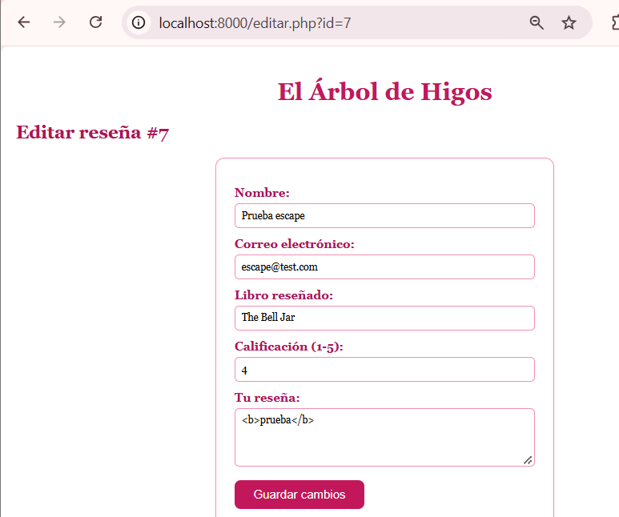
<p style="color:#c2185b; font-style:italic; font-size:13px;">Formulario con los valores actuales</p>
<br>
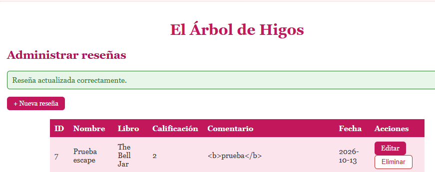
<p style="color:#c2185b; font-style:italic; font-size:13px;">Cambio guardado</p>
</div>

<br>

<h3 style="color:#ad1457;">DELETE — eliminar con seguridad</h3>

<blockquote style="border-left: 4px solid #f48fb1; background:#fff0f5; padding: 10px 15px; color:#333;">
Eliminar tiene tres seguros. Primero, el botón abre una ventana de confirmación y, si cancelo, el formulario no se envía. Segundo, es un formulario <code>POST</code> y no un enlace: un enlace borraría con solo abrir la dirección. Tercero, <code>eliminar.php</code> verifica en el servidor que la solicitud sea POST, valida el id, y usa <code>DELETE ... WHERE id = ?</code>. Con <code>affected_rows</code> sé si realmente se borró algo, para no avisar "eliminada" cuando ese id ya no existía.
</blockquote>

<div align="center">
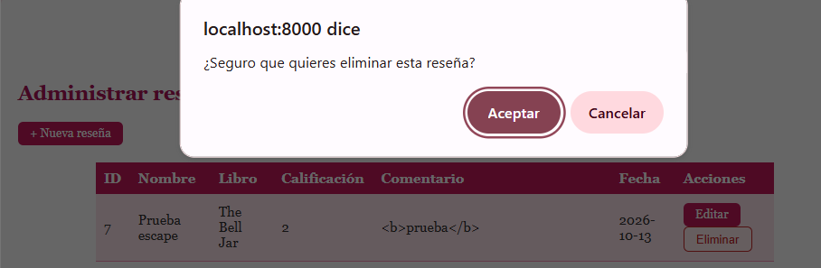
<p style="color:#c2185b; font-style:italic; font-size:13px;">Confirmación antes de eliminar</p>
<br>
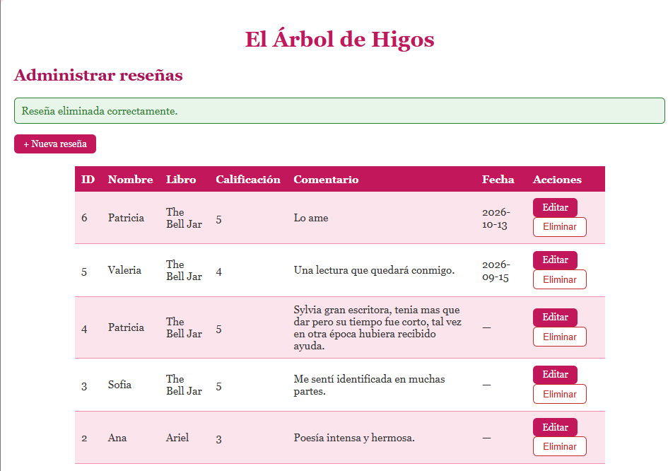
<p style="color:#c2185b; font-style:italic; font-size:13px;">Reseña eliminada correctamente</p>
</div>

<br>

<h2 style="color:#c2185b; border-bottom: 3px solid #f48fb1; padding-bottom: 6px;">💐 Archivos modificados o creados</h2>

<table style="width:100%; border-collapse: collapse;">
<tr style="background-color:#c2185b; color:#ffffff;"><th style="padding:8px; text-align:left;">Archivo</th><th style="padding:8px; text-align:left;">Estado</th><th style="padding:8px; text-align:left;">Función</th></tr>
<tr style="background-color:#fce4ec;"><td style="padding:8px;"><code>crear.php</code></td><td style="padding:8px;">Nuevo</td><td style="padding:8px;">Alta de reseñas</td></tr>
<tr style="background-color:#ffffff;"><td style="padding:8px;"><code>listar.php</code></td><td style="padding:8px;">Nuevo</td><td style="padding:8px;">Listado y acciones</td></tr>
<tr style="background-color:#fce4ec;"><td style="padding:8px;"><code>editar.php</code></td><td style="padding:8px;">Nuevo</td><td style="padding:8px;">Edición</td></tr>
<tr style="background-color:#ffffff;"><td style="padding:8px;"><code>eliminar.php</code></td><td style="padding:8px;">Nuevo</td><td style="padding:8px;">Eliminación</td></tr>
<tr style="background-color:#fce4ec;"><td style="padding:8px;"><code>conexion.php</code></td><td style="padding:8px;">Modificado</td><td style="padding:8px;">Se agregó <code>set_charset("utf8mb4")</code> para guardar bien los acentos</td></tr>
<tr style="background-color:#ffffff;"><td style="padding:8px;"><code>index.php</code></td><td style="padding:8px;">Modificado</td><td style="padding:8px;">Se agregó un menú de navegación</td></tr>
<tr style="background-color:#fce4ec;"><td style="padding:8px;"><code>estilos.css</code></td><td style="padding:8px;">Modificado</td><td style="padding:8px;">Estilos de botones, acciones y menú</td></tr>
<tr style="background-color:#ffffff;"><td style="padding:8px;"><code>pruebas_crud.md</code></td><td style="padding:8px;">Nuevo</td><td style="padding:8px;">Resultado de las 10 pruebas funcionales</td></tr>
</table>

<br>

<h2 style="color:#c2185b; border-bottom: 3px solid #f48fb1; padding-bottom: 6px;">🌸🌸🌸🌷🌸🌸💐 Tablas de la base de datos utilizadas</h2>

<blockquote style="border-left: 4px solid #f48fb1; background:#fff0f5; padding: 10px 15px; color:#333;">
Utilicé únicamente la tabla <code>resenas</code> de la base <code>arbol_de_higos</code>, creada en la Semana 05 y ampliada con el campo <code>fecha</code>. No fue necesario crear tablas nuevas.
</blockquote>

<br>

<h2 style="color:#c2185b; border-bottom: 3px solid #f48fb1; padding-bottom: 6px;">💕 Pruebas realizadas</h2>

<table style="width:100%; border-collapse: collapse;">
<tr style="background-color:#c2185b; color:#ffffff;"><th style="padding:8px;">N.º</th><th style="padding:8px; text-align:left;">Prueba</th><th style="padding:8px; text-align:left;">Resultado</th></tr>
<tr style="background-color:#fce4ec;"><td style="padding:8px; text-align:center;">1</td><td style="padding:8px;">Registrar con datos válidos</td><td style="padding:8px;">Se guarda y aparece en la lista y en MySQL</td></tr>
<tr style="background-color:#ffffff;"><td style="padding:8px; text-align:center;">2</td><td style="padding:8px;">Campos obligatorios vacíos</td><td style="padding:8px;">PHP rechaza y muestra los errores</td></tr>
<tr style="background-color:#fce4ec;"><td style="padding:8px; text-align:center;">3</td><td style="padding:8px;">Consultar el registro creado</td><td style="padding:8px;">Aparece con sus datos reales</td></tr>
<tr style="background-color:#ffffff;"><td style="padding:8px; text-align:center;">4</td><td style="padding:8px;">Editar y guardar</td><td style="padding:8px;">El cambio se guarda</td></tr>
<tr style="background-color:#fce4ec;"><td style="padding:8px; text-align:center;">5</td><td style="padding:8px;">Persistencia del cambio</td><td style="padding:8px;">Sigue guardado tras recargar y en MySQL</td></tr>
<tr style="background-color:#ffffff;"><td style="padding:8px; text-align:center;">6</td><td style="padding:8px;">Id inexistente</td><td style="padding:8px;">Aviso rojo, sin alterar otros registros</td></tr>
<tr style="background-color:#fce4ec;"><td style="padding:8px; text-align:center;">7</td><td style="padding:8px;">Cancelar la eliminación</td><td style="padding:8px;">El registro se conserva</td></tr>
<tr style="background-color:#ffffff;"><td style="padding:8px; text-align:center;">8</td><td style="padding:8px;">Eliminar la reseña de prueba</td><td style="padding:8px;">Desaparece de la lista y de MySQL</td></tr>
<tr style="background-color:#fce4ec;"><td style="padding:8px; text-align:center;">9</td><td style="padding:8px;">Lista sin registros</td><td style="padding:8px;">Muestra un mensaje apropiado</td></tr>
<tr style="background-color:#ffffff;"><td style="padding:8px; text-align:center;">10</td><td style="padding:8px;">Diseño y navegación</td><td style="padding:8px;">Todo funciona con el estilo rosa</td></tr>
</table>

<p style="color:#c2185b; font-size:13px;">El detalle de cada prueba, con sus capturas, está en <code>pruebas_crud.md</code>.</p>

<br>

<h2 style="color:#c2185b; border-bottom: 3px solid #f48fb1; padding-bottom: 6px;">🌷 Errores encontrados</h2>

<table style="width:100%; border-collapse: collapse;">
<tr style="background-color:#fce4ec;"><td style="padding:8px;"><b>Error 1 — Qué ocurrió</b></td><td style="padding:8px;">Escribí <code>USE arbol_de_higos;</code> y <code>SELECT * FROM resenas;</code> directamente en Git Bash y apareció <code>command not found</code>.</td></tr>
<tr style="background-color:#ffffff;"><td style="padding:8px;"><b>Causa</b></td><td style="padding:8px;">Esos comandos son de MySQL, no de Git Bash. Solo funcionan dentro del cliente de MySQL, donde el prompt dice <code>mysql&gt;</code>.</td></tr>
<tr style="background-color:#fce4ec;"><td style="padding:8px;"><b>Solución</b></td><td style="padding:8px;">Entrar primero con <code>mysql.exe -u root -p</code> y escribir los comandos ya dentro.</td></tr>
<tr style="background-color:#ffffff;"><td colspan="2" style="padding:4px;"></td></tr>
<tr style="background-color:#fce4ec;"><td style="padding:8px;"><b>Error 2 — Qué ocurrió</b></td><td style="padding:8px;">Se apagó mi laptop y se cerró todo mientras trabajaba. Al volver, <code>editar.php</code> no estaba en la carpeta.</td></tr>
<tr style="background-color:#ffffff;"><td style="padding:8px;"><b>Causa</b></td><td style="padding:8px;">Ese archivo todavía no se había guardado ni subido a Git cuando se apagó.</td></tr>
<tr style="background-color:#fce4ec;"><td style="padding:8px;"><b>Cómo lo investigué</b></td><td style="padding:8px;">Con <code>git status</code> comprobé que lo anterior sí estaba subido (el commit de <code>listar.php</code> aparecía en GitHub), y con <code>ls semana06/</code> vi que faltaba <code>editar.php</code>.</td></tr>
<tr style="background-color:#ffffff;"><td style="padding:8px;"><b>Solución</b></td><td style="padding:8px;">Volver a crear el archivo y guardarlo con <code>Ctrl+S</code> apenas lo pegué, comprobando que la pestaña ya no tuviera el punto de cambios sin guardar.</td></tr>
</table>

<br>

<h2 style="color:#c2185b; border-bottom: 3px solid #f48fb1; padding-bottom: 6px;">💗 Soluciones aplicadas</h2>

<blockquote style="border-left: 4px solid #f48fb1; background:#fff0f5; padding: 10px 15px; color:#333;">
Aprendí que hacer commits pequeños y frecuentes me protegió: gracias a que cada operación del CRUD tenía su propio commit, cuando se apagó la laptop solo perdí lo que no había guardado. También aprendí a distinguir en qué programa estoy escribiendo (Git Bash o MySQL) mirando cómo se ve el prompt.
</blockquote>

<br>

<h2 style="color:#c2185b; border-bottom: 3px solid #f48fb1; padding-bottom: 6px;">💐 Evidencias</h2>

<div align="center">
<table style="width:100%;">
<tr>
<td align="center" width="50%">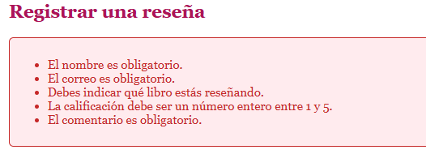<p style="font-size:12px; color:#c2185b;">Errores con el formulario vacío</p></td>
<td align="center" width="50%">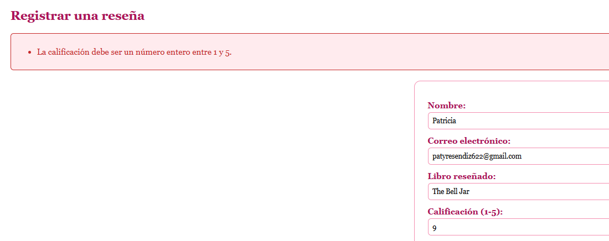<p style="font-size:12px; color:#c2185b;">Calificación fuera de rango</p></td>
</tr>
<tr>
<td align="center" width="50%">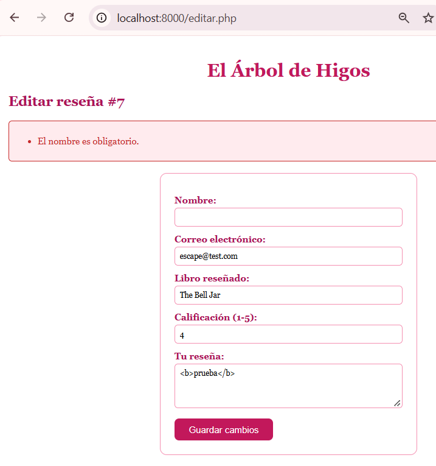<p style="font-size:12px; color:#c2185b;">Error de validación al editar</p></td>
<td align="center" width="50%">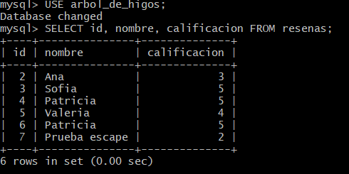<p style="font-size:12px; color:#c2185b;">Cambio verificado en MySQL</p></td>
</tr>
<tr>
<td align="center" width="50%">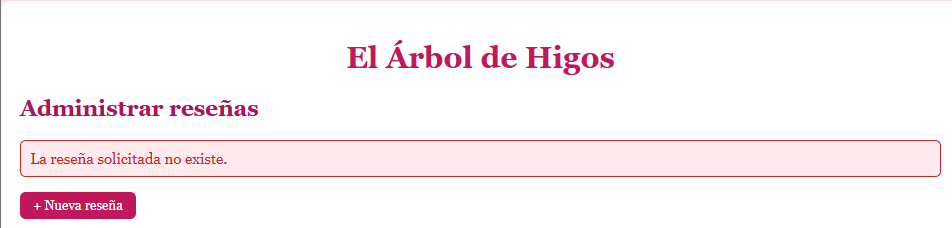<p style="font-size:12px; color:#c2185b;">Id inexistente</p></td>
<td align="center" width="50%">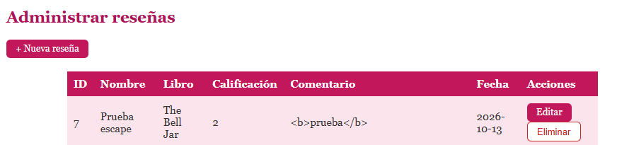<p style="font-size:12px; color:#c2185b;">Eliminación cancelada</p></td>
</tr>
<tr>
<td align="center" width="50%">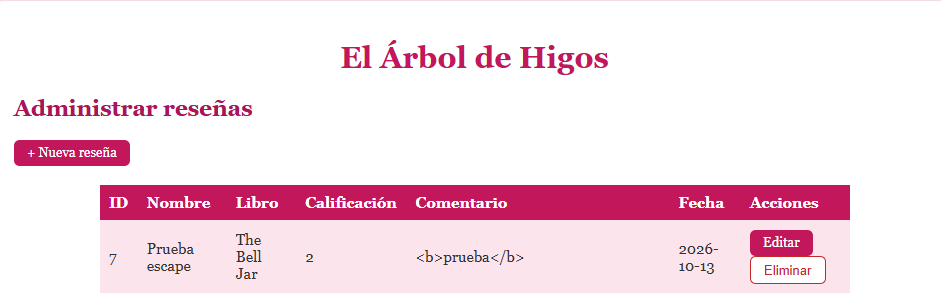<p style="font-size:12px; color:#c2185b;">Un GET no borra nada</p></td>
<td align="center" width="50%">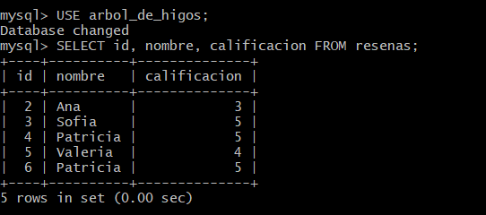<p style="font-size:12px; color:#c2185b;">Registro eliminado, verificado en MySQL</p></td>
</tr>
<tr>
<td align="center" width="50%">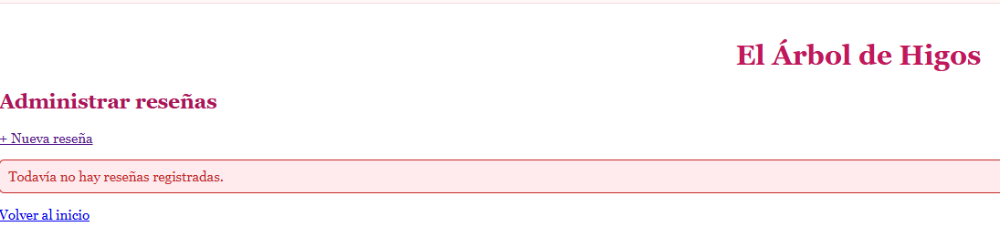<p style="font-size:12px; color:#c2185b;">Lista sin registros</p></td>
<td align="center" width="50%">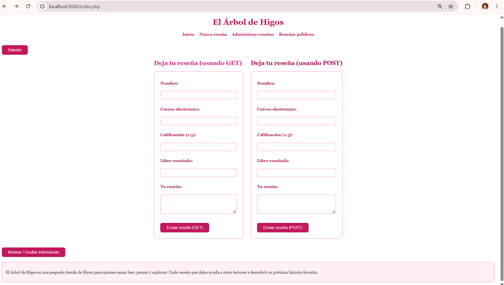<p style="font-size:12px; color:#c2185b;">Menú de navegación</p></td>
</tr>
</table>
</div>

<br>

<h2 style="color:#c2185b; border-bottom: 3px solid #f48fb1; padding-bottom: 6px;">🌷 Reflexión final</h2>

<blockquote style="border-left: 4px solid #f48fb1; background:#fff0f5; padding: 10px 15px; color:#333;">
Esta semana entendí que un CRUD no es solo poner cuatro botones: cada operación tiene riesgos distintos. Crear exige validar y no confiar en lo que escribe el usuario; editar y eliminar exigen identificar bien el registro con su id y usar <code>WHERE</code>, porque sin eso se modifican o borran todos los datos; y eliminar además exige confirmación y no hacerse con un enlace. Cambiar mis consultas a consultas preparadas me hizo ver la diferencia entre una aplicación que solo funciona y una que además es segura. También comprobé que MySQL y mi aplicación están conectados de verdad: lo que hacía en la página lo veía reflejado en la base de datos. Mi tienda "El Árbol de Higos" ya no solo guarda reseñas: ahora se pueden administrar.
</blockquote>

<br>

---

<div align="center">
<p style="color:#c2185b; font-style:italic;">Semana 06 — completada</p>
</div>
