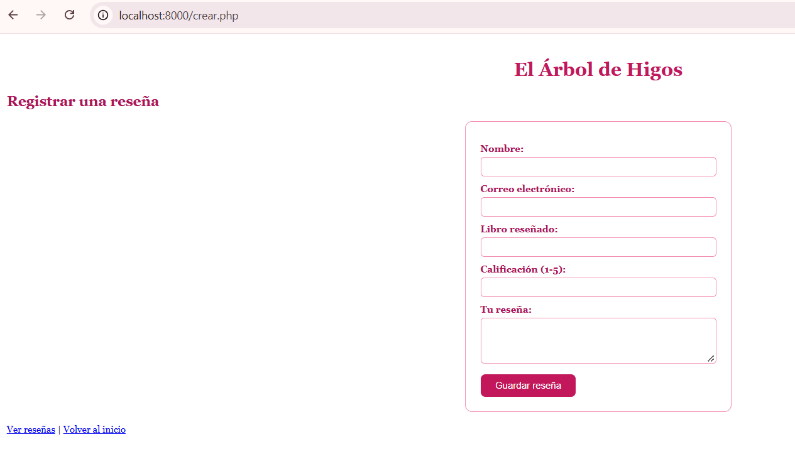
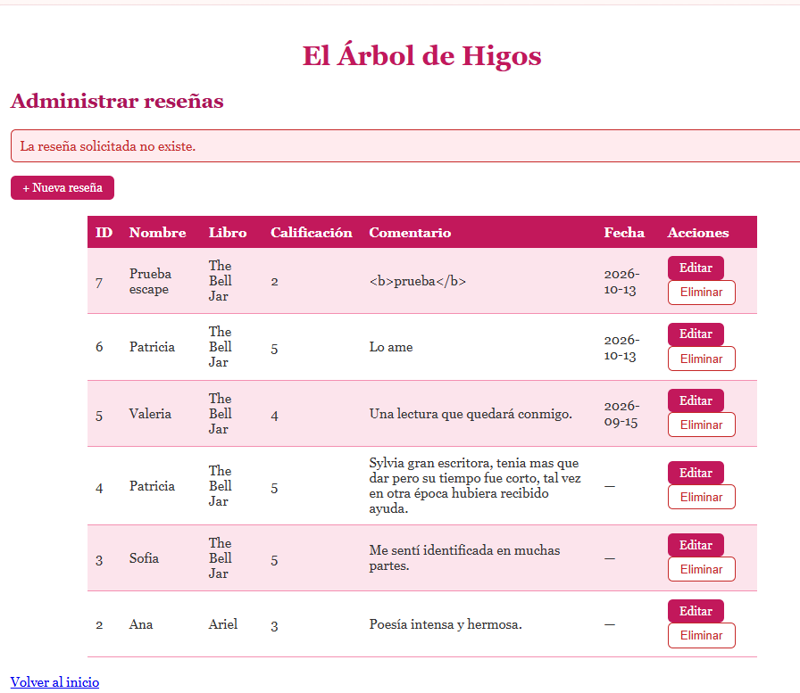

**Proyecto:** El Árbol de Higos 🌸🌸🌷🌸🌸💐
**Entidad administrada:** reseñas de libros
**Base de datos:** `arbol_de_higos`
**Tabla:** `resenas` (clave primaria: `id`)
**Alumna:** Patricia Segura Resendiz 🌸💐

Todas las pruebas se hicieron sobre la aplicación real, con el servidor de PHP corriendo desde la carpeta `semana06` y MySQL en WampServer. Para editar y eliminar se usó una reseña de demostración (`Prueba escape`, id 7), sin tocar las reseñas reales.

---

## Resumen 🌸🌸🌷🌸🌸💐

| N.º | Prueba | Operación | Resultado |
|---:|---|---|---|
| 1 | Registrar una reseña con datos válidos | CREATE | Correcto |
| 2 | Enviar campos obligatorios vacíos | CREATE | Correcto |
| 3 | Consultar la reseña recién creada | READ | Correcto |
| 4 | Editar un campo y guardar | UPDATE | Correcto |
| 5 | Recargar y comprobar que el cambio persiste | UPDATE | Correcto |
| 6 | Editar un identificador inexistente | UPDATE | Correcto |
| 7 | Cancelar la confirmación de eliminación | DELETE | Correcto |
| 8 | Eliminar la reseña de prueba | DELETE | Correcto |
| 9 | Abrir la lista sin registros | READ | Correcto |
| 10 | Comprobar diseño y navegación | General | Correcto |

---

## Prueba 1 — Registrar con datos válidos (CREATE) 🌸🌸🌷🌸🌸💐🌸🌸🌷🌸🌸💐

**Qué hice:** en `crear.php` llené todos los campos con datos válidos y presioné "Guardar reseña".

**Resultado esperado:** la reseña se guarda en MySQL y aparece en la lista.

**Resultado obtenido:** apareció el mensaje "Reseña guardada correctamente". Al consultar MySQL, el registro quedó con su `id` generado por `AUTO_INCREMENT` y con la fecha del día (`CURDATE()`).

---

## Prueba 2 — Campos obligatorios vacíos (CREATE) 🌸🌸🌷🌸🌸💐🌸🌸🌷🌸🌸💐

**Qué hice:** envié el formulario sin llenar ningún campo. Después envié una calificación de `9`.

**Resultado esperado:** PHP rechaza los datos, muestra mensajes claros y no guarda nada.

**Resultado obtenido:** aparecieron los mensajes de error dentro de la página, indicando qué campo faltaba y qué debía corregirse. Con la calificación `9` se mostró que debe ser un número entero entre 1 y 5. No se guardó ningún registro.

Esta validación se hace en el servidor (PHP). El formulario tiene `novalidate` para que se vea la validación de PHP y no la del navegador.

---

## Prueba 3 — Consultar el registro creado (READ) 🌸🌸🌷🌸🌸💐🌸🌸🌷🌸🌸💐

**Qué hice:** abrí `listar.php`.

**Resultado esperado:** se muestran los datos reales de MySQL, con botones de editar y eliminar por cada registro.

**Resultado obtenido:** la tabla mostró las reseñas guardadas, incluida la que acababa de crear, con sus botones "Editar" y "Eliminar".

**Prueba adicional (escape de HTML):** guardé un comentario con el texto `<b>prueba</b>`. En la lista se mostró literalmente, sin aplicar negritas, porque los valores se imprimen con `htmlspecialchars()`.

---

## Prueba 4 — Editar un registro (UPDATE) 🌸🌸🌷🌸🌸💐🌸🌸🌷🌸🌸💐

**Qué hice:** en `listar.php` presioné "Editar" en la reseña de prueba, cambié la calificación de `4` a `2` y guardé. Antes probé borrar el nombre para ver la validación.

**Resultado esperado:** el formulario carga los valores actuales; con datos inválidos muestra el error sin cambiar nada; con datos válidos guarda el cambio.

**Resultado obtenido:**
- El formulario se abrió con los valores actuales de la reseña.
- Con el nombre vacío apareció "El nombre es obligatorio" y los demás campos conservaron su contenido; la reseña quedó intacta.
- Con la calificación en `2` me llevó a la lista con el aviso verde "Reseña actualizada correctamente".

---

## Prueba 5 — El cambio persiste (UPDATE) 🌸🌸🌷🌸🌸💐🌸🌸🌷🌸🌸💐

**Qué hice:** recargué `listar.php` y consulté la tabla directamente en MySQL.

**Resultado esperado:** el valor modificado sigue guardado y solo cambió ese registro.

**Resultado obtenido:** la calificación se mantuvo en `2` después de recargar, y en MySQL el `SELECT` mostró el cambio solo en esa reseña. Las demás conservaron sus calificaciones, porque el `UPDATE` usa `WHERE id = ?`.

---

## Prueba 6 — Identificador inexistente (UPDATE) 🌸🌸🌷🌸🌸💐🌸🌸🌷🌸🌸💐

**Qué hice:** abrí `editar.php?id=9999` y también `editar.php?id=abc`.

**Resultado esperado:** el sistema maneja el caso sin alterar otros registros.

**Resultado obtenido:** en ambos casos me redirigió a la lista con el aviso rojo "La reseña solicitada no existe", y ninguna reseña cambió.

---

## Prueba 7 — Cancelar la eliminación (DELETE)
🌸🌸🌷🌸🌸💐🌸🌸🌷🌸🌸💐

**Qué hice:** presioné "Eliminar" en la reseña de prueba y, en la ventana de confirmación, presioné "Cancelar".

**Resultado esperado:** el registro se conserva.

**Resultado obtenido:** la ventana de confirmación se cerró, la página no cambió y la reseña siguió en la tabla.

**Prueba adicional (GET no borra):** abrí `eliminar.php?id=7` escribiendo la dirección en el navegador. No se borró nada y me regresó a la lista, porque `eliminar.php` solo acepta el método POST.

---

## Prueba 8 — Eliminar la reseña de prueba (DELETE) 🌸🌸🌷🌸🌸💐🌸🌸🌷🌸🌸💐

**Qué hice:** presioné "Eliminar" en la reseña de prueba (id 7) y confirmé.

**Resultado esperado:** la reseña se elimina y deja de aparecer en la lista.

**Resultado obtenido:** apareció el aviso verde "Reseña eliminada correctamente" y la fila desapareció. En MySQL, el `SELECT` ya no mostró el id 7 y las demás reseñas siguieron intactas. Los ids no se reacomodan: se salta el 7.

---

## Prueba 9 — Lista sin registros (READ) 🌸🌸🌷🌸🌸💐🌸🌸🌷🌸🌸💐

**Qué hice:** sin borrar ningún dato, agregué temporalmente `WHERE 1 = 0` a la consulta de `listar.php`, para que no devolviera filas. Después quité esa condición.

**Resultado esperado:** la página muestra un mensaje apropiado en lugar de una tabla vacía.

**Resultado obtenido:** apareció el mensaje "Todavía no hay reseñas registradas". Al quitar la condición, volvieron a aparecer las reseñas.

---

## Prueba 10 — Diseño y navegación (general) 🌸🌸🌷🌸🌸💐🌸🌸🌷🌸🌸💐

**Qué hice:** agregué un menú en `index.php` y recorrí Inicio, Nueva reseña, Administrar reseñas y Reseñas públicas, regresando con los enlaces de cada página.

**Resultado esperado:** todas las páginas conservan el diseño rosa y los enlaces funcionan.

**Resultado obtenido:** todas las páginas cargaron con su estilo y la navegación funcionó sin errores. JavaScript (botón "Saludar", clic en el título y validación del formulario de inicio) siguió funcionando.

---

## Resumen de seguridad aplicada 🌸🌸🌷🌸🌸💐🌸🌸🌷🌸🌸💐🌸🌸🌷🌸🌸💐

| Medida | Dónde se aplicó |
|---|---|
| Consultas preparadas (`prepare`, `bind_param`) | `crear.php`, `editar.php`, `eliminar.php` |
| Validación en el servidor | `crear.php`, `editar.php` |
| `htmlspecialchars()` al imprimir datos | `listar.php`, formularios de `crear.php` y `editar.php` |
| Eliminar solo por POST, con confirmación | `listar.php`, `eliminar.php` |
| `WHERE id = ?` en `UPDATE` y `DELETE` | `editar.php`, `eliminar.php` |
| Mensajes de la URL desde una lista cerrada | `listar.php` |
| Errores técnicos solo en el registro (`error_log`) | Todos los archivos del CRUD |
