<table style="width:100%; border:none; margin-bottom:20px;">
<tr>
<td width="120" align="center" style="border:none;">

</td>
<td align="right" style="border:none; padding: 20px 10px;">
<h1 style="color:#c2185b; font-family: Georgia, serif; letter-spacing: 2px; margin-bottom:5px;">EL ÁRBOL DE HIGOS</h1>
<p style="color:#ad1457; font-style: italic; font-size: 15px; margin:0;">Semana 07 — Login, sesiones y páginas protegidas</p>
<p style="color:#e91e8c; font-size: 13px; margin:0;">Desarrollo de Aplicaciones Web 🌸🌸🌷🌸🌸💐</p>
</td>
</tr>
</table>

<br>

<table style="width:100%; border-collapse: collapse;">
<tr style="background-color:#c2185b; color:#ffffff;">
<td style="padding:8px;"><b>Alumna</b></td>
<td style="padding:8px;">Patricia Segura Resendiz</td>
</tr>
<tr style="background-color:#fce4ec;">
<td style="padding:8px;"><b>Institución</b></td>
<td style="padding:8px;">Instituto Tecnológico Superior de Rioverde</td>
</tr>
<tr style="background-color:#c2185b; color:#ffffff;">
<td style="padding:8px;"><b>Carrera</b></td>
<td style="padding:8px;">Ingeniería en Sistemas Computacionales</td>
</tr>
<tr style="background-color:#fce4ec;">
<td style="padding:8px;"><b>Docente</b></td>
<td style="padding:8px;">Ing. José de Jesús Collazo Reyes</td>
</tr>
<tr style="background-color:#c2185b; color:#ffffff;">
<td style="padding:8px;"><b>Entorno</b></td>
<td style="padding:8px;">WampServer · Apache 2.4.59 · PHP 8.2.18 · MySQL 8.0.42</td>
</tr>
</table>

<br>

<h2 style="color:#c2185b; border-bottom: 3px solid #f48fb1; padding-bottom: 6px;">🌸🌸🌸🌷🌸🌸💐 Objetivo</h2>

<blockquote style="border-left: 4px solid #f48fb1; background:#fff0f5; padding: 10px 15px; color:#333;">
Implementar un sistema de acceso para mi tienda: que se pueda identificar a los usuarios con usuario y contraseña, mantener su sesión mientras navegan, cerrar la sesión, y que las páginas de administración solo se puedan abrir si se inició sesión. Todo sobre el mismo proyecto de las semanas anteriores, sin empezar otro.
</blockquote>

<br>

<h2 style="color:#c2185b; border-bottom: 3px solid #f48fb1; padding-bottom: 6px;">🌷🌸🌸🌷🌸🌸💐 Funcionalidad implementada</h2>

<blockquote style="border-left: 4px solid #f48fb1; background:#fff0f5; padding: 10px 15px; color:#333;">
La parte pública de la tienda (el inicio, donde los lectores dejan reseñas, y la página que muestra las reseñas) sigue abierta para cualquiera. La administración de reseñas (el CRUD de la Semana 06) quedó detrás de un login: solo entra quien tenga un usuario activo y su contraseña.
</blockquote>

<div align="center">
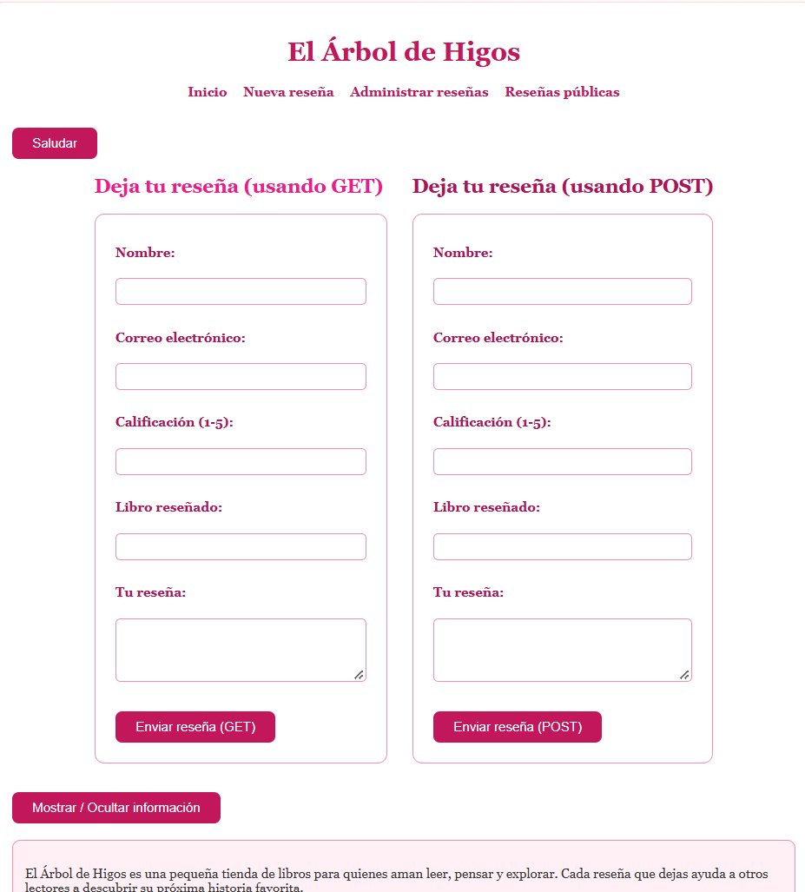
<p style="color:#c2185b; font-style:italic; font-size:13px;">Punto de partida: el CRUD de la Semana 06 funcionando desde semana07</p>
</div>

<br>

<h2 style="color:#c2185b; border-bottom: 3px solid #f48fb1; padding-bottom: 6px;">💗🌸🌸🌷🌸🌸💐 Tablas de la base de datos utilizadas</h2>

<blockquote style="border-left: 4px solid #f48fb1; background:#fff0f5; padding: 10px 15px; color:#333;">
Revisé si mi base ya tenía una tabla de usuarios y no existía, así que creé <code>usuarios</code> en la base <code>arbol_de_higos</code>. La tabla <code>resenas</code> de las semanas anteriores se sigue usando sin cambios. El SQL está documentado en <code>usuarios.sql</code>.
</blockquote>

```sql
CREATE TABLE usuarios (
    id INT AUTO_INCREMENT PRIMARY KEY,
    nombre VARCHAR(100) NOT NULL,
    usuario VARCHAR(50) NOT NULL UNIQUE,
    correo VARCHAR(150) NOT NULL UNIQUE,
    password_hash VARCHAR(255) NOT NULL,
    activo TINYINT(1) NOT NULL DEFAULT 1,
    creado_en TIMESTAMP DEFAULT CURRENT_TIMESTAMP
);
```

<table style="width:100%; border-collapse: collapse;">
<tr style="background-color:#c2185b; color:#ffffff;"><th style="padding:8px; text-align:left;">Campo</th><th style="padding:8px; text-align:left;">Para qué sirve</th></tr>
<tr style="background-color:#fce4ec;"><td style="padding:8px;"><code>id</code></td><td style="padding:8px;">Llave primaria, se genera sola</td></tr>
<tr style="background-color:#ffffff;"><td style="padding:8px;"><code>usuario</code>, <code>correo</code></td><td style="padding:8px;"><code>UNIQUE</code>: MySQL no permite que dos usuarios repitan estos datos</td></tr>
<tr style="background-color:#fce4ec;"><td style="padding:8px;"><code>password_hash</code></td><td style="padding:8px;">Guarda el hash de la contraseña, nunca la contraseña original; es <code>VARCHAR(255)</code> porque un hash es largo</td></tr>
<tr style="background-color:#ffffff;"><td style="padding:8px;"><code>activo</code></td><td style="padding:8px;">1 = puede entrar, 0 = desactivado</td></tr>
</table>

<div align="center">
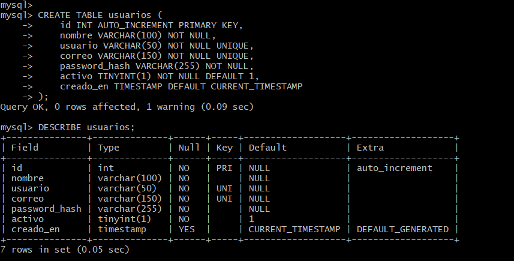
<p style="color:#c2185b; font-style:italic; font-size:13px;">Estructura de la tabla usuarios</p>
</div>

<br>

<h2 style="color:#c2185b; border-bottom: 3px solid #f48fb1; padding-bottom: 6px;">🌺🌸🌸🌷🌸🌸💐 Usuarios de prueba y contraseñas</h2>

<blockquote style="border-left: 4px solid #f48fb1; background:#fff0f5; padding: 10px 15px; color:#333;">
Para crear los usuarios hice un script temporal (<code>crear_usuario.php</code>) que recibe los datos desde la terminal y convierte la contraseña con <code>password_hash()</code> antes de guardarla con una consulta preparada. Así la contraseña no queda escrita en ningún archivo del repositorio. El script se niega a ejecutarse desde el navegador, y lo eliminé apenas creé los usuarios.
<br><br>
Creé dos usuarios de demostración: <code>admin_prueba</code> (activo) e <code>inactivo_prueba</code>, que desactivé con <code>UPDATE ... WHERE usuario = ...</code> para probar que un usuario inactivo no puede entrar.
</blockquote>

<div align="center">
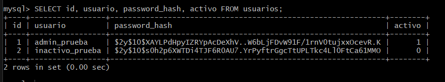
<p style="color:#c2185b; font-style:italic; font-size:13px;">En la base de datos solo existe el hash, no la contraseña</p>
</div>

<br>

<h2 style="color:#c2185b; border-bottom: 3px solid #f48fb1; padding-bottom: 6px;">💕🌸🌸🌷🌸🌸💐 Login: formulario y verificación</h2>

<blockquote style="border-left: 4px solid #f48fb1; background:#fff0f5; padding: 10px 15px; color:#333;">
El formulario (<code>login_form.php</code>) usa POST y no trae datos precargados. La verificación la hace <code>login.php</code> en el servidor, nunca con JavaScript. Los pasos son: buscar al usuario con una consulta preparada, comprobar que esté activo, y comparar la contraseña con el hash usando <code>password_verify()</code>. Si todo es correcto, regenera el identificador de sesión y guarda en <code>$_SESSION</code> solo lo necesario (id, nombre y usuario).
</blockquote>

```php
if ($fila
    && (int)$fila["activo"] === 1
    && password_verify($contrasena, $fila["password_hash"])) {

    session_regenerate_id(true);
    $_SESSION["usuario_id"] = (int)$fila["id"];
    $_SESSION["nombre"]     = $fila["nombre"];
    $_SESSION["usuario"]    = $fila["usuario"];

    header("Location: panel.php");
    exit;
}
```

<blockquote style="border-left: 4px solid #f48fb1; background:#fff0f5; padding: 10px 15px; color:#333;">
Si falla, el mensaje es siempre el mismo ("No fue posible iniciar sesión con esas credenciales"), sin decir si el problema fue el usuario o la contraseña. Así nadie puede descubrir qué usuarios existen. Esto lo comprobé con una contraseña incorrecta, un usuario inexistente y un usuario inactivo: en los tres casos salió el mismo mensaje.
</blockquote>

<div align="center">
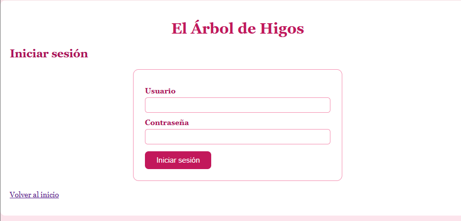
<p style="color:#c2185b; font-style:italic; font-size:13px;">Formulario de acceso</p>
<br>
<table style="width:100%;">
<tr>
<td align="center" width="33%">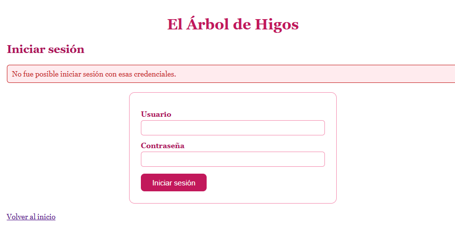<p style="font-size:12px; color:#c2185b;">Contraseña incorrecta</p></td>
<td align="center" width="33%">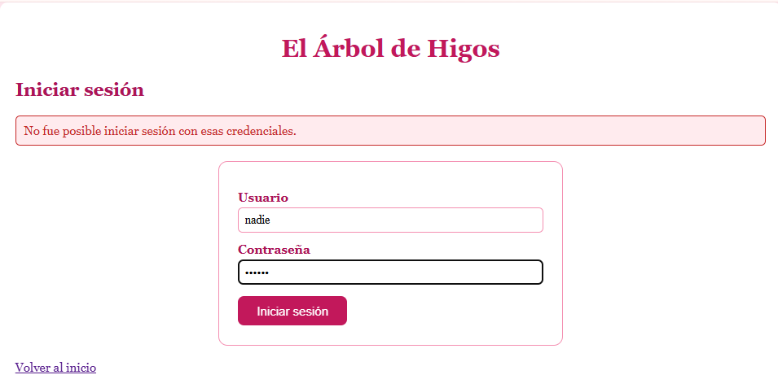<p style="font-size:12px; color:#c2185b;">Usuario inexistente</p></td>
<td align="center" width="33%">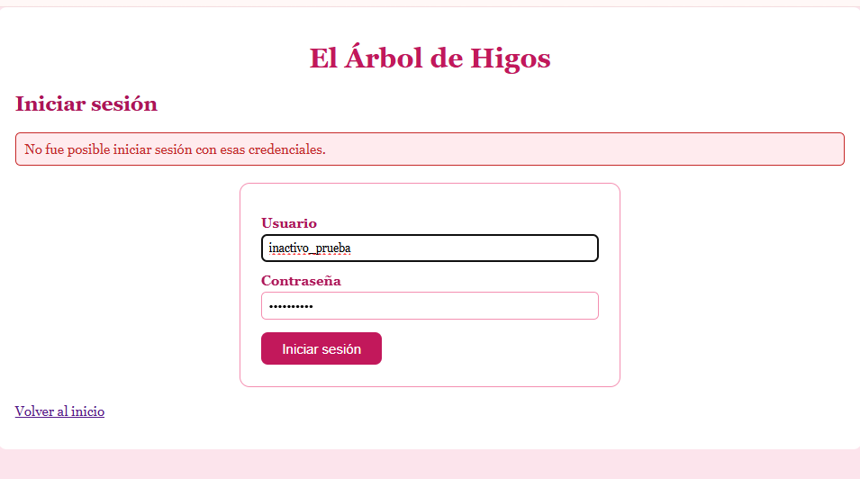<p style="font-size:12px; color:#c2185b;">Usuario inactivo</p></td>
</tr>
</table>
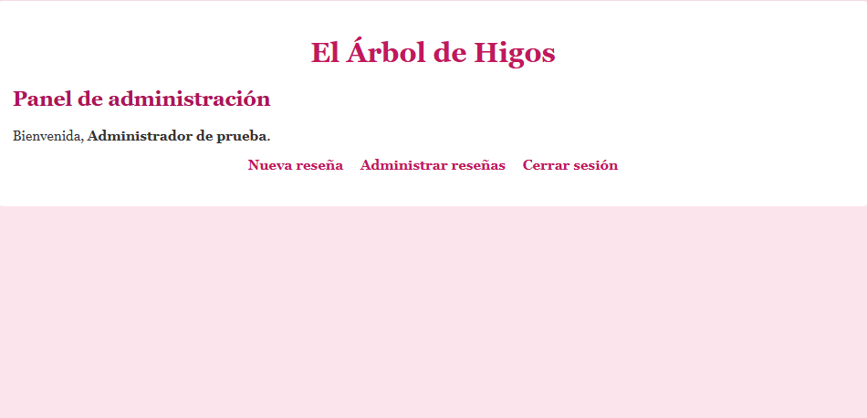
<p style="color:#c2185b; font-style:italic; font-size:13px;">Acceso correcto: el panel muestra el nombre del usuario</p>
</div>

<br>

<h2 style="color:#c2185b; border-bottom: 3px solid #f48fb1; padding-bottom: 6px;">🌸🌸🌸🌷🌸🌸💐 Páginas protegidas</h2>

<blockquote style="border-left: 4px solid #f48fb1; background:#fff0f5; padding: 10px 15px; color:#333;">
Creé <code>proteger.php</code>, que revisa en el servidor si existe <code>$_SESSION["usuario_id"]</code>; si no existe, redirige al login. Lo incluyo como primera línea de <code>panel.php</code>, <code>listar.php</code>, <code>crear.php</code>, <code>editar.php</code> y <code>eliminar.php</code>, antes de cualquier HTML. Ocultar los botones no basta: lo que importa es que quien escriba la dirección directamente tampoco pueda entrar.
</blockquote>

```php
<?php
session_start();

if (!isset($_SESSION["usuario_id"])) {
    header("Location: login_form.php?m=protegida");
    exit;
}
```

<div align="center">
<table style="width:100%;">
<tr>
<td align="center" width="33%">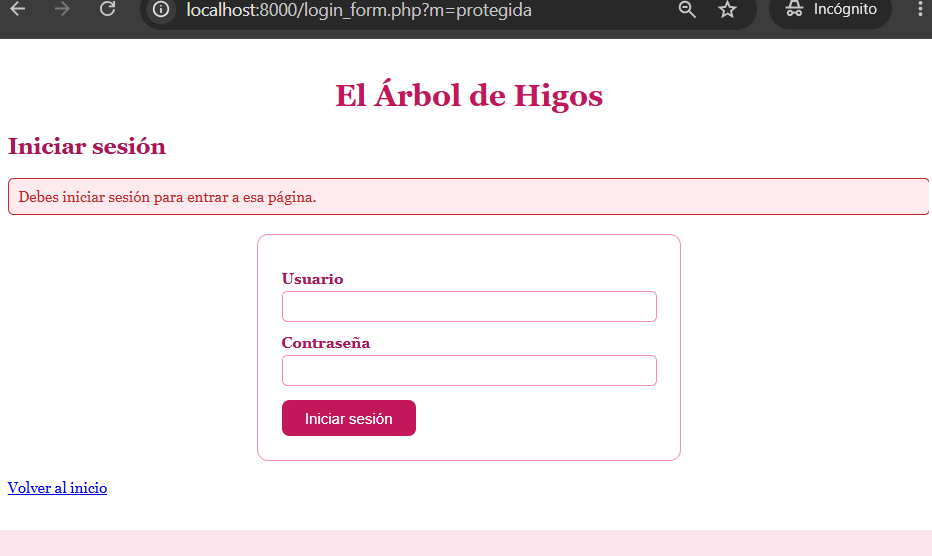<p style="font-size:12px; color:#c2185b;">panel.php sin sesión</p></td>
<td align="center" width="33%">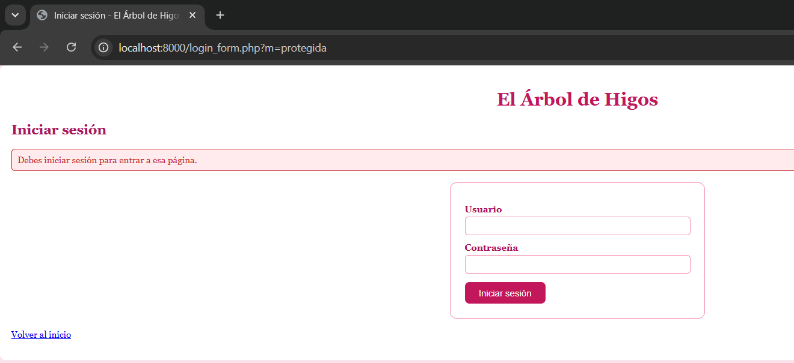<p style="font-size:12px; color:#c2185b;">listar.php sin sesión</p></td>
<td align="center" width="33%">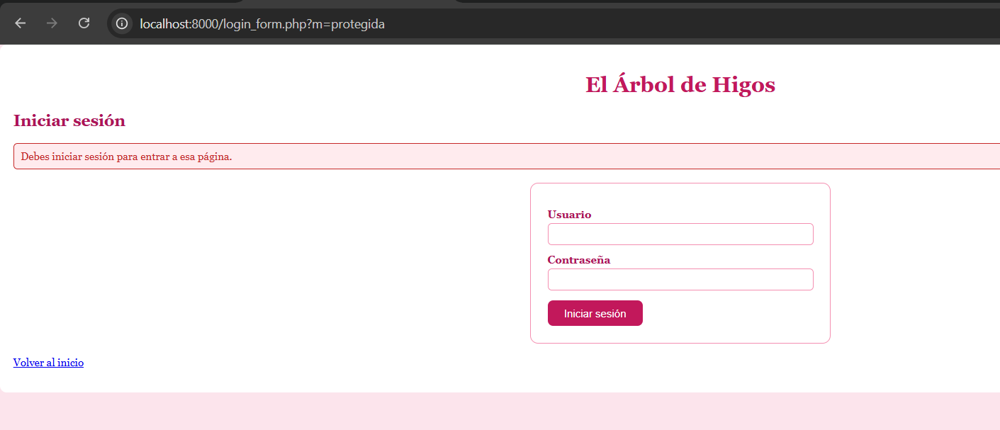<p style="font-size:12px; color:#c2185b;">crear.php sin sesión</p></td>
</tr>
</table>
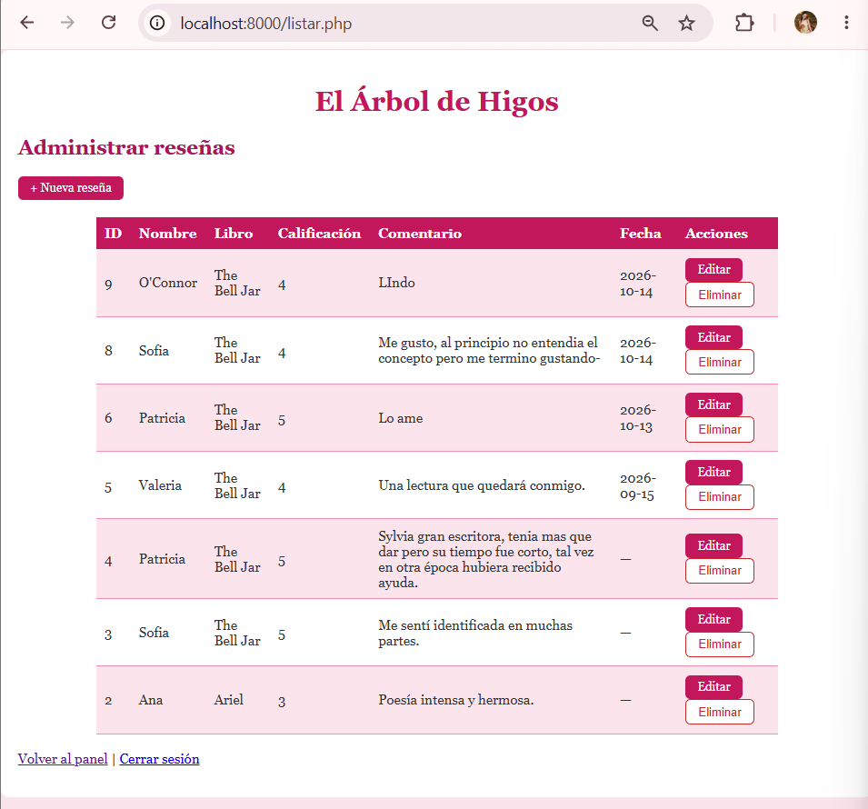
<p style="color:#c2185b; font-style:italic; font-size:13px;">Con sesión iniciada, el CRUD funciona normalmente</p>
</div>

<br>

<h2 style="color:#c2185b; border-bottom: 3px solid #f48fb1; padding-bottom: 6px;">💐🌸🌸🌷🌸🌸💐 Cerrar sesión</h2>

<blockquote style="border-left: 4px solid #f48fb1; background:#fff0f5; padding: 10px 15px; color:#333;">
<code>logout.php</code> hace tres cosas: vacía <code>$_SESSION</code>, borra la cookie de sesión del navegador y destruye la sesión en el servidor. Después de cerrar sesión, al escribir otra vez la dirección de <code>panel.php</code>, el acceso se rechaza y me manda al login.
</blockquote>

<div align="center">
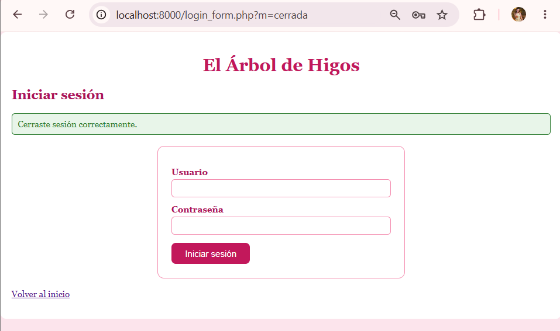
<p style="color:#c2185b; font-style:italic; font-size:13px;">Sesión cerrada correctamente</p>
<br>
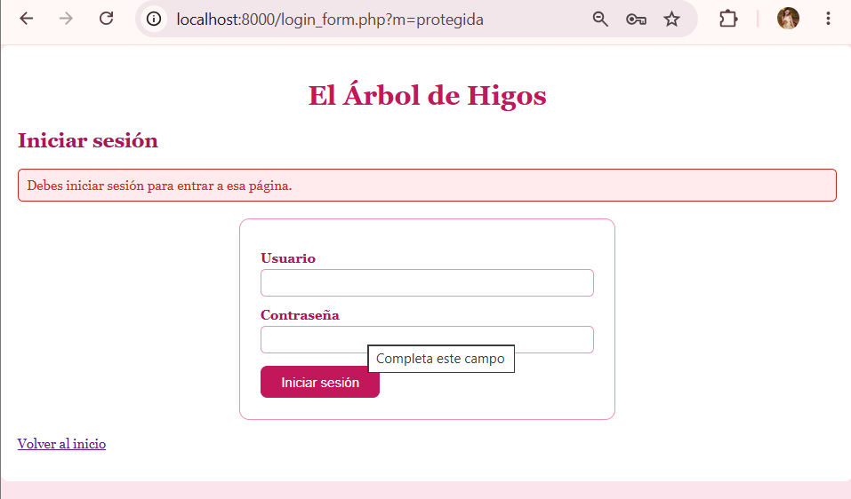
<p style="color:#c2185b; font-style:italic; font-size:13px;">El panel ya no abre después de cerrar sesión</p>
</div>

<br>

<h2 style="color:#c2185b; border-bottom: 3px solid #f48fb1; padding-bottom: 6px;">🌷🌸🌸🌷🌸🌸💐 Archivos modificados o creados</h2>

<table style="width:100%; border-collapse: collapse;">
<tr style="background-color:#c2185b; color:#ffffff;"><th style="padding:8px; text-align:left;">Archivo</th><th style="padding:8px; text-align:left;">Estado</th><th style="padding:8px; text-align:left;">Función</th></tr>
<tr style="background-color:#fce4ec;"><td style="padding:8px;"><code>login_form.php</code></td><td style="padding:8px;">Nuevo</td><td style="padding:8px;">Formulario de acceso</td></tr>
<tr style="background-color:#ffffff;"><td style="padding:8px;"><code>login.php</code></td><td style="padding:8px;">Nuevo</td><td style="padding:8px;">Verifica credenciales e inicia la sesión</td></tr>
<tr style="background-color:#fce4ec;"><td style="padding:8px;"><code>proteger.php</code></td><td style="padding:8px;">Nuevo</td><td style="padding:8px;">Bloquea el acceso sin sesión</td></tr>
<tr style="background-color:#ffffff;"><td style="padding:8px;"><code>panel.php</code></td><td style="padding:8px;">Nuevo</td><td style="padding:8px;">Panel principal protegido</td></tr>
<tr style="background-color:#fce4ec;"><td style="padding:8px;"><code>logout.php</code></td><td style="padding:8px;">Nuevo</td><td style="padding:8px;">Cierra la sesión</td></tr>
<tr style="background-color:#ffffff;"><td style="padding:8px;"><code>usuarios.sql</code></td><td style="padding:8px;">Nuevo</td><td style="padding:8px;">Documenta la tabla de usuarios</td></tr>
<tr style="background-color:#fce4ec;"><td style="padding:8px;"><code>listar.php</code>, <code>crear.php</code>, <code>editar.php</code>, <code>eliminar.php</code></td><td style="padding:8px;">Modificados</td><td style="padding:8px;">Ahora incluyen <code>proteger.php</code> como primera línea</td></tr>
<tr style="background-color:#ffffff;"><td style="padding:8px;"><code>index.php</code></td><td style="padding:8px;">Modificado</td><td style="padding:8px;">Menú público con acceso al login</td></tr>
<tr style="background-color:#fce4ec;"><td style="padding:8px;"><code>pruebas_login.md</code></td><td style="padding:8px;">Nuevo</td><td style="padding:8px;">Resultado de las 12 pruebas funcionales</td></tr>
</table>

<br>

<h2 style="color:#c2185b; border-bottom: 3px solid #f48fb1; padding-bottom: 6px;">🌺🌸🌸🌷🌸🌸💐 Pruebas realizadas</h2>

<table style="width:100%; border-collapse: collapse;">
<tr style="background-color:#c2185b; color:#ffffff;"><th style="padding:8px;">N.º</th><th style="padding:8px; text-align:left;">Prueba</th><th style="padding:8px; text-align:left;">Resultado</th></tr>
<tr style="background-color:#fce4ec;"><td style="padding:8px; text-align:center;">1</td><td style="padding:8px;">Credenciales correctas</td><td style="padding:8px;">Entra al panel</td></tr>
<tr style="background-color:#ffffff;"><td style="padding:8px; text-align:center;">2</td><td style="padding:8px;">Contraseña incorrecta</td><td style="padding:8px;">Rechazo con mensaje genérico</td></tr>
<tr style="background-color:#fce4ec;"><td style="padding:8px; text-align:center;">3</td><td style="padding:8px;">Usuario inexistente</td><td style="padding:8px;">El mismo mensaje genérico</td></tr>
<tr style="background-color:#ffffff;"><td style="padding:8px; text-align:center;">4</td><td style="padding:8px;">Abrir una página protegida sin sesión</td><td style="padding:8px;">Redirige al login</td></tr>
<tr style="background-color:#fce4ec;"><td style="padding:8px; text-align:center;">5 y 6</td><td style="padding:8px;">Navegar con sesión y ver el nombre</td><td style="padding:8px;">Correcto</td></tr>
<tr style="background-color:#ffffff;"><td style="padding:8px; text-align:center;">7</td><td style="padding:8px;">Cerrar sesión</td><td style="padding:8px;">Correcto</td></tr>
<tr style="background-color:#fce4ec;"><td style="padding:8px; text-align:center;">8 y 9</td><td style="padding:8px;">Abrir el panel después de cerrar sesión</td><td style="padding:8px;">Acceso rechazado</td></tr>
<tr style="background-color:#ffffff;"><td style="padding:8px; text-align:center;">10</td><td style="padding:8px;">Usuario inactivo</td><td style="padding:8px;">No puede entrar</td></tr>
<tr style="background-color:#fce4ec;"><td style="padding:8px; text-align:center;">11</td><td style="padding:8px;">Contraseña en la base de datos</td><td style="padding:8px;">Es un hash, no texto plano</td></tr>
<tr style="background-color:#ffffff;"><td style="padding:8px; text-align:center;">12</td><td style="padding:8px;">El CRUD con el login integrado</td><td style="padding:8px;">Sigue funcionando</td></tr>
</table>

<p style="color:#c2185b; font-size:13px;">El detalle de cada prueba, con sus capturas, está en <code>pruebas_login.md</code>.</p>

<br>

<h2 style="color:#c2185b; border-bottom: 3px solid #f48fb1; padding-bottom: 6px;">💐🌸🌸🌷🌸🌸💐 Errores encontrados</h2>

<table style="width:100%; border-collapse: collapse;">
<tr style="background-color:#fce4ec;"><td style="padding:8px;"><b>Error 1 — Qué ocurrió</b></td><td style="padding:8px;">Al abrir <code>listar.php</code> en una ventana de incógnito, sin haber iniciado sesión, la lista se mostraba completa y hasta podía editar reseñas. Debía mandarme al login.</td></tr>
<tr style="background-color:#ffffff;"><td style="padding:8px;"><b>Causa</b></td><td style="padding:8px;">Los archivos del CRUD no tenían la línea que incluye <code>proteger.php</code>, así que nada revisaba la sesión.</td></tr>
<tr style="background-color:#fce4ec;"><td style="padding:8px;"><b>Cómo lo investigué</b></td><td style="padding:8px;">Con <code>grep -n "proteger" listar.php crear.php editar.php eliminar.php</code>: no devolvió ningún resultado, lo que confirmó que ningún archivo la tenía.</td></tr>
<tr style="background-color:#ffffff;"><td style="padding:8px;"><b>Solución</b></td><td style="padding:8px;">Agregué <code>require_once "proteger.php";</code> como primera línea de los cuatro archivos y volví a correr el <code>grep</code>: ahora salió una línea por cada archivo. Al repetir la prueba en incógnito, me mandó al login.</td></tr>
<tr style="background-color:#ffffff;"><td colspan="2" style="padding:4px;"></td></tr>
<tr style="background-color:#fce4ec;"><td style="padding:8px;"><b>Error 2 — Qué ocurrió</b></td><td style="padding:8px;">Se apagó mi laptop a medio trabajo, más de una vez, y se cerró todo.</td></tr>
<tr style="background-color:#ffffff;"><td style="padding:8px;"><b>Cómo lo investigué</b></td><td style="padding:8px;">Con <code>git status</code> y <code>git log --oneline</code> comprobé qué estaba guardado y subido, y con <code>ls</code> verifiqué que los archivos seguían en su carpeta. Un commit que intenté repetir respondió <code>nothing to commit</code>, y el historial confirmó que ya estaba hecho.</td></tr>
<tr style="background-color:#fce4ec;"><td style="padding:8px;"><b>Solución</b></td><td style="padding:8px;">No se perdió nada. Volví a encender WampServer, levanté otra vez el servidor desde <code>semana07</code> y continué.</td></tr>
</table>

<br>

<h2 style="color:#c2185b; border-bottom: 3px solid #f48fb1; padding-bottom: 6px;">💗🌸🌸🌷🌸🌸💐 Soluciones aplicadas</h2>

<blockquote style="border-left: 4px solid #f48fb1; background:#fff0f5; padding: 10px 15px; color:#333;">
De este problema aprendí que una página "escondida" no está protegida: la protección tiene que estar en el servidor, en cada archivo, y hay que comprobarla de verdad escribiendo la dirección sin sesión. También aprendí a usar <code>grep</code> para verificar que un cambio quedó en todos los archivos que debía, en vez de suponerlo. Y los commits pequeños me protegieron de los apagones: cada vez que me pasó, mi trabajo anterior ya estaba en GitHub.
</blockquote>

<br>

<h2 style="color:#c2185b; border-bottom: 3px solid #f48fb1; padding-bottom: 6px;">💕🌸🌸🌷🌸🌸💐 Resumen de seguridad aplicada</h2>

<table style="width:100%; border-collapse: collapse;">
<tr style="background-color:#c2185b; color:#ffffff;"><th style="padding:8px; text-align:left;">Medida</th><th style="padding:8px; text-align:left;">Dónde se aplicó</th></tr>
<tr style="background-color:#fce4ec;"><td style="padding:8px;"><code>password_hash()</code> al crear usuarios</td><td style="padding:8px;">Script temporal, ya eliminado</td></tr>
<tr style="background-color:#ffffff;"><td style="padding:8px;"><code>password_verify()</code></td><td style="padding:8px;"><code>login.php</code></td></tr>
<tr style="background-color:#fce4ec;"><td style="padding:8px;">Consultas preparadas</td><td style="padding:8px;"><code>login.php</code> y todo el CRUD</td></tr>
<tr style="background-color:#ffffff;"><td style="padding:8px;">Mensaje genérico ante credenciales inválidas</td><td style="padding:8px;"><code>login.php</code></td></tr>
<tr style="background-color:#fce4ec;"><td style="padding:8px;">Solo usuarios activos pueden entrar</td><td style="padding:8px;"><code>login.php</code></td></tr>
<tr style="background-color:#ffffff;"><td style="padding:8px;"><code>session_regenerate_id(true)</code> tras el acceso</td><td style="padding:8px;"><code>login.php</code></td></tr>
<tr style="background-color:#fce4ec;"><td style="padding:8px;">Protección en el servidor</td><td style="padding:8px;"><code>proteger.php</code> en cada página interna</td></tr>
<tr style="background-color:#ffffff;"><td style="padding:8px;">Cierre de sesión completo</td><td style="padding:8px;"><code>logout.php</code></td></tr>
</table>

<br>

<h2 style="color:#c2185b; border-bottom: 3px solid #f48fb1; padding-bottom: 6px;">🌷🌸🌸🌷🌸🌸💐Reflexión final</h2>

<blockquote style="border-left: 4px solid #f48fb1; background:#fff0f5; padding: 10px 15px; color:#333;">
Esta semana entendí que guardar datos y controlar quién puede verlos o cambiarlos son problemas distintos. Antes, cualquiera que supiera la dirección de <code>listar.php</code> podía editar o borrar mis reseñas; ahora hay que pasar primero por el login. Aprendí que nunca se guarda la contraseña, sino su hash, y que ni yo puedo recuperar la contraseña original desde la base de datos. También entendí por qué el mensaje de error del login es siempre el mismo, y por qué la protección debe estar en PHP y no solo en la interfaz. Mi tienda "El Árbol de Higos" ya no solo guarda y administra información: ahora decide quién puede entrar a administrarla.
</blockquote>

<br>

