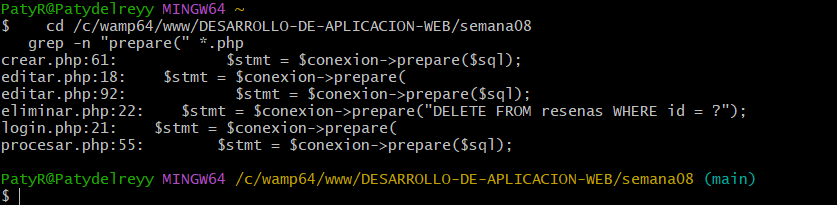
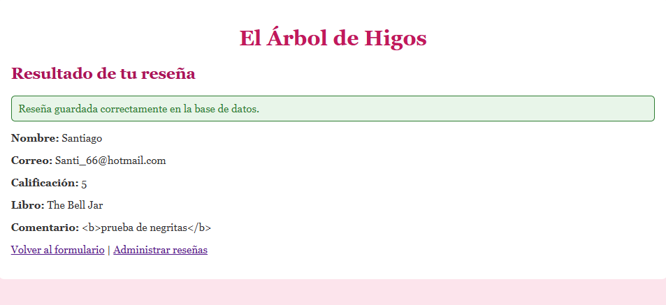
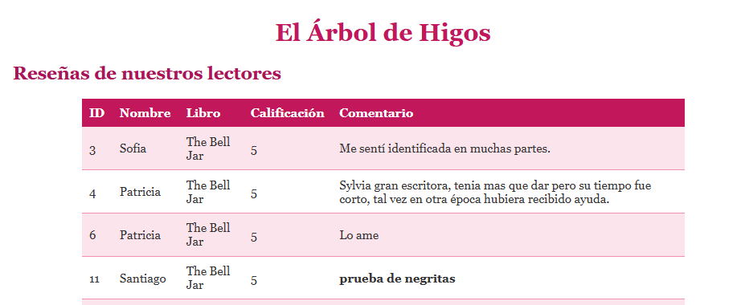
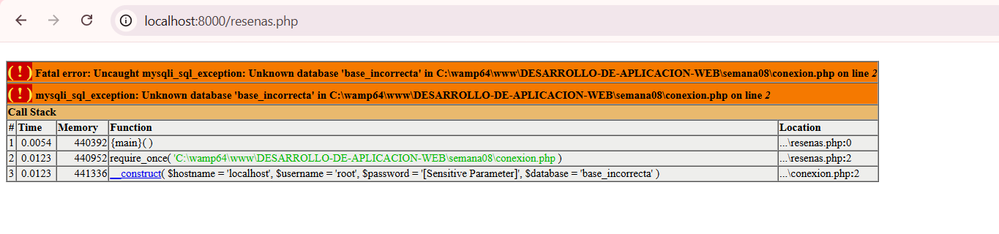
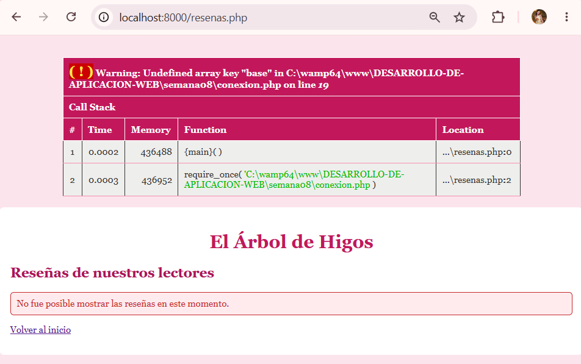
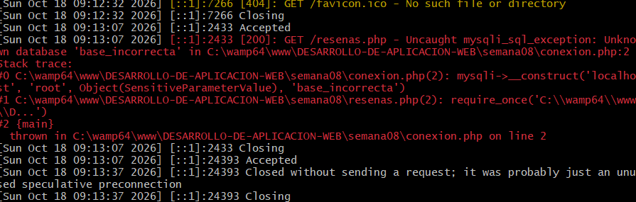
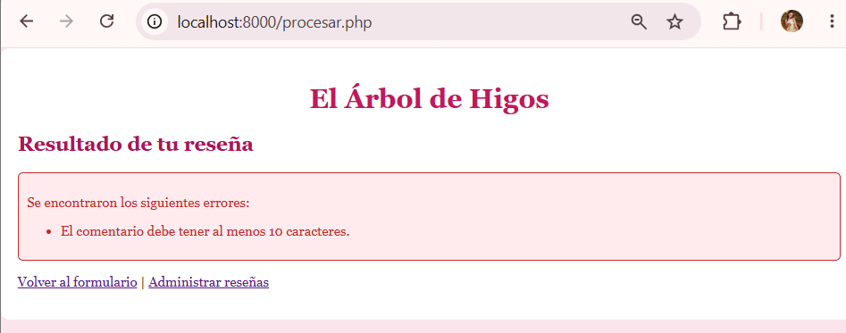
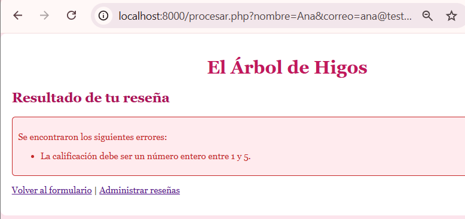
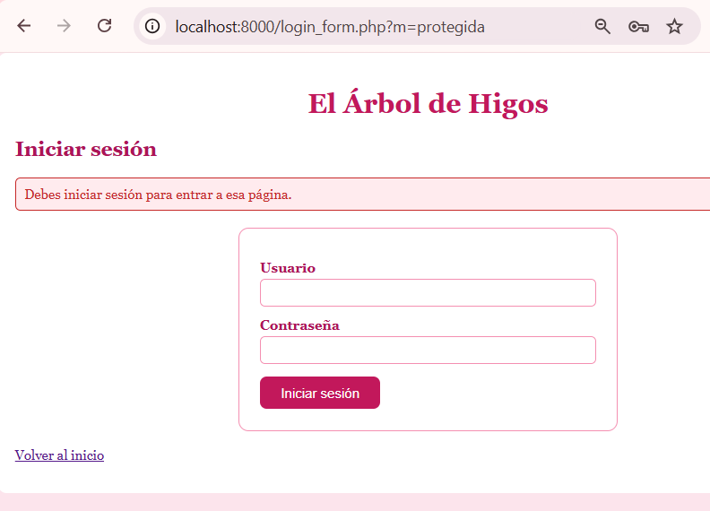

<table style="width:100%; border:none; margin-bottom:20px;">
<tr>
<td width="120" align="center" style="border:none;">

</td>
<td align="right" style="border:none; padding: 20px 10px;">
<h1 style="color:#c2185b; font-family: Georgia, serif; letter-spacing: 2px; margin-bottom:5px;">EL ÁRBOL DE HIGOS 💐💐💐💐💐💐💐</h1>
<p style="color:#ad1457; font-style: italic; font-size: 15px; margin:0;">Semana 08 — Auditoría y seguridad de la aplicación</p>
<p style="color:#e91e8c; font-size: 13px; margin:0;">Desarrollo de Aplicaciones Web</p>
</td>
</tr>
</table>

<br>

<table style="width:100%; border-collapse: collapse;">
<tr style="background-color:#c2185b; color:#ffffff;">
<td style="padding:8px;"><b>Alumna</b></td>
<td style="padding:8px;">Patricia Segura Resendiz 🌸🌸</td>
</tr>
<tr style="background-color:#fce4ec;">
<td style="padding:8px;"><b>Institución</b></td>
<td style="padding:8px;">Instituto Tecnológico Superior de Rioverde</td>
</tr>
<tr style="background-color:#c2185b; color:#ffffff;">
<td style="padding:8px;"><b>Carrera</b></td>
<td style="padding:8px;">Ingeniería en Sistemas Computacionales</td>
</tr>
<tr style="background-color:#fce4ec;">
<td style="padding:8px;"><b>Docente</b></td>
<td style="padding:8px;">Ing. José de Jesús Collazo Reyes</td>
</tr>
<tr style="background-color:#c2185b; color:#ffffff;">
<td style="padding:8px;"><b>Entorno</b></td>
<td style="padding:8px;">WampServer · Apache 2.4.59 · PHP 8.2.18 · MySQL 8.0.42</td>
</tr>
</table>

<br>

<h2 style="color:#c2185b; border-bottom: 3px solid #f48fb1; padding-bottom: 6px;">🌸🌸🌸🌷🌸🌸💐🌸🌸🌷🌸🌸💐 Objetivo</h2>

<blockquote style="border-left: 4px solid #f48fb1; background:#fff0f5; padding: 10px 15px; color:#333;">
Revisar la seguridad de mi tienda de libros en lugar de dar por hecho que estaba bien: buscar en mi propio código dónde se reciben datos, dónde se consulta la base de datos y dónde se muestra información, corregir lo que encontrara y comprobar que las correcciones funcionan.
</blockquote>

<br>

<h2 style="color:#c2185b; border-bottom: 3px solid #f48fb1; padding-bottom: 6px;">🌷🌸🌸🌷🌸🌸💐🌸🌸🌷🌸🌸💐 Estado antes de empezar</h2>

<blockquote style="border-left: 4px solid #f48fb1; background:#fff0f5; padding: 10px 15px; color:#333;">
Copié la Semana 07 a <code>semana08</code> y comprobé que todo funcionara antes de tocar nada: el inicio y su menú, el login, el CRUD, las páginas protegidas y el cierre de sesión. Así sé que los problemas que encontré después no venían de errores anteriores.
</blockquote>

<div align="center">

<p style="color:#c2185b; font-style:italic; font-size:13px;">Proyecto funcionando antes de la auditoría</p>
</div>

<br>

<h2 style="color:#c2185b; border-bottom: 3px solid #f48fb1; padding-bottom: 6px;">💗🌸🌸🌷🌸🌸💐🌸🌸🌷🌸🌸💐 Funcionalidad implementada</h2>

<table style="width:100%; border-collapse: collapse;">
<tr style="background-color:#c2185b; color:#ffffff;"><th style="padding:8px; text-align:left;">Mejora</th><th style="padding:8px; text-align:left;">Qué resuelve</th></tr>
<tr style="background-color:#fce4ec;"><td style="padding:8px;">Salida escapada en la página pública</td><td style="padding:8px;">El visitante ya no puede meter código HTML que se ejecute en la página</td></tr>
<tr style="background-color:#ffffff;"><td style="padding:8px;">Configuración fuera del repositorio</td><td style="padding:8px;">El usuario y la contraseña de MySQL ya no se suben a GitHub</td></tr>
<tr style="background-color:#fce4ec;"><td style="padding:8px;">Errores de conexión controlados</td><td style="padding:8px;">El visitante ve un mensaje genérico y el detalle va al registro del servidor</td></tr>
<tr style="background-color:#ffffff;"><td style="padding:8px;">Reglas de negocio</td><td style="padding:8px;">Comentario de 10 a 1000 caracteres y calificación entera de 1 a 5</td></tr>
<tr style="background-color:#fce4ec;"><td style="padding:8px;">Auditoría documentada</td><td style="padding:8px;"><code>auditoria.md</code> con el inventario y los hallazgos</td></tr>
</table>

<br>

<h2 style="color:#c2185b; border-bottom: 3px solid #f48fb1; padding-bottom: 6px;">🌺🌸🌸🌷🌸🌸💐🌸🌸🌷🌸🌸💐 Cómo hice la auditoría</h2>

<blockquote style="border-left: 4px solid #f48fb1; background:#fff0f5; padding: 10px 15px; color:#333;">
En lugar de revisar de memoria, busqué evidencia en el código con <code>grep</code>. Primero listé todas las consultas con <code>grep -n "query(\|prepare(" *.php</code>: todo lo que recibe datos del usuario usa <code>prepare(</code>, y las dos consultas con <code>query(</code> son fijas, sin ninguna variable. Después listé los lugares donde se imprimen variables sin <code>htmlspecialchars()</code>. Casi todos eran seguros (números forzados con <code>(int)</code>, mensajes escritos por mí, avisos de una lista cerrada), pero <code>resenas.php</code> imprimía texto de visitantes sin escapar.
</blockquote>

<div align="center">

<p style="color:#c2185b; font-style:italic; font-size:13px;">Las operaciones que reciben datos usan consultas preparadas</p>
</div>

<br>

<h2 style="color:#c2185b; border-bottom: 3px solid #f48fb1; padding-bottom: 6px;">💕🌸🌸🌷🌸🌸💐🌸🌸🌷🌸🌸💐Archivos modificados o creados</h2>

<table style="width:100%; border-collapse: collapse;">
<tr style="background-color:#c2185b; color:#ffffff;"><th style="padding:8px; text-align:left;">Archivo</th><th style="padding:8px; text-align:left;">Estado</th><th style="padding:8px; text-align:left;">Función</th></tr>
<tr style="background-color:#fce4ec;"><td style="padding:8px;"><code>resenas.php</code></td><td style="padding:8px;">Modificado</td><td style="padding:8px;">Escapa la salida, oculta el ID y maneja errores sin mostrar detalles</td></tr>
<tr style="background-color:#ffffff;"><td style="padding:8px;"><code>conexion.php</code></td><td style="padding:8px;">Modificado</td><td style="padding:8px;">Lee la configuración de <code>config.php</code> y atrapa los errores</td></tr>
<tr style="background-color:#fce4ec;"><td style="padding:8px;"><code>config.php</code></td><td style="padding:8px;">Nuevo (no se sube)</td><td style="padding:8px;">Datos reales de conexión, ignorado por Git</td></tr>
<tr style="background-color:#ffffff;"><td style="padding:8px;"><code>config.ejemplo.php</code></td><td style="padding:8px;">Nuevo</td><td style="padding:8px;">Plantilla sin datos reales</td></tr>
<tr style="background-color:#fce4ec;"><td style="padding:8px;"><code>.gitignore</code> (raíz)</td><td style="padding:8px;">Nuevo</td><td style="padding:8px;">Evita subir <code>config.php</code></td></tr>
<tr style="background-color:#ffffff;"><td style="padding:8px;"><code>crear.php</code>, <code>editar.php</code>, <code>procesar.php</code></td><td style="padding:8px;">Modificados</td><td style="padding:8px;">Nueva regla de validación del comentario</td></tr>
<tr style="background-color:#fce4ec;"><td style="padding:8px;"><code>auditoria.md</code>, <code>pruebas_seguridad.md</code></td><td style="padding:8px;">Nuevos</td><td style="padding:8px;">Inventario, hallazgos y resultado de las pruebas</td></tr>
</table>

<br>

<h2 style="color:#c2185b; border-bottom: 3px solid #f48fb1; padding-bottom: 6px;">🌸🌸🌸🌷🌸🌸💐🌸🌸🌷🌸🌸💐 Tablas de la base de datos utilizadas</h2>

<blockquote style="border-left: 4px solid #f48fb1; background:#fff0f5; padding: 10px 15px; color:#333;">
Utilicé <code>resenas</code> y <code>usuarios</code> de la base <code>arbol_de_higos</code>, sin cambiarles la estructura. En <code>usuarios</code> comprobé que la columna <code>password_hash</code> guarda solo el hash.
</blockquote>

<br>

<h2 style="color:#c2185b; border-bottom: 3px solid #f48fb1; padding-bottom: 6px;">🌸🌸🌷🌸🌸💐🌸🌸🌷🌸🌸💐🌷 Hallazgo 1 — El HTML de un visitante se ejecutaba</h2>

<blockquote style="border-left: 4px solid #f48fb1; background:#fff0f5; padding: 10px 15px; color:#333;">
<code>resenas.php</code> es la página pública y mostraba nombre, libro y comentario tal cual. Para comprobarlo guardé una reseña con el comentario <code>&lt;b&gt;prueba&lt;/b&gt;</code>, y en la página salió en negritas: el navegador estaba interpretando lo que escribió el visitante como código de mi página. Si en lugar de negritas alguien guardara un script, se ejecutaría en el navegador de todo el que abriera la página.
<br><br>
La corrección fue imprimir cada texto con <code>htmlspecialchars()</code>, que convierte los símbolos como <code>&lt;</code> y <code>&gt;</code> en texto inofensivo. Después, el mismo comentario se ve literal, con los símbolos a la vista.
</blockquote>

```php
echo htmlspecialchars($fila["comentario"], ENT_QUOTES, "UTF-8");
```

<div align="center">
<table style="width:100%;">
<tr>
<td align="center" width="50%"><p style="font-size:12px; color:#a33a2e;">Antes: el comentario sale en negritas</p></td>
<td align="center" width="50%"><p style="font-size:12px; color:#2e7d32;">Después: se muestra como texto</p></td>
</tr>
</table>
</div>

<br>

<h2 style="color:#c2185b; border-bottom: 3px solid #f48fb1; padding-bottom: 6px;">💐🌸🌸🌷🌸🌸💐🌸🌸🌷🌸🌸💐 Hallazgo 2 — Credenciales y errores técnicos</h2>

<blockquote style="border-left: 4px solid #f48fb1; background:#fff0f5; padding: 10px 15px; color:#333;">
Había dos problemas en <code>conexion.php</code>. El usuario y la contraseña de MySQL estaban escritos dentro del archivo, y ese archivo se sube a GitHub. Y al provocar un error de conexión (poniendo una base de datos que no existe), la pantalla mostraba el error completo con la pila de llamadas, las rutas del servidor y el usuario. Mi <code>if ($conexion-&gt;connect_error)</code> nunca se ejecutaba, porque en PHP 8.2 el error es una excepción que se lanza antes.
<br><br>
La solución tuvo tres partes: mover los datos reales a <code>config.php</code>, agregar a <code>.gitignore</code> esa línea para que Git no lo suba (y comprobarlo con <code>git check-ignore -v</code>), y atrapar la excepción con <code>try / catch</code> para mandar el detalle a <code>error_log()</code> y mostrarle al visitante solo un mensaje genérico.
</blockquote>

<div align="center">
<table style="width:100%;">
<tr>
<td align="center" width="50%"><p style="font-size:12px; color:#a33a2e;">Antes: error con pila de llamadas</p></td>
<td align="center" width="50%"><p style="font-size:12px; color:#2e7d32;">Después: mensaje genérico</p></td>
</tr>
</table>

<p style="color:#c2185b; font-style:italic; font-size:13px;">El detalle técnico queda en el registro del servidor</p>
</div>

<br>

<h2 style="color:#c2185b; border-bottom: 3px solid #f48fb1; padding-bottom: 6px;">💕🌸🌸🌷🌸🌸💐🌸🌸🌷🌸🌸💐 Validaciones y reglas de negocio</h2>

<blockquote style="border-left: 4px solid #f48fb1; background:#fff0f5; padding: 10px 15px; color:#333;">
Mi servidor ya validaba campos vacíos, el formato del correo, las longitudes máximas y los identificadores. Agregué una regla de negocio nueva: el comentario debe tener entre 10 y 1000 caracteres. Junto con la calificación entera entre 1 y 5, que ya existía, son las dos reglas que documento. Las probé y PHP rechazó los valores que no las cumplían, también cuando JavaScript no interviene.
</blockquote>

<div align="center">
<table style="width:100%;">
<tr>
<td align="center" width="33%"><p style="font-size:12px; color:#c2185b;">Comentario demasiado corto</p></td>
<td align="center" width="33%"><p style="font-size:12px; color:#c2185b;">Calificación fuera de rango</p></td>
<td align="center" width="33%"><p style="font-size:12px; color:#c2185b;">Identificador inválido</p></td>
</tr>
</table>
</div>

<br>

<h2 style="color:#c2185b; border-bottom: 3px solid #f48fb1; padding-bottom: 6px;">🌺🌸🌸🌷🌸🌸💐🌸🌸🌷🌸🌸💐 Pruebas realizadas</h2>

<table style="width:100%; border-collapse: collapse;">
<tr style="background-color:#c2185b; color:#ffffff;"><th style="padding:8px;">N.º</th><th style="padding:8px; text-align:left;">Prueba</th><th style="padding:8px; text-align:left;">Resultado</th></tr>
<tr style="background-color:#fce4ec;"><td style="padding:8px; text-align:center;">1</td><td style="padding:8px;">Campo obligatorio vacío</td><td style="padding:8px;">Correcta</td></tr>
<tr style="background-color:#ffffff;"><td style="padding:8px; text-align:center;">2</td><td style="padding:8px;">Identificador inválido</td><td style="padding:8px;">Correcta</td></tr>
<tr style="background-color:#fce4ec;"><td style="padding:8px; text-align:center;">3</td><td style="padding:8px;">Identificador inexistente</td><td style="padding:8px;">Correcta</td></tr>
<tr style="background-color:#ffffff;"><td style="padding:8px; text-align:center;">4</td><td style="padding:8px;">Consultas preparadas</td><td style="padding:8px;">Correcta</td></tr>
<tr style="background-color:#fce4ec;"><td style="padding:8px; text-align:center;">5</td><td style="padding:8px;">Caracteres especiales como texto</td><td style="padding:8px;">Correcta (tras la corrección)</td></tr>
<tr style="background-color:#ffffff;"><td style="padding:8px; text-align:center;">6 y 7</td><td style="padding:8px;">Login con contraseña correcta e incorrecta</td><td style="padding:8px;">Correcta</td></tr>
<tr style="background-color:#fce4ec;"><td style="padding:8px; text-align:center;">8</td><td style="padding:8px;">Contraseña como hash en la base</td><td style="padding:8px;">Correcta</td></tr>
<tr style="background-color:#ffffff;"><td style="padding:8px; text-align:center;">9 y 10</td><td style="padding:8px;">Sin sesión y cierre de sesión</td><td style="padding:8px;">Correcta</td></tr>
<tr style="background-color:#fce4ec;"><td style="padding:8px; text-align:center;">11</td><td style="padding:8px;">Errores sin credenciales ni detalles técnicos</td><td style="padding:8px;">Correcta (tras la corrección)</td></tr>
<tr style="background-color:#ffffff;"><td style="padding:8px; text-align:center;">12</td><td style="padding:8px;">El CRUD sigue funcionando</td><td style="padding:8px;">Correcta</td></tr>
</table>

<p style="color:#c2185b; font-size:13px;">El detalle de cada prueba, con sus capturas y el lugar del servidor donde se aplica la protección, está en <code>pruebas_seguridad.md</code>.</p>

<br>

<h2 style="color:#c2185b; border-bottom: 3px solid #f48fb1; padding-bottom: 6px;">💐 Errores encontrados</h2>

<table style="width:100%; border-collapse: collapse;">
<tr style="background-color:#fce4ec;"><td style="padding:8px;"><b>Error 1 — Qué ocurrió</b></td><td style="padding:8px;">La página pública de reseñas ejecutaba el HTML que escribía un visitante.</td></tr>
<tr style="background-color:#ffffff;"><td style="padding:8px;"><b>Causa</b></td><td style="padding:8px;">Imprimía los datos de la base de datos sin escapar. Ese archivo venía de la Semana 05 y no lo había actualizado cuando corregí el resto.</td></tr>
<tr style="background-color:#fce4ec;"><td style="padding:8px;"><b>Solución</b></td><td style="padding:8px;">Usar <code>htmlspecialchars()</code> en cada dato de usuario y volver a probar con el mismo comentario.</td></tr>
<tr style="background-color:#ffffff;"><td colspan="2" style="padding:4px;"></td></tr>
<tr style="background-color:#fce4ec;"><td style="padding:8px;"><b>Error 2 — Qué ocurrió</b></td><td style="padding:8px;">Las credenciales de MySQL estaban en el repositorio y un error de conexión mostraba detalles técnicos al visitante.</td></tr>
<tr style="background-color:#ffffff;"><td style="padding:8px;"><b>Causa</b></td><td style="padding:8px;">Los datos estaban escritos directamente en <code>conexion.php</code> y no se atrapaba la excepción de la conexión.</td></tr>
<tr style="background-color:#fce4ec;"><td style="padding:8px;"><b>Solución</b></td><td style="padding:8px;">Separar la configuración en <code>config.php</code>, ignorarlo con <code>.gitignore</code> y manejar el error con <code>try / catch</code> y <code>error_log()</code>.</td></tr>
<tr style="background-color:#ffffff;"><td colspan="2" style="padding:4px;"></td></tr>
<tr style="background-color:#fce4ec;"><td style="padding:8px;"><b>Error 3 — Qué ocurrió</b></td><td style="padding:8px;">Dudé cómo crear <code>.gitignore</code> y pensé que era una carpeta.</td></tr>
<tr style="background-color:#ffffff;"><td style="padding:8px;"><b>Solución</b></td><td style="padding:8px;">Es un archivo (con el punto al inicio en el nombre) que va en la raíz del repositorio. Comprobé con <code>ls -a</code> y <code>git check-ignore -v</code> que quedó bien.</td></tr>
</table>

<br>

<h2 style="color:#c2185b; border-bottom: 3px solid #f48fb1; padding-bottom: 6px;">🌷 Limitaciones que dejé documentadas</h2>

<blockquote style="border-left: 4px solid #f48fb1; background:#fff0f5; padding: 10px 15px; color:#333;">
No corregí todo, y lo dejé escrito en <code>auditoria.md</code>: los formularios no tienen token CSRF, el login no limita los intentos, y las carpetas de semanas anteriores conservan su <code>conexion.php</code> con el usuario de pruebas de WampServer. Prefiero reconocerlo que fingir que la aplicación ya es perfecta.
</blockquote>

<br>

<h2 style="color:#c2185b; border-bottom: 3px solid #f48fb1; padding-bottom: 6px;">💗🌸🌸🌷🌸🌸💐🌸🌸🌷🌸🌸💐 Reflexión final</h2>

<blockquote style="border-left: 4px solid #f48fb1; background:#fff0f5; padding: 10px 15px; color:#333;">
Lo que más me enseñó esta semana es que corregir una vez no basta: había arreglado el escape de datos en el CRUD y se me quedó sin arreglar la página pública, porque era un archivo viejo. Auditar significa buscar en todos los archivos, con evidencia, y no confiar en que "ya lo hice". También entendí que una aplicación puede funcionar perfecto y aun así ser insegura: el error de conexión funcionaba, pero le regalaba al visitante información de mi servidor. Y aprendí que algunos secretos, como las credenciales, no deben estar en el repositorio aunque el proyecto sea escolar. Mi tienda "El Árbol de Higos" ya no solo funciona: ahora la revisé buscando cómo podía fallar.
</blockquote>

<br>

