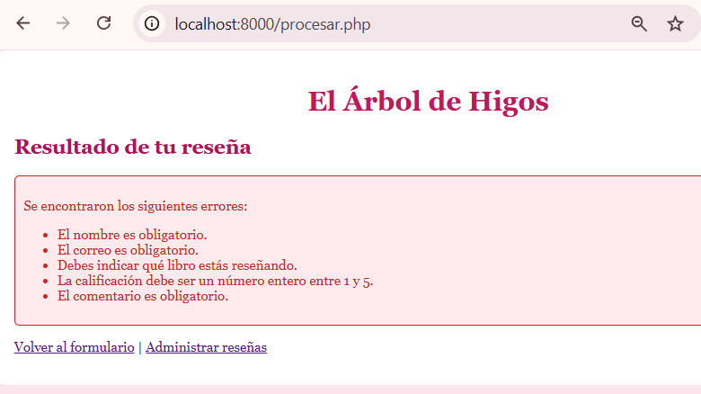
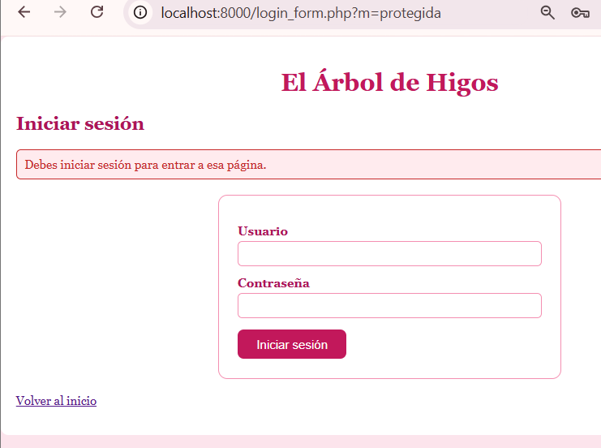
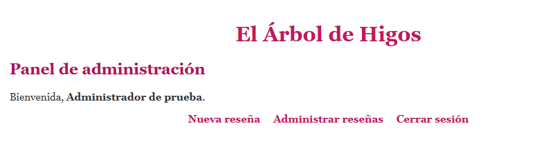
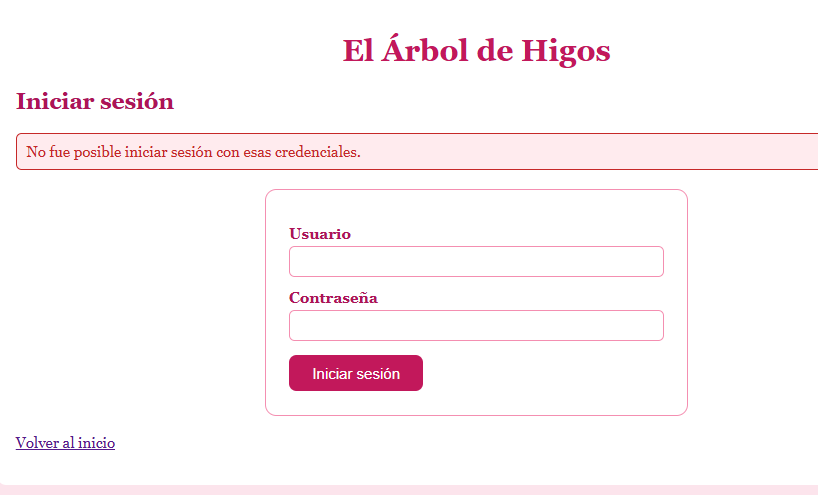
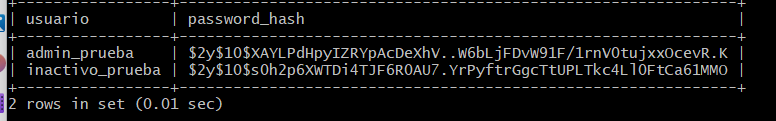
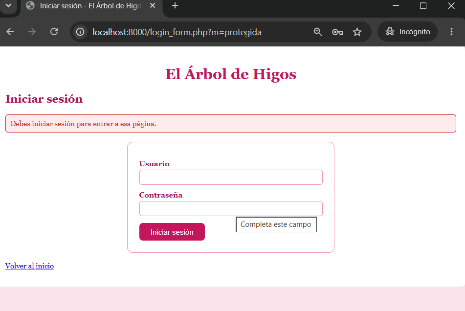
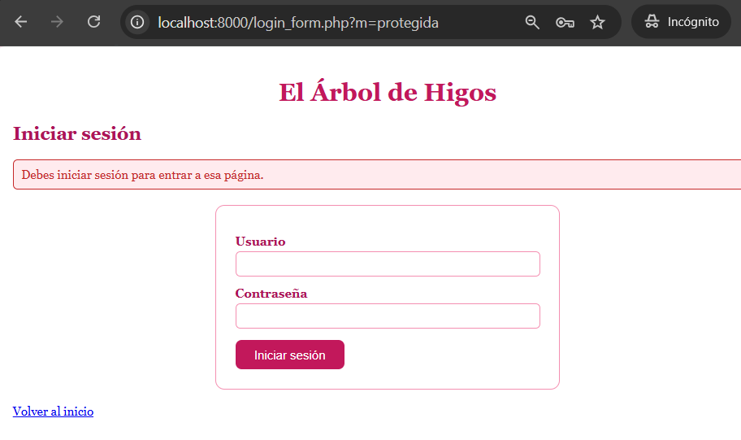
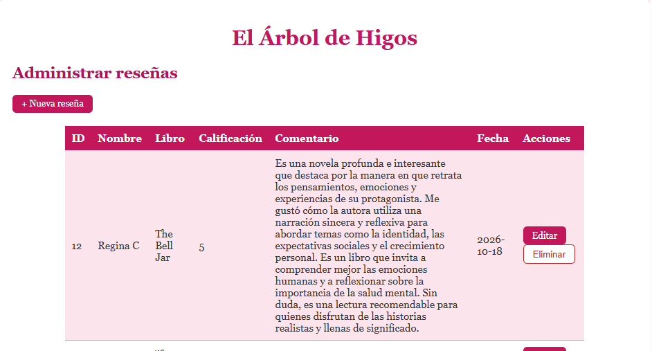

# Pruebas de seguridad — Semana 08

**Proyecto:** El Árbol de Higos 🌸🌸🌷🌸🌸💐🌸🌸🌷🌸🌸💐
**Alumna:** Patricia Segura Resendiz

Las pruebas se hicieron únicamente sobre mi aplicación de práctica, con datos y cuentas de demostración, con el servidor de PHP corriendo desde `semana08`. Las pruebas de acceso sin sesión se hicieron en una ventana de incógnito.

Cada prueba indica **dónde** se aplica la protección en el servidor.

---

## Resumen 🌸🌸🌷🌸🌸💐🌸🌸🌷🌸🌸💐

| N.º | Prueba | Resultado |
|---:|---|---|
| 1 | Campo obligatorio vacío | Correcta |
| 2 | Identificador con formato inválido | Correcta |
| 3 | Identificador inexistente | Correcta |
| 4 | Consultas preparadas en las operaciones del CRUD | Correcta |
| 5 | Caracteres especiales mostrados como texto | Correcta |
| 6 | Inicio de sesión con contraseña correcta | Correcta |
| 7 | Inicio de sesión con contraseña incorrecta | Correcta |
| 8 | La base de datos no guarda la contraseña original | Correcta |
| 9 | Página protegida sin sesión | Correcta |
| 10 | Cerrar sesión y volver al panel | Correcta |
| 11 | Mensajes de error sin credenciales ni detalles técnicos | Correcta |
| 12 | El CRUD sigue funcionando después de las correcciones | Correcta |

---

## Prueba 1 — Campo obligatorio vacío
🌸🌸🌷🌸🌸💐🌸🌸🌷🌸🌸💐🌸🌸🌷🌸🌸💐🌸🌸🌷🌸🌸💐
**Qué hice:** envié el formulario público de POST sin llenar ningún campo.

**Resultado esperado:** PHP rechaza los datos y no guarda nada.

**Resultado obtenido:** aparecieron los mensajes de error de PHP. Como el JavaScript del inicio solo valida el formulario de GET, esta prueba demuestra que el servidor valida por su cuenta.

**Dónde se aplica:** `procesar.php` (y `crear.php`), con `trim()` y comprobación de cada campo antes de guardar.

Prueba relacionada, con una regla de negocio: un comentario de menos de 10 caracteres es rechazado.

---

## Prueba 2 — Identificador con formato inválido 🌸🌸🌷🌸🌸💐🌸🌸🌷🌸🌸💐

**Qué hice:** abrí `editar.php?id=abc`.

**Resultado esperado:** el sistema lo maneja sin alterar registros.

**Resultado obtenido:** me mandó a la lista con el aviso rojo "La reseña solicitada no existe", y no se modificó nada.

**Dónde se aplica:** `editar.php` y `eliminar.php`, con `filter_var(..., FILTER_VALIDATE_INT)` y un mínimo de 1.

---

## Prueba 3 — Identificador inexistente 🌸🌸🌷🌸🌸💐🌸🌸🌷🌸🌸💐

**Qué hice:** abrí `editar.php?id=9999`.

**Resultado esperado:** el sistema lo rechaza sin afectar otros registros.

**Resultado obtenido:** me mandó a la lista con el mismo aviso rojo y ninguna reseña cambió.

**Dónde se aplica:** `editar.php` busca el registro con una consulta preparada antes de mostrar el formulario; si no existe, redirige. En `eliminar.php`, `affected_rows` indica si realmente se borró algo.

---

## Prueba 4 — Consultas preparadas 🌸🌸🌷🌸🌸💐🌸🌸🌷🌸🌸💐

**Qué hice:** busqué en los archivos PHP todas las consultas con `grep -n "query(\|prepare(" *.php`.

**Resultado esperado:** toda operación que recibe datos del usuario usa consultas preparadas.

**Resultado obtenido:** `crear.php`, `editar.php`, `eliminar.php`, `login.php` y `procesar.php` usan `prepare(`. Las dos consultas con `query(` (`listar.php` y `resenas.php`) son fijas, sin ninguna variable.

**Dónde se aplica:** todos los archivos que reciben datos. El `UPDATE` y el `DELETE` llevan `WHERE id = ?`, para afectar un solo registro.

---

## Prueba 5 — Caracteres especiales 🌸🌸🌷🌸🌸💐🌸🌸🌷🌸🌸💐

**Qué hice:** guardé una reseña con el comentario `<b>prueba</b>` y la abrí en la página pública.

**Resultado esperado:** se muestra como texto, sin ejecutarse como HTML.

**Resultado obtenido:** antes de la corrección, `resenas.php` mostraba el comentario en negritas (el HTML se ejecutaba). Después de agregar `htmlspecialchars()`, el mismo comentario se muestra con los símbolos `<b>` y `</b>` a la vista.

**Dónde se aplica:** `resenas.php`, `listar.php`, y los valores de los formularios de `crear.php`, `editar.php` y `procesar.php`.

---

## Prueba 6 — Inicio de sesión con contraseña correcta 🌸🌸🌷🌸🌸💐🌸🌸🌷🌸🌸💐

**Qué hice:** inicié sesión con una cuenta de demostración y su contraseña.

**Resultado esperado:** acceso al panel.

**Resultado obtenido:** me llevó al panel.

**Dónde se aplica:** `login.php`, con consulta preparada y `password_verify()`.

---

## Prueba 7 — Inicio de sesión con contraseña incorrecta 🌸🌸🌷🌸🌸💐🌸🌸🌷🌸🌸💐

**Qué hice:** usé la misma cuenta con una contraseña equivocada.

**Resultado esperado:** el acceso se rechaza.

**Resultado obtenido:** apareció un mensaje genérico, sin indicar si falló el usuario o la contraseña.

**Dónde se aplica:** `login.php`.

---

## Prueba 8 — La contraseña no se guarda en texto plano 🌸🌸🌷🌸🌸💐🌸🌸🌷🌸🌸💐

**Qué hice:** consulté la tabla `usuarios` directamente en MySQL.

**Resultado esperado:** la columna de contraseña contiene un hash.

**Resultado obtenido:** `password_hash` muestra una cadena larga que empieza con `$2y$10$...`; la contraseña original no aparece.

**Dónde se aplica:** la creación de usuarios usa `password_hash()`.

---

## Prueba 9 — Página protegida sin sesión 🌸🌸🌷🌸🌸💐🌸🌸🌷🌸🌸💐

**Qué hice:** en una ventana de incógnito abrí `listar.php` escribiendo la dirección.

**Resultado esperado:** el acceso se rechaza.

**Resultado obtenido:** me mandó al formulario de acceso con el aviso de que debo iniciar sesión.

**Dónde se aplica:** `proteger.php`, incluido como primera línea de cada página interna.

---

## Prueba 10 — Cerrar sesión y volver al panel 🌸🌸🌷🌸🌸💐🌸🌸🌷🌸🌸💐

**Qué hice:** inicié sesión, cerré sesión y escribí la dirección de `panel.php`.

**Resultado esperado:** el acceso se rechaza.

**Resultado obtenido:** me mandó al login.

**Dónde se aplica:** `logout.php` vacía `$_SESSION`, borra la cookie y destruye la sesión; `proteger.php` rechaza el acceso.

---

## Prueba 11 — Mensajes de error sin credenciales ni detalles técnicos 🌸🌸🌷🌸🌸💐🌸🌸🌷🌸🌸💐

**Qué hice:** provoqué un error de conexión cambiando el nombre de la base de datos en `config.php`.

**Resultado esperado:** el visitante no ve credenciales ni detalles técnicos.

**Resultado obtenido:** antes de la corrección, la pantalla mostraba el error completo con la pila de llamadas y rutas del servidor. Ahora solo aparece "El sistema no está disponible en este momento", y el detalle técnico queda en el registro del servidor. Además, el mensaje del login es siempre el mismo.

**Dónde se aplica:** `conexion.php` (con `try / catch` y `error_log()`); las credenciales viven en `config.php`, que no se sube al repositorio.

---

## Prueba 12 — El CRUD continúa funcionando 🌸🌸🌷🌸🌸💐🌸🌸🌷🌸🌸💐

**Qué hice:** con sesión iniciada, creé una reseña de prueba, la edité y la eliminé.

**Resultado esperado:** las cuatro operaciones siguen funcionando después de las correcciones.

**Resultado obtenido:** las operaciones funcionaron con normalidad, aplicando las nuevas reglas de validación.

