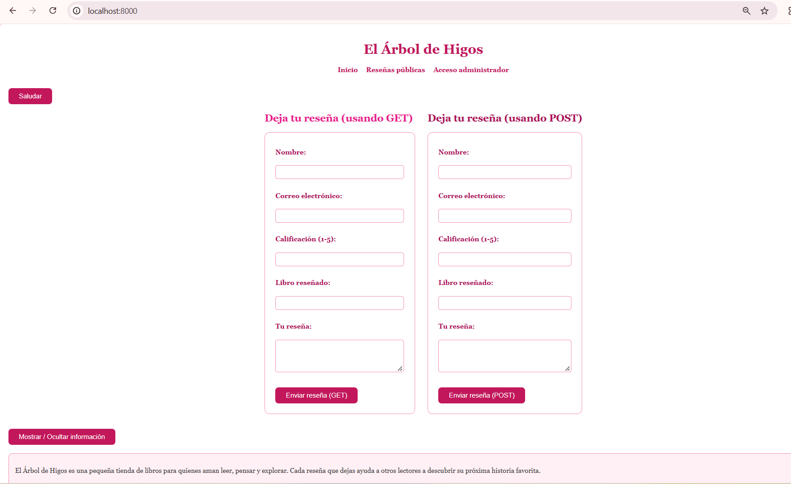
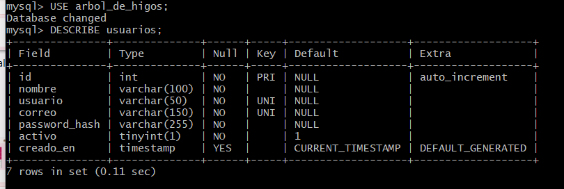
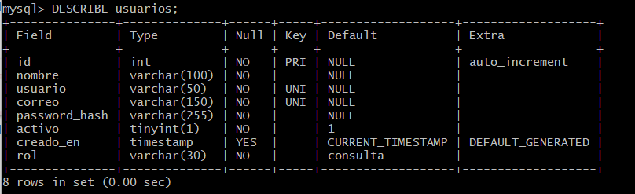
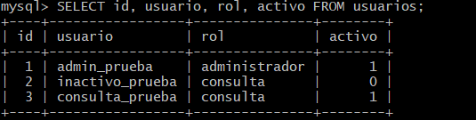

<table style="width:100%; border:none; margin-bottom:20px;">
<tr>
<td width="120" align="center" style="border:none;">

</td>
<td align="right" style="border:none; padding: 20px 10px;">
<h1 style="color:#c2185b; font-family: Georgia, serif; letter-spacing: 2px; margin-bottom:5px;"> 💐💐💐💐 EL ÁRBOL DE HIGOS 💐💐💐💐</h1>
<p style="color:#ad1457; font-style: italic; font-size: 15px; margin:0;">Semana 09 — Roles y permisos</p>
<p style="color:#e91e8c; font-size: 13px; margin:0;">Desarrollo de Aplicaciones Web</p>
</td>
</tr>
</table>

<br>

<table style="width:100%; border-collapse: collapse;">
<tr style="background-color:#c2185b; color:#ffffff;">
<td style="padding:8px;"><b>Alumna</b></td>
<td style="padding:8px;">Patricia Segura Resendiz</td>
</tr>
<tr style="background-color:#fce4ec;">
<td style="padding:8px;"><b>Institución</b></td>
<td style="padding:8px;">Instituto Tecnológico Superior de Rioverde</td>
</tr>
<tr style="background-color:#c2185b; color:#ffffff;">
<td style="padding:8px;"><b>Carrera</b></td>
<td style="padding:8px;">Ingeniería en Sistemas Computacionales</td>
</tr>
<tr style="background-color:#fce4ec;">
<td style="padding:8px;"><b>Docente</b></td>
<td style="padding:8px;">Ing. José de Jesús Collazo Reyes</td>
</tr>
<tr style="background-color:#c2185b; color:#ffffff;">
<td style="padding:8px;"><b>Entorno</b></td>
<td style="padding:8px;">WampServer · Apache 2.4.59 · PHP 8.2.18 · MySQL 8.0.42</td>
</tr>
</table>

<br>

<h2 style="color:#c2185b; border-bottom: 3px solid #f48fb1; padding-bottom: 6px;">🌸🌸🌸🌷🌸🌸💐🌸🌸🌷🌸🌸💐💐 Objetivo</h2>

<blockquote style="border-left: 4px solid #f48fb1; background:#fff0f5; padding: 10px 15px; color:#333;">
Lograr que cada usuario que inicia sesión solo pueda hacer lo que le corresponde: que quien administra la tienda pueda crear, editar y eliminar reseñas, y que quien solo consulta pueda ver la información sin modificarla. Y que esa restricción la imponga el servidor, no la apariencia del menú.
</blockquote>

<br>

<h2 style="color:#c2185b; border-bottom: 3px solid #f48fb1; padding-bottom: 6px;">🌷🌸🌸🌷🌸🌸💐🌸🌸🌷🌸🌸💐💐 Punto de partida</h2>

<blockquote style="border-left: 4px solid #f48fb1; background:#fff0f5; padding: 10px 15px; color:#333;">
Copié la Semana 08 a <code>semana09</code> y comprobé desde esa carpeta que todo siguiera funcionando (login, CRUD, páginas protegidas y las correcciones de seguridad) antes de agregar roles.
</blockquote>

<div align="center">

<p style="color:#c2185b; font-style:italic; font-size:13px;">Proyecto funcionando antes de agregar roles</p>
</div>

<br>

<h2 style="color:#c2185b; border-bottom: 3px solid #f48fb1; padding-bottom: 6px;">💗🌸🌸🌷🌸🌸💐🌸🌸🌷🌸🌸💐💐 Diseño de los roles</h2>

<blockquote style="border-left: 4px solid #f48fb1; background:#fff0f5; padding: 10px 15px; color:#333;">
Definí dos roles, porque mi tienda solo necesita dos tipos de usuario con permisos fijos. Un rol agrupa lo que una persona puede hacer, y documenté qué puede hacer cada uno:
</blockquote>

<table style="width:100%; border-collapse: collapse;">
<tr style="background-color:#c2185b; color:#ffffff;"><th style="padding:8px; text-align:left;">Rol</th><th style="padding:8px; text-align:left;">Puede</th><th style="padding:8px; text-align:left;">No puede</th></tr>
<tr style="background-color:#fce4ec;"><td style="padding:8px;"><code>administrador</code></td><td style="padding:8px;">Panel, listar, crear, editar y eliminar reseñas</td><td style="padding:8px;">—</td></tr>
<tr style="background-color:#ffffff;"><td style="padding:8px;"><code>consulta</code></td><td style="padding:8px;">Panel y listado de reseñas</td><td style="padding:8px;">Crear, editar y eliminar</td></tr>
</table>

<blockquote style="border-left: 4px solid #f48fb1; background:#fff0f5; padding: 10px 15px; color:#333; margin-top:10px;">
La parte pública de la tienda (inicio, dejar una reseña y ver las reseñas) sigue abierta para cualquiera, porque es parte de lo que hace la tienda. La restricción por rol se aplica a la administración. El diseño completo está en <code>diseno_roles.md</code>.
</blockquote>

<br>

<h2 style="color:#c2185b; border-bottom: 3px solid #f48fb1; padding-bottom: 6px;">🌺🌸🌸🌷🌸🌸💐🌸🌸🌷🌸🌸💐💐 Estructura de datos</h2>

<blockquote style="border-left: 4px solid #f48fb1; background:#fff0f5; padding: 10px 15px; color:#333;">
Elegí la opción más sencilla: una columna <code>rol</code> en la tabla <code>usuarios</code>, en lugar de tablas separadas de roles y permisos, porque con dos roles fijos habría sido complicar el proyecto sin necesidad. Antes de modificar la tabla revisé su estructura con <code>DESCRIBE</code> para comprobar que no existiera ya una columna equivalente.
</blockquote>

```sql
ALTER TABLE usuarios
    ADD COLUMN rol VARCHAR(30) NOT NULL DEFAULT 'consulta',
    ADD CONSTRAINT chk_usuarios_rol CHECK (rol IN ('administrador', 'consulta'));

UPDATE usuarios SET rol = 'administrador' WHERE usuario = 'admin_prueba';
```

<blockquote style="border-left: 4px solid #f48fb1; background:#fff0f5; padding: 10px 15px; color:#333;">
Dos decisiones de esa instrucción: el valor por defecto es <code>consulta</code>, así toda cuenta nueva empieza con los permisos mínimos y nadie es administrador por accidente; y el <code>CHECK</code> hace que MySQL rechace cualquier valor que no sea uno de los dos roles. Y el <code>UPDATE</code> lleva <code>WHERE</code>, porque sin él todas las cuentas habrían quedado como administradoras.
</blockquote>

<div align="center">
<table style="width:100%;">
<tr>
<td align="center" width="50%"><p style="font-size:12px; color:#c2185b;">Tabla usuarios antes</p></td>
<td align="center" width="50%"><p style="font-size:12px; color:#c2185b;">Con la columna rol</p></td>
</tr>
</table>
</div>

<br>

<h2 style="color:#c2185b; border-bottom: 3px solid #f48fb1; padding-bottom: 6px;">💕🌸🌸🌷🌸🌸💐🌸🌸🌷🌸🌸💐💐 Cuentas de demostración</h2>

<blockquote style="border-left: 4px solid #f48fb1; background:#fff0f5; padding: 10px 15px; color:#333;">
Dos cuentas con permisos diferentes: <code>admin_prueba</code> (administrador) y <code>consulta_prueba</code> (consulta). La segunda la creé con un script temporal que recibe los datos desde la terminal, convierte la contraseña con <code>password_hash()</code> y se niega a ejecutarse desde el navegador; lo eliminé al terminar. Como el <code>INSERT</code> no menciona el rol, la cuenta nueva quedó con el valor por defecto, <code>consulta</code>. Los roles los asigné directamente en la base de datos, sin un formulario donde alguien pudiera elegir el suyo.
</blockquote>

<div align="center">

<p style="color:#c2185b; font-style:italic; font-size:13px;">Cuentas de demostración con su rol</p>
</div>

<br>

<h2 style="color:#c2185b; border-bottom: 3px solid #f48fb1; padding-bottom: 6px;">🌸🌸🌸🌷🌸🌸💐🌸🌸🌷🌸🌸💐💐 Cómo funciona la autorización</h2>

<blockquote style="border-left: 4px solid #f48fb1; background:#fff0f5; padding: 10px 15px; color:#333;">
El rol sale de la base de datos: <code>login.php</code> lo consulta junto con el usuario y lo guarda en <code>$_SESSION["rol"]</code>. Nunca lo leo de un formulario, de la URL ni de JavaScript, porque cualquiera de esos datos lo puede cambiar el usuario.
<br><br>
Creé <code>autorizacion.php</code>, que incluye la comprobación de sesión y define tres funciones: <code>rolActual()</code> (solo acepta los dos valores conocidos), <code>tieneRol()</code> (devuelve verdadero o falso, la uso para adaptar el menú) y <code>exigirRol()</code>, que detiene la ejecución con un 403 si el rol no está permitido. Cada archivo restringido la llama antes de hacer cualquier consulta, así una cuenta sin permiso nunca llega a tocar la base de datos.
</blockquote>

```php
<?php
require_once "autorizacion.php";
exigirRol(["administrador"]);
require_once "conexion.php";
```

<blockquote style="border-left: 4px solid #f48fb1; background:#fff0f5; padding: 10px 15px; color:#333;">
<code>exigirRol()</code> falla cerrado: si el rol no existe o no es uno de los dos conocidos, se rechaza. El 403 es la respuesta correcta cuando la persona sí está identificada pero no tiene permiso; la redirección al login es para quien no se identificó.
</blockquote>

<div align="center">
<table style="width:100%;">
<tr>
<td align="center" width="50%"><p style="font-size:12px; color:#c2185b;">Sesión del administrador</p></td>
<td align="center" width="50%"><p style="font-size:12px; color:#c2185b;">Sesión de consulta</p></td>
</tr>
</table>
</div>

<br>

<h2 style="color:#c2185b; border-bottom: 3px solid #f48fb1; padding-bottom: 6px;">🌷🌸🌸🌷🌸🌸💐🌸🌸🌷🌸🌸💐💐 Operaciones protegidas desde el servidor</h2>

<table style="width:100%; border-collapse: collapse;">
<tr style="background-color:#c2185b; color:#ffffff;"><th style="padding:8px; text-align:left;">Archivo</th><th style="padding:8px; text-align:left;">Sin sesión</th><th style="padding:8px; text-align:left;"><code>consulta</code></th><th style="padding:8px; text-align:left;"><code>administrador</code></th></tr>
<tr style="background-color:#fce4ec;"><td style="padding:8px;"><code>panel.php</code>, <code>listar.php</code></td><td style="padding:8px;">Rechazado</td><td style="padding:8px;">Permitido</td><td style="padding:8px;">Permitido</td></tr>
<tr style="background-color:#ffffff;"><td style="padding:8px;"><code>crear.php</code></td><td style="padding:8px;">Rechazado</td><td style="padding:8px;"><b>403</b></td><td style="padding:8px;">Permitido</td></tr>
<tr style="background-color:#fce4ec;"><td style="padding:8px;"><code>editar.php</code></td><td style="padding:8px;">Rechazado</td><td style="padding:8px;"><b>403</b></td><td style="padding:8px;">Permitido</td></tr>
<tr style="background-color:#ffffff;"><td style="padding:8px;"><code>eliminar.php</code></td><td style="padding:8px;">Rechazado</td><td style="padding:8px;"><b>403</b></td><td style="padding:8px;">Permitido</td></tr>
</table>

<blockquote style="border-left: 4px solid #f48fb1; background:#fff0f5; padding: 10px 15px; color:#333; margin-top:10px;">
La prueba más importante fue la de eliminar: con la cuenta de consulta, cuando el botón todavía se veía, envié el formulario de eliminar y el servidor lo rechazó. Eso demuestra que ocultar el botón no era la protección. También abrí <code>crear.php?rol=administrador</code> para comprobar que un usuario no puede darse privilegios mandando un dato: el rol no se lee de la URL.
</blockquote>

<div align="center">
<table style="width:100%;">
<tr>
<td align="center" width="33%"><p style="font-size:12px; color:#a33a2e;">Crear, denegado</p></td>
<td align="center" width="33%"><p style="font-size:12px; color:#a33a2e;">Editar, denegado</p></td>
<td align="center" width="33%"><p style="font-size:12px; color:#a33a2e;">Eliminar, denegado</p></td>
</tr>
<tr>
<td align="center" width="33%"><p style="font-size:12px; color:#2e7d32;">El registro quedó intacto</p></td>
<td align="center" width="33%"><p style="font-size:12px; color:#a33a2e;">Rol por la URL, denegado</p></td>
<td align="center" width="33%"></td>
</tr>
</table>
</div>

<br>

<h2 style="color:#c2185b; border-bottom: 3px solid #f48fb1; padding-bottom: 6px;">💐🌸🌸🌷🌸🌸💐🌸🌸🌷🌸🌸💐💐 Menú dinámico según el rol</h2>

<blockquote style="border-left: 4px solid #f48fb1; background:#fff0f5; padding: 10px 15px; color:#333;">
El panel y la lista se adaptan al rol con <code>tieneRol()</code>: el administrador ve "Nueva reseña", "Administrar reseñas" y los botones de editar y eliminar; la cuenta de consulta solo ve "Consultar reseñas", sin columna de acciones. Pero el menú mejora la experiencia, no es una barrera: aunque el enlace a <code>crear.php</code> no aparezca para la cuenta de consulta, escribir la dirección sigue siendo rechazado por el servidor.
</blockquote>

<div align="center">
<table style="width:100%;">
<tr>
<td align="center" width="50%"><p style="font-size:12px; color:#c2185b;">Menú del administrador</p></td>
<td align="center" width="50%"><p style="font-size:12px; color:#c2185b;">Menú de consulta</p></td>
</tr>
<tr>
<td align="center" width="50%"><p style="font-size:12px; color:#c2185b;">Lista del administrador</p></td>
<td align="center" width="50%"><p style="font-size:12px; color:#c2185b;">Lista de consulta</p></td>
</tr>
</table>
</div>

<br>

<h2 style="color:#c2185b; border-bottom: 3px solid #f48fb1; padding-bottom: 6px;">🌸🌸🌸🌷🌸🌸💐🌸🌸🌷🌸🌸💐💐 Archivos modificados o creados</h2>

<table style="width:100%; border-collapse: collapse;">
<tr style="background-color:#c2185b; color:#ffffff;"><th style="padding:8px; text-align:left;">Archivo</th><th style="padding:8px; text-align:left;">Estado</th><th style="padding:8px; text-align:left;">Función</th></tr>
<tr style="background-color:#fce4ec;"><td style="padding:8px;"><code>autorizacion.php</code></td><td style="padding:8px;">Nuevo</td><td style="padding:8px;">Funciones de autorización por rol</td></tr>
<tr style="background-color:#ffffff;"><td style="padding:8px;"><code>login.php</code></td><td style="padding:8px;">Modificado</td><td style="padding:8px;">Lee el rol de la base de datos y lo guarda en la sesión</td></tr>
<tr style="background-color:#fce4ec;"><td style="padding:8px;"><code>panel.php</code>, <code>listar.php</code></td><td style="padding:8px;">Modificados</td><td style="padding:8px;">Muestran el rol y adaptan el menú</td></tr>
<tr style="background-color:#ffffff;"><td style="padding:8px;"><code>crear.php</code>, <code>editar.php</code>, <code>eliminar.php</code></td><td style="padding:8px;">Modificados</td><td style="padding:8px;">Exigen el rol administrador antes de cualquier consulta</td></tr>
<tr style="background-color:#fce4ec;"><td style="padding:8px;"><code>roles.sql</code></td><td style="padding:8px;">Nuevo</td><td style="padding:8px;">Documenta el SQL de la columna y la asignación</td></tr>
<tr style="background-color:#ffffff;"><td style="padding:8px;"><code>diseno_roles.md</code>, <code>pruebas_roles_permisos.md</code></td><td style="padding:8px;">Nuevos</td><td style="padding:8px;">Diseño de roles y resultado de las pruebas</td></tr>
</table>

<br>

<h2 style="color:#c2185b; border-bottom: 3px solid #f48fb1; padding-bottom: 6px;">💕🌸🌸🌷🌸🌸💐🌸🌸🌷🌸🌸💐💐 Tablas de la base de datos utilizadas</h2>

<blockquote style="border-left: 4px solid #f48fb1; background:#fff0f5; padding: 10px 15px; color:#333;">
La tabla <code>usuarios</code>, a la que le agregué la columna <code>rol</code>, y la tabla <code>resenas</code>, sin cambios.
</blockquote>

<br>

<h2 style="color:#c2185b; border-bottom: 3px solid #f48fb1; padding-bottom: 6px;">🌺🌸🌸🌷🌸🌸💐🌸🌸🌷🌸🌸💐💐 Pruebas realizadas</h2>

<blockquote style="border-left: 4px solid #f48fb1; background:#fff0f5; padding: 10px 15px; color:#333;">
Hice las pruebas de la guía con las dos cuentas: el administrador inicia sesión, ve su menú, consulta, crea, edita y elimina; la cuenta de consulta ve su menú reducido, consulta, y es rechazada al intentar crear, editar o eliminar por la dirección o por el envío del formulario; la base de datos no cambia con esos intentos; y después de cerrar sesión, una página privada ya no abre. La prueba 14 (gestión de usuarios) no aplica, porque mi proyecto no tiene ese módulo. El detalle de cada prueba, con sus capturas, está en <code>pruebas_roles_permisos.md</code>.
</blockquote>

<div align="center">
<table style="width:100%;">
<tr>
<td align="center" width="50%"><p style="font-size:12px; color:#c2185b;">El administrador crea una reseña</p></td>
<td align="center" width="50%"><p style="font-size:12px; color:#c2185b;">Sin sesión, la página privada no abre</p></td>
</tr>
</table>
</div>

<br>

<h2 style="color:#c2185b; border-bottom: 3px solid #f48fb1; padding-bottom: 6px;">🌸🌸🌷🌸🌸💐🌸🌸🌷🌸🌸💐💐🌷 Errores encontrados</h2>

<table style="width:100%; border-collapse: collapse;">
<tr style="background-color:#fce4ec;"><td style="padding:8px;"><b>Qué ocurrió</b></td><td style="padding:8px;">Al subir <code>pruebas_roles_permisos.md</code>, el archivo hacía referencia a una captura (<code>13-admin-crud-funciona.png</code>) que no existía: mis capturas del administrador se habían guardado como <code>13.0-...</code>, <code>13.02-...</code> y <code>13.03-...</code>.</td></tr>
<tr style="background-color:#ffffff;"><td style="padding:8px;"><b>Causa</b></td><td style="padding:8px;">Los nombres de las imágenes del documento no coincidían con los nombres reales de los archivos.</td></tr>
<tr style="background-color:#fce4ec;"><td style="padding:8px;"><b>Solución</b></td><td style="padding:8px;">Corregí las referencias para que coincidan con los nombres reales, y verifiqué con un comando que revisa cada imagen mencionada en el documento y avisa si falta alguna. Hice un commit aparte con la corrección.</td></tr>
</table>

<br>

<h2 style="color:#c2185b; border-bottom: 3px solid #f48fb1; padding-bottom: 6px;">🌸🌸🌷🌸🌸💐🌸🌸🌷🌸🌸💐💐💗 Observaciones de diseño y limitaciones</h2>

<blockquote style="border-left: 4px solid #f48fb1; background:#fff0f5; padding: 10px 15px; color:#333;">
<b>El rol vive en la sesión.</b> Si cambio el rol de una cuenta directamente en MySQL, la sesión que ya estaba abierta no se entera; hay que cerrar sesión y volver a entrar. Y una sesión abierta antes de existir la columna <code>rol</code> no tiene rol, así que, por fallar cerrado, el sistema rechaza todo lo restringido hasta iniciar sesión de nuevo.
<br><br>
<b>No hay módulo de gestión de usuarios.</b> Los roles se asignan en la base de datos, como permite la guía.
<br><br>
<b>Pendientes que documenté desde la Semana 08:</b> los formularios no tienen token CSRF y el login no limita los intentos.
</blockquote>

<br>

<h2 style="color:#c2185b; border-bottom: 3px solid #f48fb1; padding-bottom: 6px;">🌸🌸🌸🌷🌸🌸💐🌸🌸🌷🌸🌸💐💐 Reflexión final</h2>

<blockquote style="border-left: 4px solid #f48fb1; background:#fff0f5; padding: 10px 15px; color:#333;">
Lo que más me quedó claro es la diferencia entre mostrar y permitir. Quitarle un botón a la cuenta de consulta hace que la página se vea mejor, pero no la protege: la protección es que el servidor diga que no cuando alguien intenta la operación, aunque lo haga escribiendo la dirección o enviando el formulario a mano. Por eso la prueba que más me importó fue la de eliminar con la cuenta de consulta. También entendí por qué el rol debe salir de la base de datos y no de lo que manda el navegador, y por qué conviene que las cuentas nuevas empiecen con el mínimo de permisos. Mi tienda "El Árbol de Higos" ya no solo pide que inicies sesión: ahora distingue quién eres y qué puedes hacer.
</blockquote>

<br>

