# Pruebas de roles y permisos — Semana 09

**Proyecto:** 💐💐💐💐 El Árbol de Higos 💐💐💐💐
**Alumna:** Patricia Segura Resendiz

## Cuentas de demostración 🌸🌸🌷🌸🌸💐🌸🌸🌷🌸🌸💐💐

| Usuario | Rol |
|---|---|
| `admin_prueba` | `administrador` |
| `consulta_prueba` | `consulta` |

Las pruebas se hicieron sobre la aplicación real, con el servidor de PHP corriendo desde `semana09`. Las contraseñas de prueba no se guardan en ningún archivo del repositorio.

## Dónde se aplica la autorización 🌸🌸🌷🌸🌸💐🌸🌸🌷🌸🌸💐💐

El rol se consulta en la base de datos cuando se inicia sesión (`login.php`) y se guarda en `$_SESSION["rol"]`. Nunca se lee de un formulario, de la URL ni de JavaScript. Cada archivo restringido llama a `exigirRol()` (definida en `autorizacion.php`) **antes** de hacer cualquier consulta, y si el rol no es el permitido responde 403 y se detiene.

| Archivo | Roles permitidos |
|---|---|
| `panel.php`, `listar.php` | `administrador`, `consulta` |
| `crear.php`, `editar.php`, `eliminar.php` | Solo `administrador` |

El menú y la lista se adaptan al rol, pero eso es solo comodidad: la barrera real está en el servidor.

---

## Resumen 🌸🌸🌷🌸🌸💐🌸🌸🌷🌸🌸💐💐

| N.º | Prueba | Resultado |
|---:|---|---|
| 1 | Iniciar sesión como administrador | Correcta |
| 2 | El menú del administrador muestra las opciones autorizadas | Correcta |
| 3 | El administrador consulta registros | Correcta |
| 4 | El administrador crea un registro | Correcta |
| 5 | El administrador edita un registro | Correcta |
| 6 | El administrador elimina un registro de demostración | Correcta |
| 7 | Cerrar sesión e iniciar con la cuenta de consulta | Correcta |
| 8 | El menú de consulta no muestra las operaciones restringidas | Correcta |
| 9 | La cuenta de consulta consulta registros | Correcta |
| 10 | Consulta intenta abrir directamente la página de creación | Correcta (rechazada) |
| 11 | Consulta intenta abrir directamente la edición | Correcta (rechazada) |
| 12 | Consulta intenta ejecutar la eliminación | Correcta (rechazada) |
| 13 | PHP rechaza y la base de datos no cambia | Correcta |
| 14 | Gestión de usuarios sin el rol autorizado | No aplica |
| 15 | Cerrar sesión y abrir una página privada por su dirección | Correcta |
| 16 | CRUD y login siguen funcionando para los roles autorizados | Correcta |
| 17 | Un usuario no puede otorgarse privilegios manipulando un dato | Correcta |

---

## Pruebas del administrador 🌸🌸🌷🌸🌸💐🌸🌸🌷🌸🌸💐💐

### Pruebas 1 y 2 — Inicio de sesión y menú

**Qué hice:** inicié sesión con `admin_prueba`.

**Resultado esperado:** el panel muestra el rol `administrador` y el menú con las opciones de administración.

**Resultado obtenido:** el panel mostró "Tu rol: administrador" y las opciones **Nueva reseña**, **Administrar reseñas** y **Cerrar sesión**.

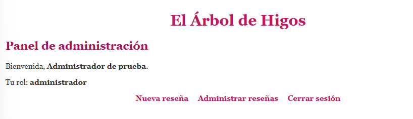
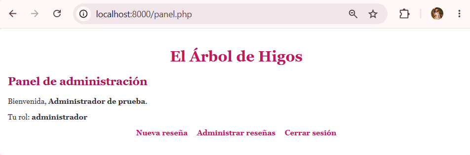

### Prueba 3 — Consultar 🌸🌸🌷🌸🌸💐🌸🌸🌷🌸🌸💐💐

**Resultado obtenido:** la lista muestra las reseñas, con el botón "+ Nueva reseña", la columna **Acciones** y los botones de editar y eliminar.

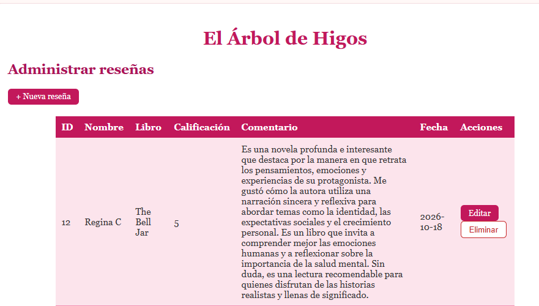

### Prueba 4 — Crear 🌸🌸🌷🌸🌸💐🌸🌸🌷🌸🌸💐💐

**Qué hice:** creé una reseña desde **Nueva reseña**.

**Resultado obtenido:** apareció "Reseña guardada correctamente".

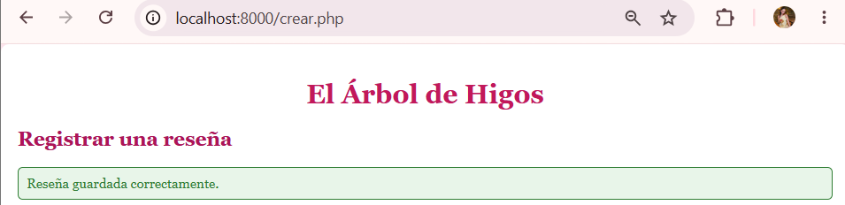

### Pruebas 5 y 6 — Editar y eliminar 🌸🌸🌷🌸🌸💐🌸🌸🌷🌸🌸💐💐

**Qué hice:** edité una reseña de demostración y después la eliminé.

**Resultado obtenido:** ambas operaciones funcionaron, y la reseña desapareció de la lista.

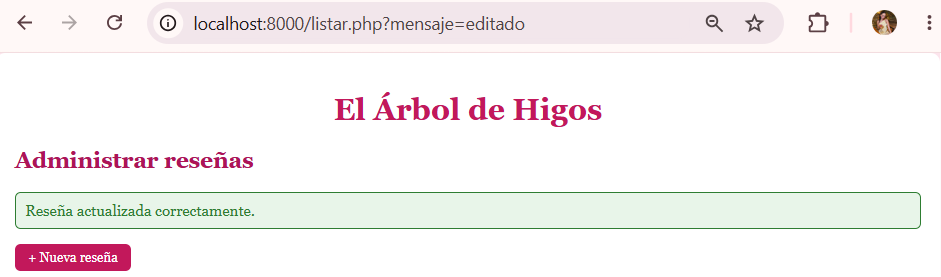
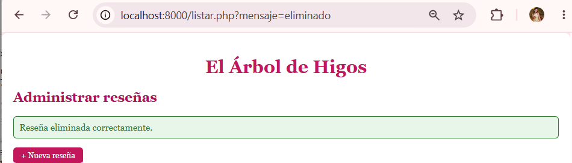
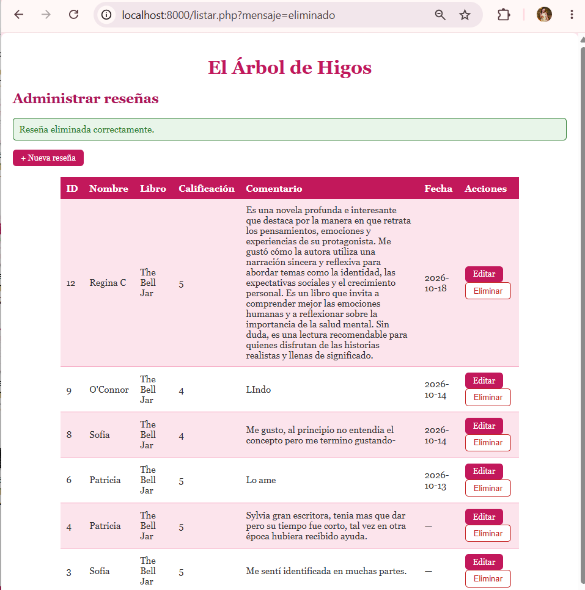

---

## Pruebas de la cuenta de consulta 🌸🌸🌷🌸🌸💐🌸🌸🌷🌸🌸💐💐

### Pruebas 7, 8 y 9 — Sesión, menú y consulta 🌸🌸🌷🌸🌸💐🌸🌸🌷🌸🌸💐💐

**Qué hice:** cerré sesión e inicié con `consulta_prueba`.

**Resultado esperado:** el panel y la lista no ofrecen operaciones restringidas.

**Resultado obtenido:** el panel mostró "Tu rol: consulta" con las opciones **Consultar reseñas** y **Cerrar sesión**. La lista muestra las reseñas, sin "+ Nueva reseña", sin columna Acciones y sin botones.

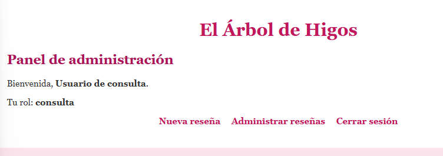
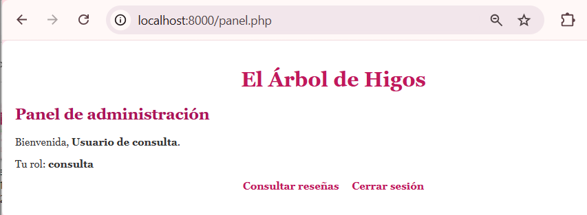
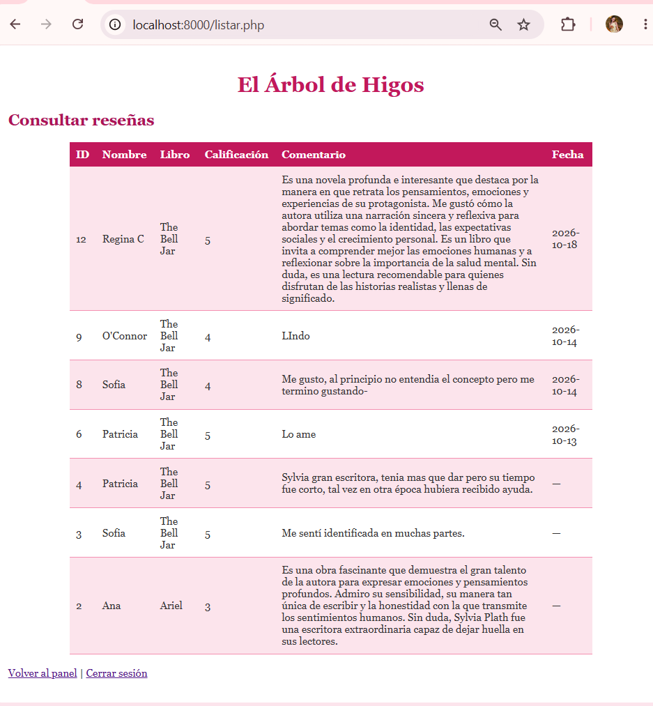

### Prueba 10 — Abrir `crear.php` directamente 🌸🌸🌷🌸🌸💐🌸🌸🌷🌸🌸💐💐

**Qué hice:** con la cuenta de consulta escribí la dirección de `crear.php`.

**Resultado esperado:** el servidor lo rechaza.

**Resultado obtenido:** apareció "Acceso denegado" con el mensaje de que no tengo permiso (respuesta 403).

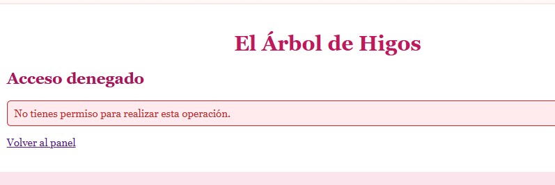

### Prueba 11 — Abrir `editar.php` directamente

**Resultado obtenido:** el mismo rechazo con la dirección de edición de una reseña.

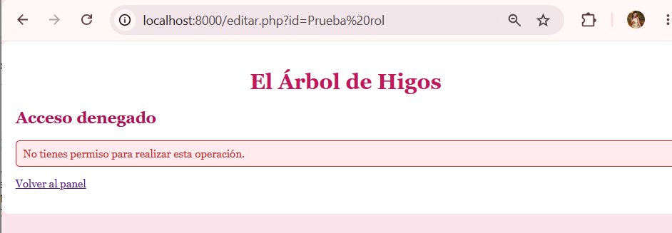

### Prueba 12 — Ejecutar la eliminación
🌸🌸🌷🌸🌸💐🌸🌸🌷🌸🌸💐💐
**Qué hice:** con la cuenta de consulta, cuando los botones todavía estaban visibles, envié el formulario de eliminar de una reseña de demostración y acepté la confirmación.

**Resultado esperado:** la solicitud llega al servidor por POST y es rechazada.

**Resultado obtenido:** apareció "Acceso denegado". Esta prueba es la importante: demuestra que ocultar el botón no era la protección, porque la solicitud sí llegó y fue el servidor quien la detuvo.

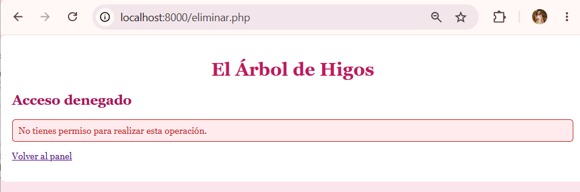

### Prueba 13 — La base de datos no cambia 🌸🌸🌷🌸🌸💐🌸🌸🌷🌸🌸💐💐

**Resultado obtenido:** después de los intentos anteriores, la reseña de demostración seguía en la lista. `exigirRol()` se ejecuta antes de cualquier consulta, así que una cuenta sin permiso nunca llega a tocar la base de datos.

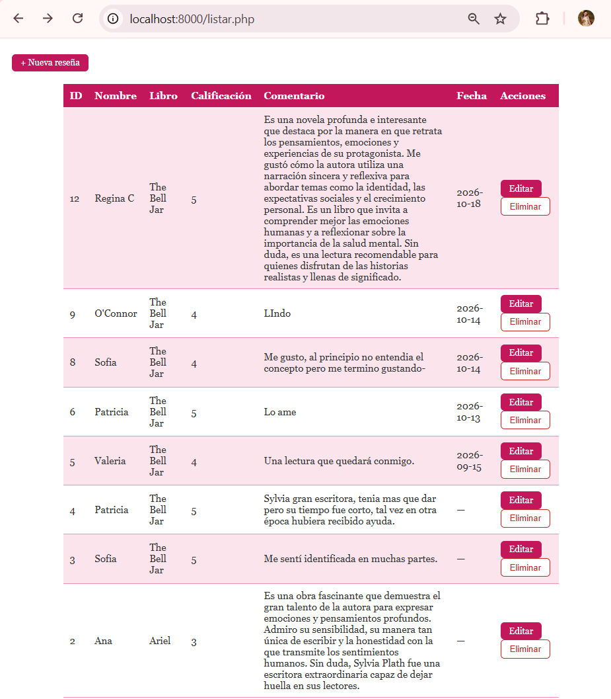

### Prueba 14 — Gestión de usuarios 🌸🌸🌷🌸🌸💐🌸🌸🌷🌸🌸💐💐

**No aplica.** Mi proyecto no tiene un módulo de gestión de usuarios: los roles se asignan directamente en la base de datos, como permite la guía.

### Prueba 17 — Otorgarse privilegios 🌸🌸🌷🌸🌸💐🌸🌸🌷🌸🌸💐💐

**Qué hice:** con la cuenta de consulta abrí `crear.php?rol=administrador`.

**Resultado esperado:** sigue rechazado, porque el rol nunca se toma de la URL.

**Resultado obtenido:** apareció "Acceso denegado".

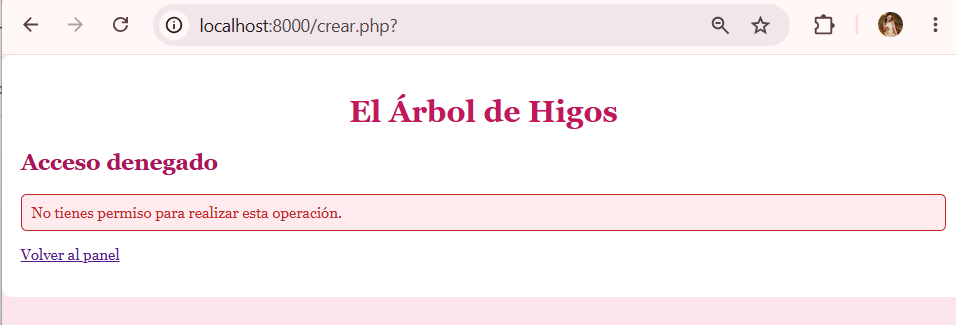

**Prueba adicional:** abrí `crear.php` escribiendo la dirección aunque el enlace ya no aparece en el menú de consulta. Sigue rechazado, así que la seguridad no depende del menú.

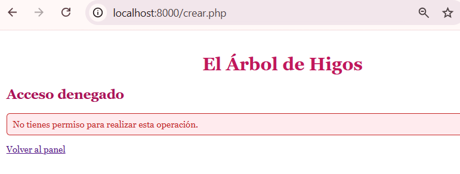

---

## Cierre de sesión 🌸🌸🌷🌸🌸💐🌸🌸🌷🌸🌸💐💐

### Prueba 15 — Página privada sin sesión

**Qué hice:** cerré sesión y escribí la dirección de `listar.php`.

**Resultado obtenido:** me mandó al formulario de acceso con el aviso de que debo iniciar sesión.

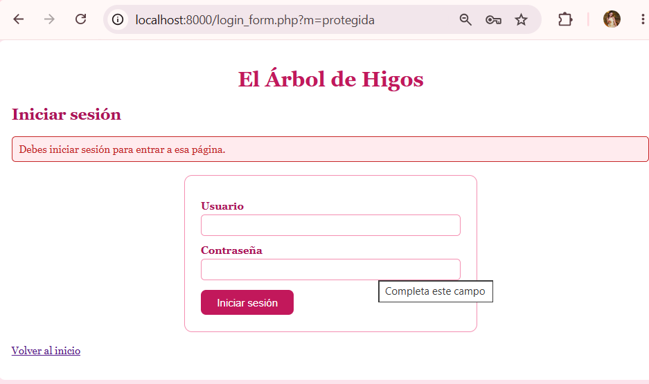

### Prueba 16 — Todo sigue funcionando
 🌸🌸🌷🌸🌸💐🌸🌸🌷🌸🌸💐💐
El login, el cierre de sesión y el CRUD siguen funcionando para el administrador, y la cuenta de consulta conserva su acceso de lectura.

---

## Resumen de la matriz probada
🌸🌸🌷🌸🌸💐🌸🌸🌷🌸🌸💐💐

| Archivo | Sin sesión | `consulta` | `administrador` |
|---|---|---|---|
| `panel.php` | Rechazado | Permitido | Permitido |
| `listar.php` | Rechazado | Permitido | Permitido |
| `crear.php` | Rechazado | **403** | Permitido |
| `editar.php` | Rechazado | **403** | Permitido |
| `eliminar.php` | Rechazado | **403** | Permitido |
