<table style="width:100%; border:none; margin-bottom:20px;">
<tr>
<td width="120" align="center" style="border:none;">

</td>
<td align="right" style="border:none; padding: 20px 10px;">
<h1 style="color:#c2185b; font-family: Georgia, serif; letter-spacing: 2px; margin-bottom:5px;">💐💐💐💐 EL ÁRBOL DE HIGOS 💐💐💐💐</h1>
<p style="color:#ad1457; font-style: italic; font-size: 15px; margin:0;">Semana 10 — AJAX y Fetch API</p>
<p style="color:#e91e8c; font-size: 13px; margin:0;">Desarrollo de Aplicaciones Web</p>
</td>
</tr>
</table>

<br>

<table style="width:100%; border-collapse: collapse;">
<tr style="background-color:#c2185b; color:#ffffff;">
<td style="padding:8px;"><b>Alumna</b></td>
<td style="padding:8px;">Patricia Segura Resendiz</td>
</tr>
<tr style="background-color:#fce4ec;">
<td style="padding:8px;"><b>Institución</b></td>
<td style="padding:8px;">Instituto Tecnológico Superior de Rioverde</td>
</tr>
<tr style="background-color:#c2185b; color:#ffffff;">
<td style="padding:8px;"><b>Carrera</b></td>
<td style="padding:8px;">Ingeniería en Sistemas Computacionales</td>
</tr>
<tr style="background-color:#fce4ec;">
<td style="padding:8px;"><b>Docente</b></td>
<td style="padding:8px;">Ing. José de Jesús Collazo Reyes</td>
</tr>
<tr style="background-color:#c2185b; color:#ffffff;">
<td style="padding:8px;"><b>Entorno</b></td>
<td style="padding:8px;">WampServer · Apache 2.4.59 · PHP 8.2.18 · MySQL 8.0.42</td>
</tr>
</table>

<br>

<h2 style="color:#c2185b; border-bottom: 3px solid #f48fb1; padding-bottom: 6px;">🌸🌸🌸🌸🌷🌸🌸 Objetivo</h2>

<blockquote style="border-left: 4px solid #f48fb1; background:#fff0f5; padding: 10px 15px; color:#333;">
Hacer que una parte de mi tienda se comunique con el servidor sin recargar la página: la lista de reseñas del administrador ahora la pide JavaScript con <code>fetch()</code> a un endpoint de PHP que responde en JSON, y la tabla se actualiza sola. Y que ese endpoint aplique las mismas reglas de sesión y de rol que una página normal.
</blockquote>

<br>

<h2 style="color:#c2185b; border-bottom: 3px solid #f48fb1; padding-bottom: 6px;">🌷🌸🌸🌸🌷🌸🌸💐🌸 Punto de partida</h2>

<blockquote style="border-left: 4px solid #f48fb1; background:#fff0f5; padding: 10px 15px; color:#333;">
Copié la Semana 09 a <code>semana10</code> y comprobé desde esa carpeta que el login, los roles y el CRUD siguieran funcionando antes de agregar nada, para no atribuirle a Fetch un problema que ya existiera.
</blockquote>

<div align="center">
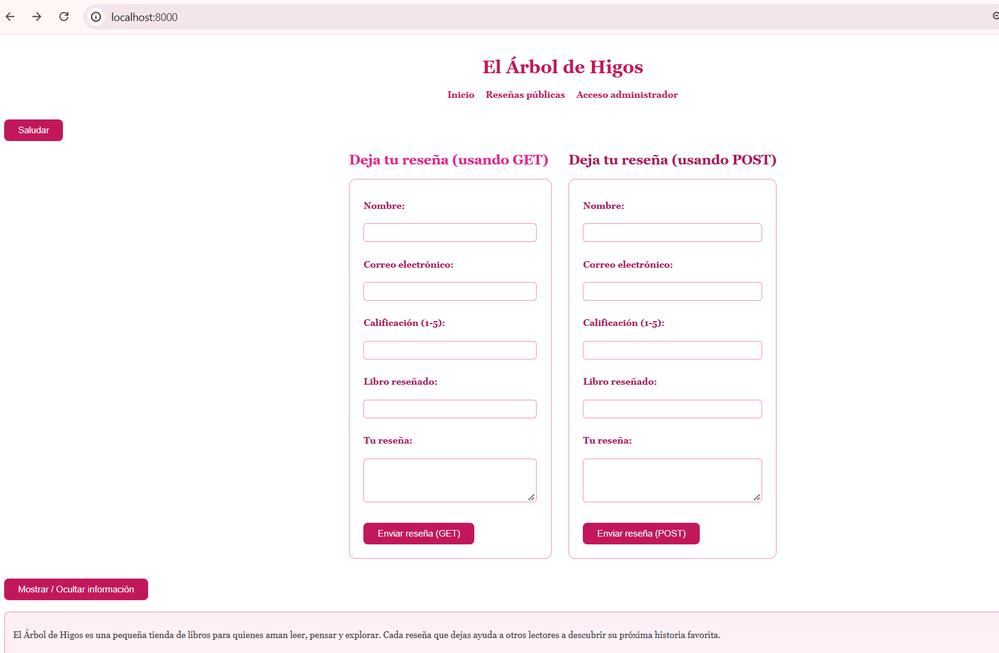
<p style="color:#c2185b; font-style:italic; font-size:13px;">Proyecto funcionando antes de agregar Fetch</p>
</div>

<br>

<h2 style="color:#c2185b; border-bottom: 3px solid #f48fb1; padding-bottom: 6px;">🌸🌸🌸🌷🌸🌸💐🌸🌸🌷💗 Funcionalidad implementada</h2>

<blockquote style="border-left: 4px solid #f48fb1; background:#fff0f5; padding: 10px 15px; color:#333;">
Elegí la operación de <b>consultar reseñas</b>, que es de solo lectura y no puede dañar datos. <code>listar.php</code> dejó de armar la tabla con PHP: ahora es solo la estructura (un botón "Actualizar lista", una zona de estado y una zona para la tabla), y <code>listar.js</code> pide los datos al endpoint y dibuja la tabla. El diseño completo está en <code>diseno_fetch.md</code>.
</blockquote>

```text
Clic en "Actualizar lista"
   ↓
fetch("api/resenas.php")
   ↓
PHP: ¿método GET? ¿hay sesión? ¿el rol puede ver reseñas?
   ↓
PHP consulta MySQL → responde JSON + código HTTP
   ↓
JavaScript revisa respuesta.ok y arma la tabla
```

<div align="center">
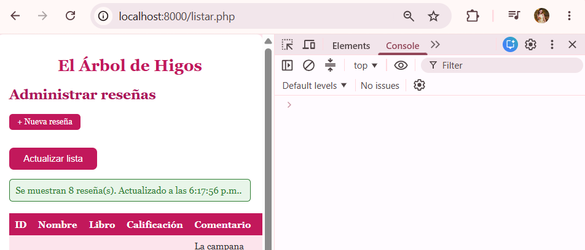
<p style="color:#c2185b; font-style:italic; font-size:13px;">Lista cargada con Fetch</p>
<br>
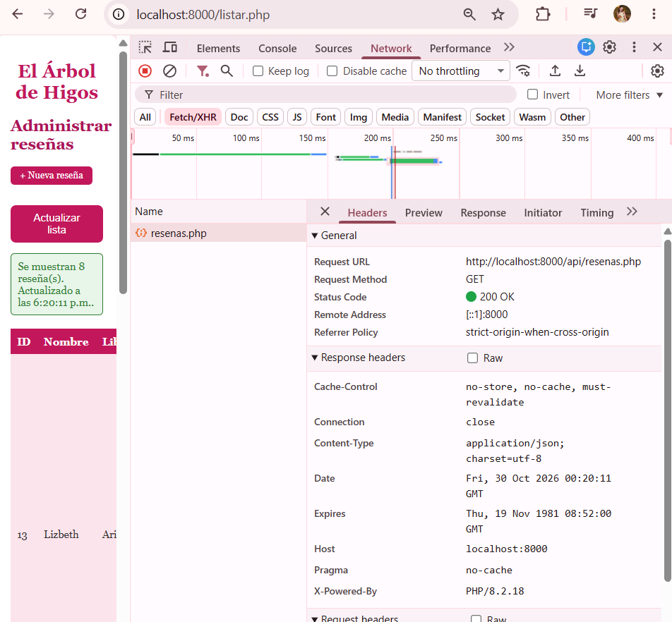
<p style="color:#c2185b; font-style:italic; font-size:13px;">La petición Fetch en la pestaña Network</p>
</div>

<br>

<h2 style="color:#c2185b; border-bottom: 3px solid #f48fb1; padding-bottom: 6px;">🌺🌸🌸🌸🌷🌸🌸💐🌸🌸 El endpoint JSON</h2>

<blockquote style="border-left: 4px solid #f48fb1; background:#fff0f5; padding: 10px 15px; color:#333;">
<code>api/resenas.php</code> responde siempre con <code>Content-Type: application/json</code> y con el código HTTP que corresponde. Comprueba, en este orden: que haya sesión (401), que el método sea GET (405) y que el rol pueda consultar (403); solo después toca la base de datos. No envía el correo de los usuarios, porque la lista nunca lo mostró y no hay razón para mandárselo al navegador. Y apaga <code>display_errors</code>, porque un aviso de PHP impreso antes del JSON lo rompería.
</blockquote>

<table style="width:100%; border-collapse: collapse;">
<tr style="background-color:#c2185b; color:#ffffff;"><th style="padding:8px; text-align:left;">Código</th><th style="padding:8px; text-align:left;">Cuándo</th></tr>
<tr style="background-color:#fce4ec;"><td style="padding:8px;"><b>200</b></td><td style="padding:8px;">Consulta correcta</td></tr>
<tr style="background-color:#ffffff;"><td style="padding:8px;"><b>401</b></td><td style="padding:8px;">No hay sesión</td></tr>
<tr style="background-color:#fce4ec;"><td style="padding:8px;"><b>403</b></td><td style="padding:8px;">Hay sesión, pero el rol no tiene permiso</td></tr>
<tr style="background-color:#ffffff;"><td style="padding:8px;"><b>405</b></td><td style="padding:8px;">El método no es GET</td></tr>
<tr style="background-color:#fce4ec;"><td style="padding:8px;"><b>500</b></td><td style="padding:8px;">Falla la conexión o la consulta (el detalle va al registro, no a la respuesta)</td></tr>
</table>

<div align="center">
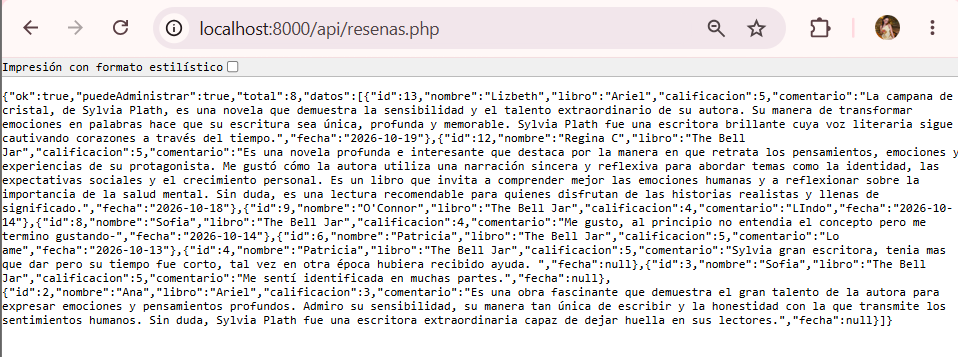
<p style="color:#c2185b; font-style:italic; font-size:13px;">Respuesta JSON del endpoint</p>
</div>

<br>

<h2 style="color:#c2185b; border-bottom: 3px solid #f48fb1; padding-bottom: 6px;">💕🌸🌸🌸🌷🌸🌸💐🌸🌸 Una decisión que tuve que entender</h2>

<blockquote style="border-left: 4px solid #f48fb1; background:#fff0f5; padding: 10px 15px; color:#333;">
Mi endpoint no usa <code>proteger.php</code> ni <code>autorizacion.php</code>, que son los que protegen mis páginas. La razón es que esos archivos, cuando no hay sesión, <b>redirigen al login</b>. Para una página normal eso es lo correcto, pero para <code>fetch()</code> sería un problema: recibiría la página de login en HTML y trataría de leerla como JSON. Por eso creé <code>autorizacion_json.php</code>, que aplica las mismas reglas pero responde con JSON y con 401 o 403.
<br><br>
Por la misma razón modifiqué <code>conexion.php</code>: si la conexión falla, antes respondía con texto plano; ahora, cuando lo pide un endpoint JSON (con la constante <code>RESPUESTA_JSON</code>), responde en JSON. Las páginas normales no cambian.
</blockquote>

<br>

<h2 style="color:#c2185b; border-bottom: 3px solid #f48fb1; padding-bottom: 6px;">🌸🌸🌸🌸🌷🌸🌸💐🌸🌸 La parte del navegador</h2>

<blockquote style="border-left: 4px solid #f48fb1; background:#fff0f5; padding: 10px 15px; color:#333;">
En <code>listar.js</code> hay tres decisiones importantes. Primero, reviso <code>respuesta.ok</code> a mano, porque <code>fetch()</code> no trata un 403 o un 500 como error por sí solo. Segundo, pinto cada dato con <code>textContent</code> y no con <code>innerHTML</code>: es el mismo problema del comentario <code>&lt;b&gt;prueba&lt;/b&gt;</code> de la Semana 08, y una tabla armada por JavaScript lo habría vuelto a abrir. Tercero, desactivo el botón mientras la petición está en curso, para evitar peticiones repetidas.
</blockquote>

```javascript
function celda(texto) {
    const td = document.createElement("td");
    td.textContent = texto;      // texto plano: nunca se interpreta como HTML
    return td;
}
```

<div align="center">
<table style="width:100%;">
<tr>
<td align="center" width="50%">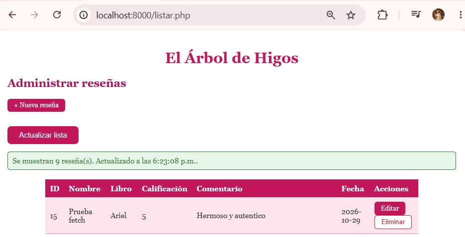<p style="font-size:12px; color:#c2185b;">Se actualiza sin recargar la página</p></td>
<td align="center" width="50%">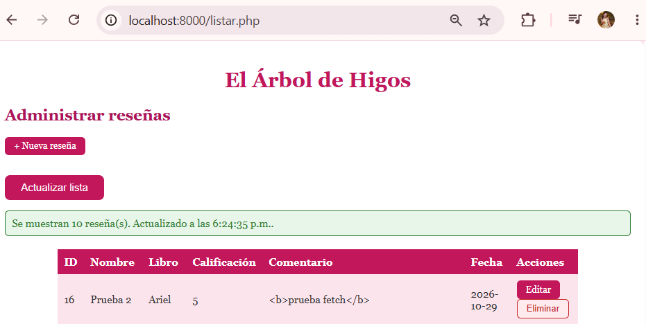<p style="font-size:12px; color:#c2185b;">El HTML escrito en un comentario se ve como texto</p></td>
</tr>
</table>
</div>

<br>

<h2 style="color:#c2185b; border-bottom: 3px solid #f48fb1; padding-bottom: 6px;">🌸🌸🌸🌷🌸🌸💐🌸🌸🌷 Seguridad y permisos conservados</h2>

<table style="width:100%; border-collapse: collapse;">
<tr style="background-color:#c2185b; color:#ffffff;"><th style="padding:8px; text-align:left;">Medida</th><th style="padding:8px; text-align:left;">Dónde</th></tr>
<tr style="background-color:#fce4ec;"><td style="padding:8px;">Comprobación de sesión</td><td style="padding:8px;"><code>autorizacion_json.php</code></td></tr>
<tr style="background-color:#ffffff;"><td style="padding:8px;">Comprobación de rol en el servidor</td><td style="padding:8px;"><code>exigirRolJson()</code></td></tr>
<tr style="background-color:#fce4ec;"><td style="padding:8px;">El rol nunca se recibe del navegador</td><td style="padding:8px;">Sale de <code>$_SESSION</code></td></tr>
<tr style="background-color:#ffffff;"><td style="padding:8px;">Sin credenciales ni detalles técnicos en la respuesta</td><td style="padding:8px;"><code>try / catch</code> y <code>error_log()</code></td></tr>
<tr style="background-color:#fce4ec;"><td style="padding:8px;">Salida segura en la tabla</td><td style="padding:8px;"><code>textContent</code> en <code>listar.js</code></td></tr>
<tr style="background-color:#ffffff;"><td style="padding:8px;">Editar y eliminar siguen protegidos en el servidor</td><td style="padding:8px;"><code>exigirRol()</code> en <code>editar.php</code> y <code>eliminar.php</code></td></tr>
</table>

<blockquote style="border-left: 4px solid #f48fb1; background:#fff0f5; padding: 10px 15px; color:#333; margin-top:10px;">
El endpoint solo lee, así que usa una consulta fija sin datos del usuario y no necesita <code>prepare()</code> ni protección CSRF. Ambas cosas cobrarán sentido cuando una operación reciba datos o modifique registros.
</blockquote>

<div align="center">
<table style="width:100%;">
<tr>
<td align="center" width="50%">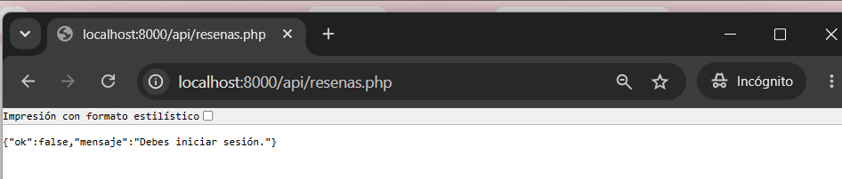<p style="font-size:12px; color:#c2185b;">Sin sesión: 401 en JSON</p></td>
<td align="center" width="50%">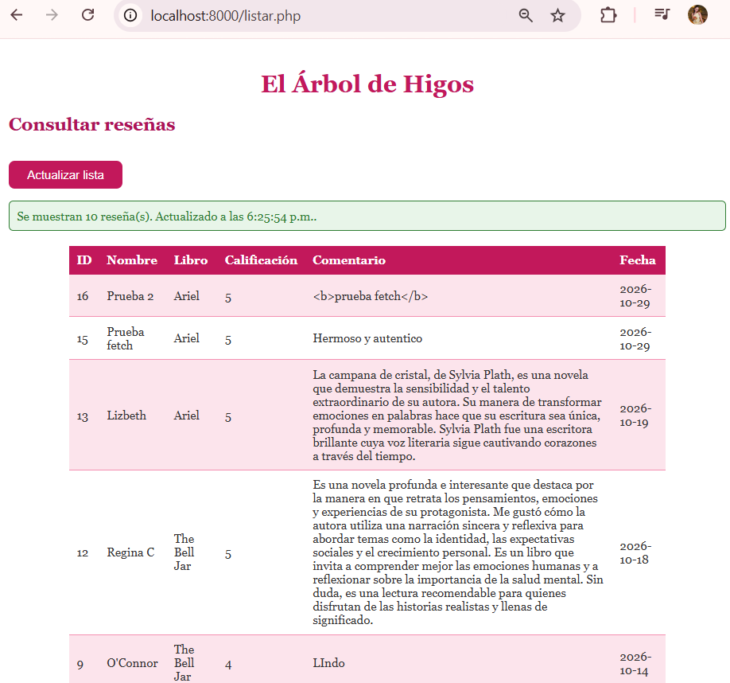<p style="font-size:12px; color:#c2185b;">Cuenta de consulta: sin acciones</p></td>
</tr>
</table>
</div>

<br>

<h2 style="color:#c2185b; border-bottom: 3px solid #f48fb1; padding-bottom: 6px;">💐🌸🌸🌸🌷🌸🌸💐 Archivos creados o modificados</h2>

<table style="width:100%; border-collapse: collapse;">
<tr style="background-color:#c2185b; color:#ffffff;"><th style="padding:8px; text-align:left;">Archivo</th><th style="padding:8px; text-align:left;">Estado</th><th style="padding:8px; text-align:left;">Función</th></tr>
<tr style="background-color:#fce4ec;"><td style="padding:8px;"><code>api/resenas.php</code></td><td style="padding:8px;">Nuevo</td><td style="padding:8px;">Endpoint JSON de consulta</td></tr>
<tr style="background-color:#ffffff;"><td style="padding:8px;"><code>autorizacion_json.php</code></td><td style="padding:8px;">Nuevo</td><td style="padding:8px;">Sesión y rol con respuestas JSON</td></tr>
<tr style="background-color:#fce4ec;"><td style="padding:8px;"><code>listar.js</code></td><td style="padding:8px;">Nuevo</td><td style="padding:8px;">Fetch, tabla y manejo de errores</td></tr>
<tr style="background-color:#ffffff;"><td style="padding:8px;"><code>listar.php</code></td><td style="padding:8px;">Modificado</td><td style="padding:8px;">Solo estructura; ya no consulta la base de datos</td></tr>
<tr style="background-color:#fce4ec;"><td style="padding:8px;"><code>conexion.php</code></td><td style="padding:8px;">Modificado</td><td style="padding:8px;">Responde en JSON cuando lo pide un endpoint</td></tr>
<tr style="background-color:#ffffff;"><td style="padding:8px;"><code>diseno_fetch.md</code>, <code>pruebas_fetch.md</code></td><td style="padding:8px;">Nuevos</td><td style="padding:8px;">Diseño y resultado de las pruebas</td></tr>
</table>

<br>

<h2 style="color:#c2185b; border-bottom: 3px solid #f48fb1; padding-bottom: 6px;">💕🌸🌸🌸🌷🌸🌸💐 Tablas de la base de datos involucradas</h2>

<blockquote style="border-left: 4px solid #f48fb1; background:#fff0f5; padding: 10px 15px; color:#333;">
Solo <code>resenas</code>, en modo lectura. No cambié la estructura de ninguna tabla.
</blockquote>

<br>

<h2 style="color:#c2185b; border-bottom: 3px solid #f48fb1; padding-bottom: 6px;">🌺🌸🌸🌸🌷🌸🌸💐 Pruebas realizadas</h2>

<table style="width:100%; border-collapse: collapse;">
<tr style="background-color:#c2185b; color:#ffffff;"><th style="padding:8px;">N.º</th><th style="padding:8px; text-align:left;">Prueba</th><th style="padding:8px; text-align:left;">Resultado</th></tr>
<tr style="background-color:#fce4ec;"><td style="padding:8px; text-align:center;">1 a 4</td><td style="padding:8px;">Carga, petición Fetch, JSON válido y actualización sin recargar</td><td style="padding:8px;">Correcta</td></tr>
<tr style="background-color:#ffffff;"><td style="padding:8px; text-align:center;">5 a 7</td><td style="padding:8px;">Datos válidos, campo vacío, identificador</td><td style="padding:8px;">No aplica (el endpoint solo lee)</td></tr>
<tr style="background-color:#fce4ec;"><td style="padding:8px; text-align:center;">8 y 9</td><td style="padding:8px;">Sin permiso y base de datos intacta</td><td style="padding:8px;">Correcta</td></tr>
<tr style="background-color:#ffffff;"><td style="padding:8px; text-align:center;">10</td><td style="padding:8px;">Errores controlados</td><td style="padding:8px;">Correcta</td></tr>
<tr style="background-color:#fce4ec;"><td style="padding:8px; text-align:center;">11 y 12</td><td style="padding:8px;">Consola limpia y el resto de la aplicación funcionando</td><td style="padding:8px;">Correcta</td></tr>
</table>

<p style="color:#c2185b; font-size:13px;">El detalle de cada prueba, con sus capturas, está en <code>pruebas_fetch.md</code>.</p>

<br>

<h2 style="color:#c2185b; border-bottom: 3px solid #f48fb1; padding-bottom: 6px;">🌷🌸🌸🌸🌷🌸🌸💐 Errores encontrados y errores provocados</h2>

<blockquote style="border-left: 4px solid #f48fb1; background:#fff0f5; padding: 10px 15px; color:#333;">
Una parte de la práctica fue provocar fallos a propósito para comprobar que la interfaz los maneja sin mostrar detalles técnicos. Cada cambio temporal lo revertí después de la prueba.
</blockquote>

<table style="width:100%; border-collapse: collapse;">
<tr style="background-color:#c2185b; color:#ffffff;"><th style="padding:8px; text-align:left;">Fallo provocado</th><th style="padding:8px; text-align:left;">Qué mostró la interfaz</th><th style="padding:8px; text-align:left;">Qué aprendí</th></tr>
<tr style="background-color:#fce4ec;"><td style="padding:8px;">Cerré la sesión en otra pestaña y presioné "Actualizar lista"</td><td style="padding:8px;">Me llevó al login</td><td style="padding:8px;">Un 401 significa que hay que volver a identificarse, no mostrar un error</td></tr>
<tr style="background-color:#ffffff;"><td style="padding:8px;">Restringí el endpoint a otro rol</td><td style="padding:8px;">"No tienes permiso para esta operación" (403)</td><td style="padding:8px;">La autorización la impone el servidor; JavaScript solo muestra lo que le contestan</td></tr>
<tr style="background-color:#fce4ec;"><td style="padding:8px;">Puse una base de datos que no existe</td><td style="padding:8px;">"El sistema no está disponible en este momento" (500)</td><td style="padding:8px;">El detalle técnico va al registro, no a la respuesta</td></tr>
<tr style="background-color:#ffffff;"><td style="padding:8px;">Activé el modo sin conexión del navegador</td><td style="padding:8px;">"No hay comunicación con el servidor"</td><td style="padding:8px;">Un <code>TypeError</code> de <code>fetch()</code> significa que no hubo comunicación, distinto de un error del servidor</td></tr>
<tr style="background-color:#fce4ec;"><td style="padding:8px;">Hice que el endpoint imprimiera HTML antes del JSON</td><td style="padding:8px;">"No fue posible cargar las reseñas"</td><td style="padding:8px;">Por eso el endpoint apaga <code>display_errors</code>: un aviso de PHP rompería el JSON</td></tr>
</table>

<div align="center">
<table style="width:100%;">
<tr>
<td align="center" width="50%">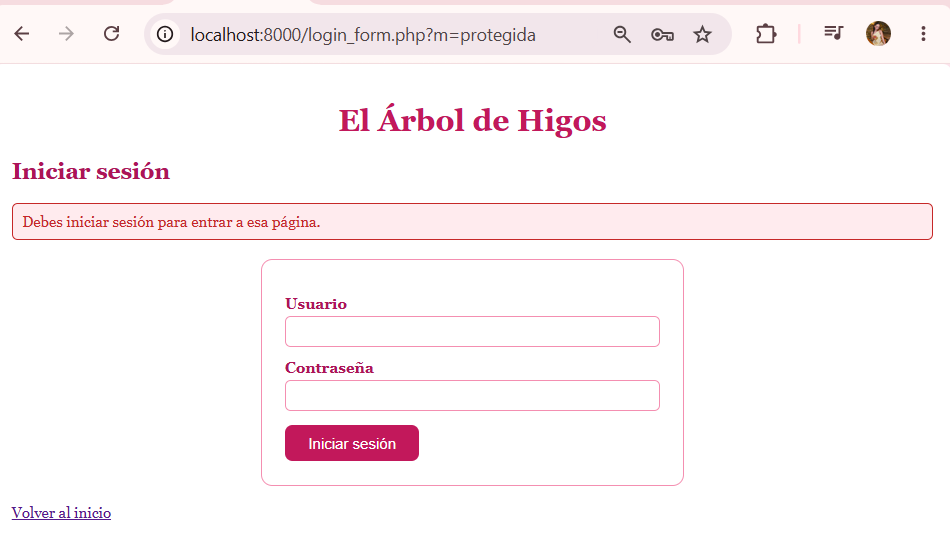<p style="font-size:12px; color:#a33a2e;">Sesión caducada</p></td>
<td align="center" width="50%">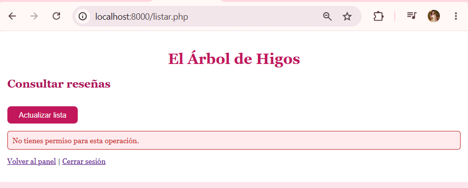<p style="font-size:12px; color:#a33a2e;">Sin permiso</p></td>
</tr>
<tr>
<td align="center" width="50%">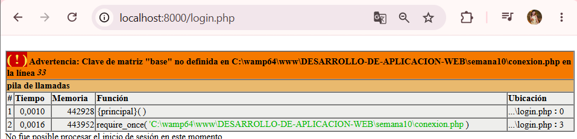<p style="font-size:12px; color:#a33a2e;">Error 500 controlado</p></td>
<td align="center" width="50%">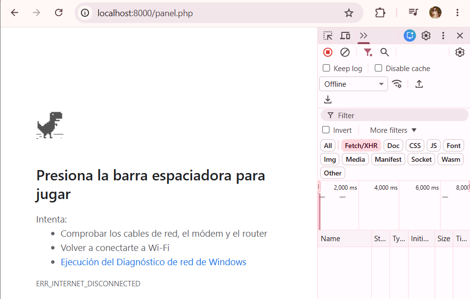<p style="font-size:12px; color:#a33a2e;">Sin comunicación</p></td>
</tr>
<tr>
<td align="center" width="50%">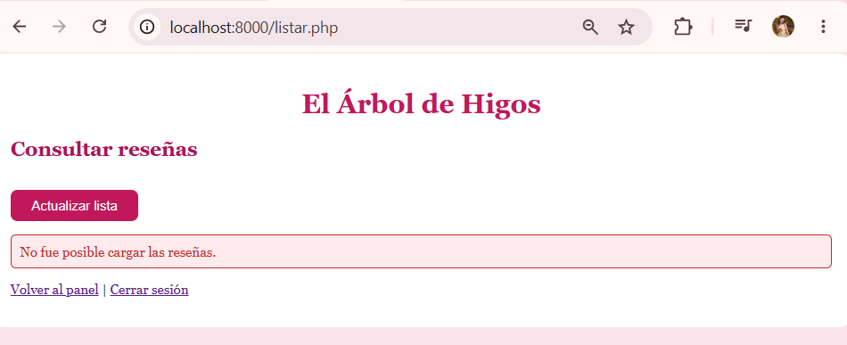<p style="font-size:12px; color:#a33a2e;">Respuesta que no es JSON</p></td>
<td align="center" width="50%">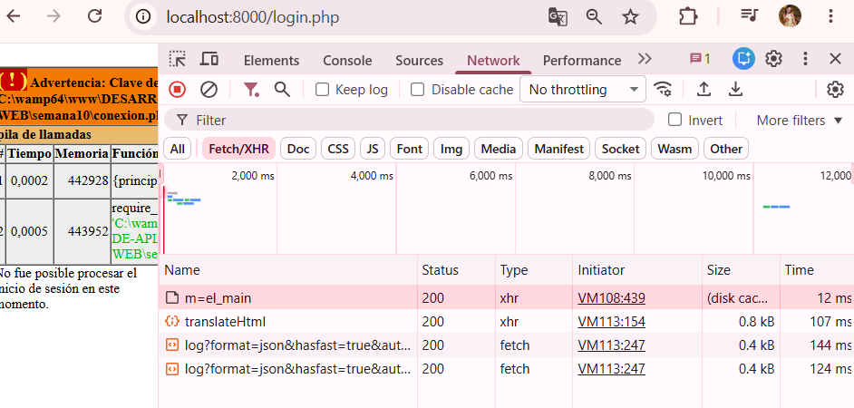<p style="font-size:12px; color:#a33a2e;">Estado 500 en Network</p></td>
</tr>
</table>
</div>

<br>

<h2 style="color:#c2185b; border-bottom: 3px solid #f48fb1; padding-bottom: 6px;">💗🌸🌸🌸🌷🌸🌸💐🌸🌸 Limitaciones</h2>

<blockquote style="border-left: 4px solid #f48fb1; background:#fff0f5; padding: 10px 15px; color:#333;">
<b>Solo convertí una operación a Fetch</b>, como pide la guía; crear, editar y eliminar siguen funcionando con formularios tradicionales.
<br><br>
<b>La lista depende de JavaScript.</b> Si está desactivado, la página muestra un aviso, porque la tabla ya no la arma PHP. Es el costo de este diseño; la página pública <code>resenas.php</code> sigue armada en el servidor.
<br><br>
<b>La comprobación de rol está duplicada</b> en <code>autorizacion.php</code> y <code>autorizacion_json.php</code>. Lo dejé anotado para unificarlo al reorganizar el proyecto en la Semana 11.
</blockquote>

<br>

<h2 style="color:#c2185b; border-bottom: 3px solid #f48fb1; padding-bottom: 6px;">🌸🌸🌸🌸🌷🌸🌸💐🌸 Reflexión final</h2>

<blockquote style="border-left: 4px solid #f48fb1; background:#fff0f5; padding: 10px 15px; color:#333;">
Lo que más me enseñó esta semana es que una petición de Fetch sigue siendo una petición al servidor, y debe pasar por las mismas reglas de sesión, de permisos y de validación que una página normal. Entendí por qué un endpoint no puede redirigir al login como lo hace una página: tiene que contestar con un código y con JSON, porque quien lo recibe es un programa y no una persona. También comprendí que fetch no considera error un 403 o un 500, así que hay que revisar la respuesta a mano, y que lo que muestre la interfaz cuando algo falla importa tanto como cuando todo sale bien. Y volví a ver el peligro de pintar datos con <code>innerHTML</code>, que es el mismo de la Semana 08. Mi tienda "El Árbol de Higos" ya no solo recarga páginas: ahora una parte de ella conversa con el servidor.
</blockquote>

<br>
