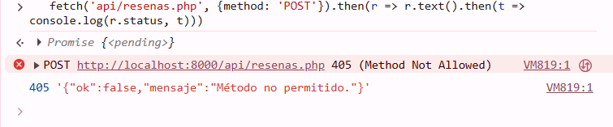
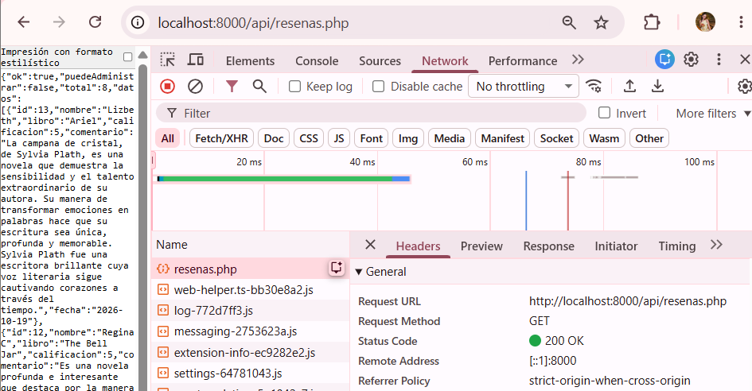
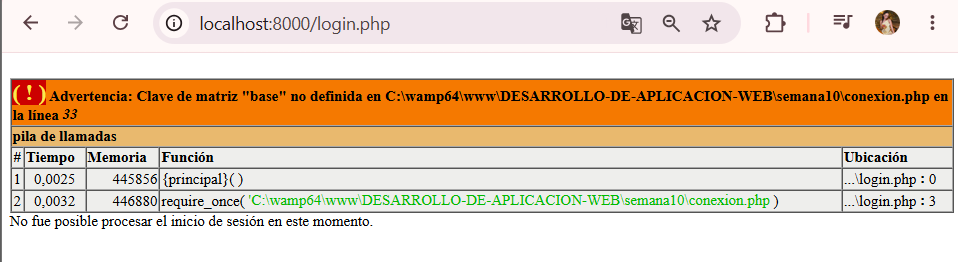

# Pruebas de Fetch API — Semana 10 🌷🌸

**Proyecto:** 💐💐💐💐 El Árbol de Higos 💐💐💐💐
**Módulo:** consulta de reseñas (`listar.php` + `listar.js` + `api/resenas.php`)
**Alumna:** Patricia Segura Resendiz

Las pruebas se hicieron sobre la aplicación real, con el servidor de PHP corriendo desde `semana10` y cuentas de demostración (`admin_prueba` y `consulta_prueba`). El endpoint solo lee datos: no recibe campos ni identificadores, por eso algunas pruebas de la guía no aplican y lo explico en cada caso.

## Dónde se aplica cada comprobación
🌸🌸🌸🌷🌸🌸💐🌸🌸🌷🌸🌸💐💐

| Comprobación | Dónde |
|---|---|
| Sesión (401 en JSON) | `autorizacion_json.php`, al inicio del endpoint |
| Método permitido (405) | `api/resenas.php` |
| Rol (403 en JSON) | `exigirRolJson()` en `autorizacion_json.php` |
| Errores de base de datos sin detalles (500) | `try / catch` en el endpoint y en `conexion.php` |
| Ningún aviso de PHP mezclado con el JSON | `ini_set("display_errors", "0")` en el endpoint |
| Texto mostrado como texto, no como HTML | `textContent` en `listar.js` |
| Revisión de `respuesta.ok` y del JSON | `listar.js` |

---

## Resumen
🌸🌸🌸🌷🌸🌸💐🌸🌸🌷🌸🌸💐💐

| N.º | Prueba | Resultado |
|---:|---|---|
| 1 | Abrir el módulo y comprobar que carga | Correcta |
| 2 | Ejecutar la operación que usa Fetch | Correcta |
| 3 | El navegador recibe una respuesta JSON válida | Correcta |
| 4 | La interfaz se actualiza sin recargar la página | Correcta |
| 5 | Enviar datos válidos | No aplica |
| 6 | Enviar un campo obligatorio vacío | No aplica |
| 7 | Identificador inválido o inexistente | No aplica |
| 8 | Usuario sin el permiso necesario | Correcta |
| 9 | La solicitud no autorizada no modifica la base de datos | Correcta |
| 10 | Respuestas de error controladas | Correcta |
| 11 | Revisar la consola del navegador | Correcta |
| 12 | El CRUD, el login y los roles siguen funcionando | Correcta |

---

## Prueba 1 — Abrir el módulo
🌸🌸🌸🌷🌸🌸💐🌸🌸🌷🌸🌸💐💐

**Qué hice:** inicié sesión con `admin_prueba` y entré a "Administrar reseñas".

**Resultado esperado:** la página abre y la tabla aparece sola.

**Resultado obtenido:** la tabla se cargó al abrir la página, con el mensaje "Se muestran N reseña(s). Actualizado a las…".

---

## Prueba 2 — Ejecutar la operación con Fetch
🌸🌸🌸🌷🌸🌸💐🌸🌸🌷🌸🌸💐💐

**Qué hice:** con las herramientas de desarrollador abiertas (pestaña Network, filtro Fetch/XHR), presioné "Actualizar lista".

**Resultado esperado:** una petición `fetch` a `api/resenas.php`.

**Resultado obtenido:** apareció una sola línea `resenas.php`, de tipo `fetch` y con estado `200`.

---

## Prueba 3 — Respuesta JSON válida
🌸🌸🌸🌷🌸🌸💐🌸🌸🌷🌸🌸💐💐

**Qué hice:** abrí `api/resenas.php` directamente con la sesión iniciada, y revisé la pestaña Response de la petición.

**Resultado esperado:** solo JSON, sin HTML y sin el correo de los usuarios.

**Resultado obtenido:** el navegador recibió un JSON con `ok`, `puedeAdministrar`, `total` y `datos`. No incluye correos ni HTML.

---

## Prueba 4 — Actualización sin recargar
🌸🌸🌸🌷🌸🌸💐🌸🌸🌷🌸🌸💐💐

**Qué hice:** con la lista abierta, guardé una reseña nueva desde otra pestaña y volví a la primera para presionar "Actualizar lista".

**Resultado esperado:** la reseña aparece sin recargar la página.

**Resultado obtenido:** la reseña apareció y cambió la hora del mensaje de estado, sin recargar la página completa. Solo se reemplazó la zona de la tabla.

---

## Pruebas 5, 6 y 7 — Datos válidos, campo vacío e identificador
🌸🌸🌸🌷🌸🌸💐🌸🌸🌷🌸🌸💐💐

**No aplican.** Esta operación solo consulta: el endpoint no recibe campos de formulario ni identificadores, así que no hay datos que validar. La única entrada que acepta es el método HTTP, y su "entrada inválida" es cualquier método distinto de GET, que se prueba aquí:

**Qué hice:** desde la consola del navegador envié una petición POST al endpoint.

**Resultado obtenido:** respondió `405` con `{"ok":false,"mensaje":"Método no permitido."}`.

Estas validaciones (campos, rangos, identificadores) cobrarán sentido cuando agregue búsqueda y orden en la Semana 13.

---

## Pruebas 8 y 9 — Sin permiso, y la base de datos no cambia
🌸🌸🌸🌷🌸🌸💐🌸🌸🌷🌸🌸💐💐

**Qué hice:**
- Abrí el endpoint sin sesión (ventana de incógnito).
- Entré con la cuenta de consulta y abrí el endpoint.
- Restringí temporalmente el endpoint al rol administrador y abrí la lista con la cuenta de consulta. Después regresé el cambio.

**Resultado esperado:** sin sesión recibo 401 en JSON (no una redirección al login); con la cuenta de consulta recibo 200 normalmente, y 403 cuando el endpoint exige otro rol.

**Resultado obtenido:** sin sesión respondió `{"ok":false,"mensaje":"Debes iniciar sesión."}`. Con la cuenta de consulta funcionó y `puedeAdministrar` fue `false`. Con el endpoint restringido, la lista mostró "No tienes permiso para esta operación".

Una decisión importante: el endpoint no usa `proteger.php` ni `autorizacion.php`, porque esos archivos redirigen al login y `fetch()` recibiría HTML. Por eso tiene su propia comprobación, que responde con JSON y con el código HTTP correcto.

Como este endpoint solo lee, la prueba de que una solicitud rechazada no modifica la base de datos se cumple por diseño; tendrá más peso cuando agregue operaciones que modifican datos.

---

## Prueba 10 — Errores controlados
🌸🌸🌸🌷🌸🌸💐🌸🌸🌷🌸🌸💐💐

**Qué hice:** provoqué cuatro fallos y observé el mensaje de la interfaz.

| Fallo provocado | Resultado en la interfaz |
|---|---|
| Cerré la sesión en otra pestaña y presioné "Actualizar lista" | Me llevó al login con el aviso de que debo iniciar sesión |
| Cambié el nombre de la base de datos en `config.php` | "El sistema no está disponible en este momento", con estado 500 y sin detalles técnicos |
| Activé el modo sin conexión en las herramientas de desarrollador | "No hay comunicación con el servidor" |
| Hice que el endpoint imprimiera HTML antes del JSON | "No fue posible cargar las reseñas" |

El último caso explica por qué el endpoint apaga `display_errors`: si PHP dejara escapar un aviso, se mezclaría con el JSON y el navegador no podría leerlo. Todos los cambios temporales se revirtieron después de cada prueba.

El error de conexión también se probó directamente en el endpoint, y respondió en JSON:

---

## Prueba 11 — Consola del navegador
🌸🌸🌸🌷🌸🌸💐🌸🌸🌷🌸🌸💐💐

**Qué hice:** con la lista cargada, revisé la pestaña Console.

**Resultado obtenido:** sin errores en la carga normal. Los mensajes que aparecen en la consola durante las pruebas de error son los que el código deja a propósito (`console.error` con el nombre del error, sin datos sensibles).

---

## Prueba 12 — El resto de la aplicación sigue funcionando
🌸🌸🌸🌷🌸🌸💐🌸🌸🌷🌸🌸💐💐

**Qué hice:** comprobé que los datos se muestran como texto, que la cuenta de consulta conserva su vista reducida, y que las acciones de editar y eliminar (ahora dibujadas por JavaScript) siguen funcionando para el administrador.

**Resultado obtenido:**
- Un comentario con `<b>prueba fetch</b>` se muestra literal, sin negritas, porque la tabla se arma con `textContent` y no con `innerHTML`.
- La cuenta de consulta ve la lista sin columna de acciones.
- Crear, editar y eliminar siguen funcionando, y el rechazo por rol sigue en `crear.php`, `editar.php` y `eliminar.php`.

