# Pruebas de MVC — Semana 11

**Proyecto:** 💐💐💐💐 El Árbol de Higos 💐💐💐💐
**Módulo reorganizado:** consulta de reseñas (modelo, controlador, vista y dos puntos de entrada)
**Alumna:** Patricia Segura Resendiz

Las pruebas se hicieron sobre la aplicación real, con el servidor de PHP corriendo desde `semana11` y las cuentas de demostración `admin_prueba` y `consulta_prueba`. La estructura se describe en `estructura_mvc.md` y el estado anterior en `estructura_inicial.md`.

---

## Resumen
🌸🌸🌸🌷🌸🌸💐🌸🌸🌷🌸🌸💐💐

| N.º | Prueba | Resultado |
|---:|---|---|
| 1 | Abrir la aplicación después de reorganizar los archivos | Correcta |
| 2 | Iniciar sesión con una cuenta de demostración | Correcta |
| 3 | Consultar el listado que ahora usa el modelo | Correcta |
| 4 | El controlador coordina la operación | Correcta |
| 5 | La vista presenta correctamente los datos | Correcta |
| 6 | Los datos dinámicos se muestran de forma segura | Correcta |
| 7 | Probar una creación o actualización reorganizada | No aplica |
| 8 | Un usuario sin permiso no puede ejecutar una acción restringida | Correcta |
| 9 | Probar el endpoint que usa Fetch | Correcta |
| 10 | La respuesta JSON conserva su formato | Correcta |
| 11 | Cerrar sesión y abrir una página privada por su dirección | Correcta |
| 12 | Revisar errores de PHP y del navegador | Correcta |
| 13 | Comparar las funciones antes y después | Correcta |
| 14 | Corregir cualquier regresión encontrada | Completar |

---

## Pruebas 1 y 2 — La aplicación abre e inicio de sesión
🌸🌸🌸🌷🌸🌸💐🌸🌸🌷🌸🌸💐💐

**Qué hice:** abrí la aplicación desde `semana11` y comprobé que el login funcionara con las dos cuentas.

**Resultado obtenido:** el inicio abre con su menú y el login funciona con las cuentas de demostración. El estado antes de reorganizar está documentado en `estructura_inicial.md`.

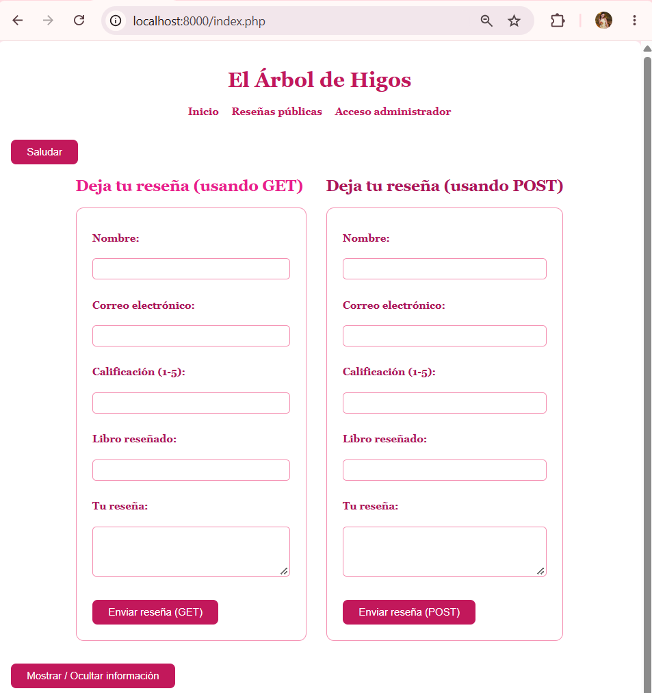

---

## Prueba 3 — El listado usa el modelo
🌸🌸🌸🌷🌸🌸💐🌸🌸🌷🌸🌸💐💐

**Qué hice:** abrí "Administrar reseñas" y la página pública de reseñas, después de mover las consultas a `Resena.php`.

**Resultado esperado:** los mismos datos de antes, ahora obtenidos por el modelo.

**Resultado obtenido:** la lista del administrador cargó con Fetch y la página pública mostró las reseñas ordenadas de mejor a peor calificación. Ninguno de los dos archivos de entrada contiene SQL.

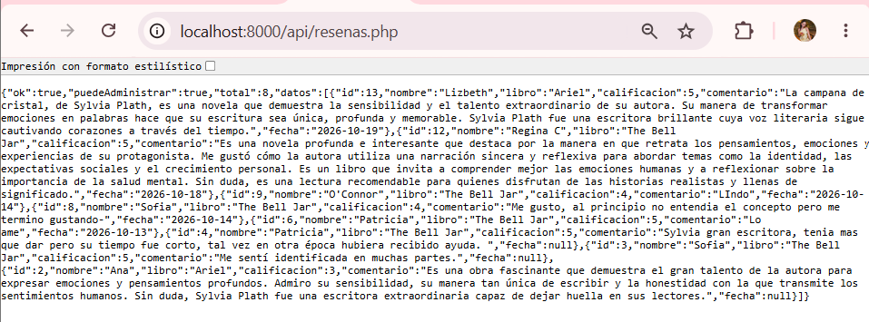
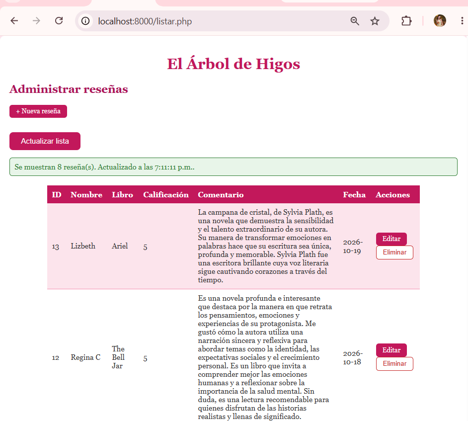

---

## Prueba 4 — El controlador coordina la operación
🌸🌸🌸🌷🌸🌸💐🌸🌸🌷🌸🌸💐💐

**Qué hice:** busqué consultas SQL en los puntos de entrada y en la carpeta `app`, con `grep`.

**Resultado esperado:** el SQL solo existe en el modelo.

**Resultado obtenido:** `resenas.php` y `api/resenas.php` no contienen ninguna instrucción `SELECT`; las consultas están únicamente en `app/models/Resena.php`.

**Cómo se reparte el trabajo:** el punto de entrada recibe la solicitud y llama al controlador; el controlador le pide los datos al modelo, atrapa cualquier error, lo registra con `error_log()` y decide qué responder; el modelo solo ejecuta la consulta.

Además, provoqué un fallo en el modelo para ver el recorrido: el modelo lanzó la excepción, el controlador la atrapó y la vista mostró un mensaje general, sin detalles técnicos.

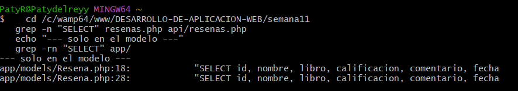
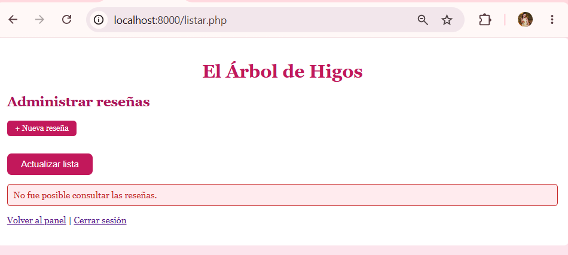
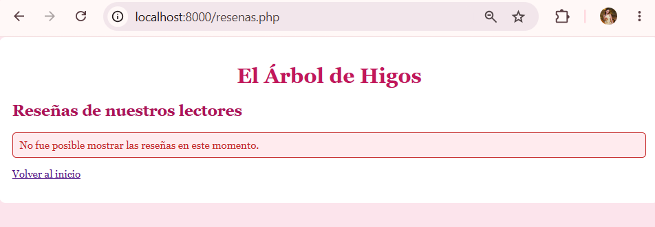

---

## Prueba 5 — La vista presenta los datos
🌸🌸🌸🌷🌸🌸💐🌸🌸🌷🌸🌸💐💐

**Qué hice:** abrí la página pública de reseñas.

**Resultado obtenido:** tiene el mismo aspecto que antes de la reorganización, con la tabla y el estilo de la tienda. La vista (`app/views/resenas/publicas.php`) solo recibe los datos y los presenta.

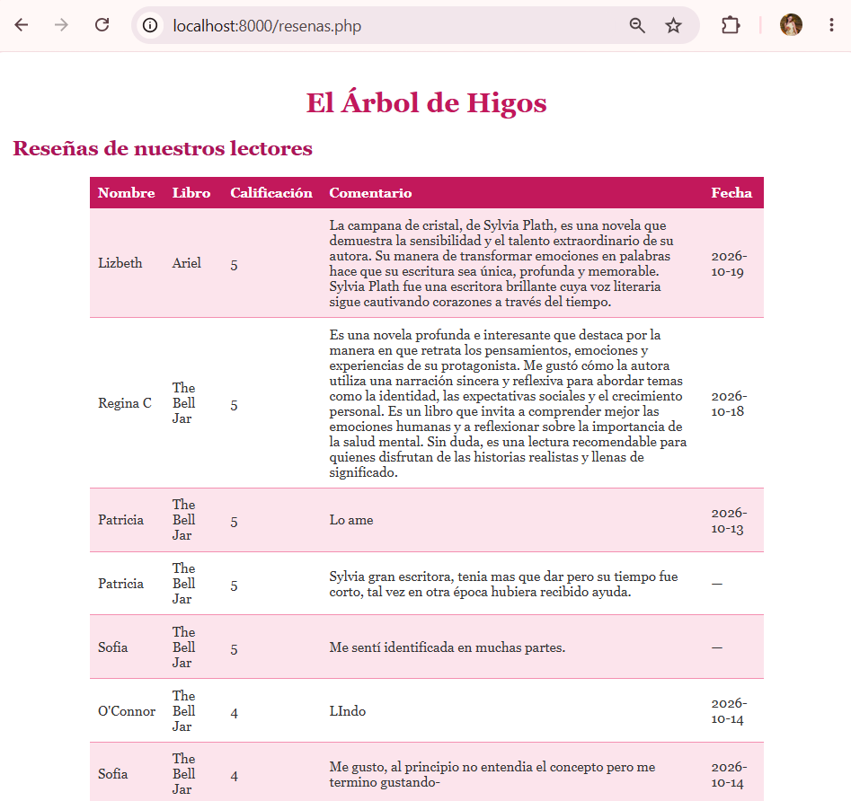

---

## Prueba 6 — Datos dinámicos de forma segura
🌸🌸🌸🌷🌸🌸💐🌸🌸🌷🌸🌸💐💐

**Qué hice:** guardé una reseña con el comentario `<b>prueba mvc</b>` y la abrí en la página pública.

**Resultado esperado:** se muestra como texto, no como HTML.

**Resultado obtenido:** el comentario se ve literal, con los símbolos a la vista y sin negritas, porque la vista escapa cada valor con `htmlspecialchars()`.

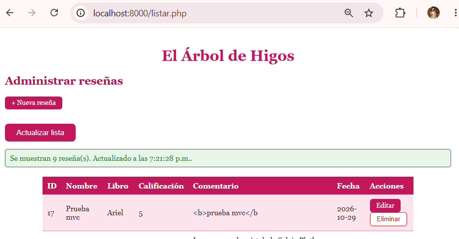

---

## Prueba 7 — Creación o actualización reorganizada
🌸🌸🌸🌷🌸🌸💐🌸🌸🌷🌸🌸💐💐

**No aplica.** En esta práctica reorganicé solo el módulo de consulta. El alta, la edición y la eliminación siguen con la estructura anterior y quedan documentados como pendientes en `estructura_mvc.md`.

---

## Prueba 8 — Usuario sin permiso
🌸🌸🌸🌷🌸🌸💐🌸🌸🌷🌸🌸💐💐

**Qué hice:** con `consulta_prueba` abrí `crear.php` escribiendo la dirección.

**Resultado esperado:** el servidor lo rechaza.

**Resultado obtenido:** apareció "Acceso denegado". Las comprobaciones de rol no cambiaron con la reorganización. En el endpoint, la comprobación de rol sigue ejecutándose antes de llamar al controlador, y su respuesta 403 se probó en la Semana 10.

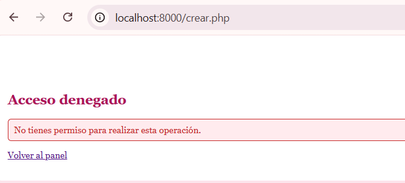

---

## Pruebas 9 y 10 — El endpoint y su formato JSON
🌸🌸🌸🌷🌸🌸💐🌸🌸🌷🌸🌸💐💐

**Qué hice:** abrí el endpoint con la sesión iniciada y usé la lista, que lo consume con Fetch.

**Resultado esperado:** el mismo formato JSON de la Semana 10 y la lista funcionando sin cambiar `listar.js`.

**Resultado obtenido:** el endpoint respondió con `ok`, `puedeAdministrar`, `total` y `datos`, sin HTML ni correos, y la tabla se cargó y se actualizó con el botón "Actualizar lista". Sin sesión sigue respondiendo `401` en JSON.

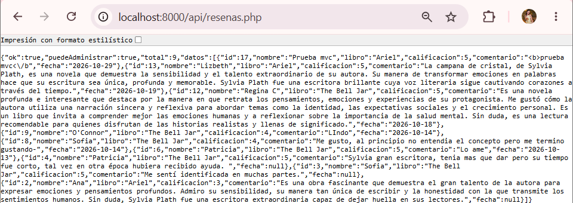
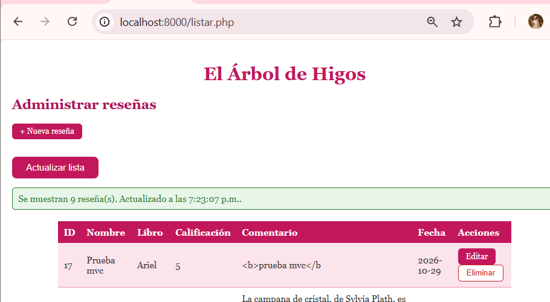

---

## Prueba 11 — Cerrar sesión y acceso directo
🌸🌸🌸🌷🌸🌸💐🌸🌸🌷🌸🌸💐💐

**Qué hice:** cerré sesión y escribí la dirección de una página privada.

**Resultado obtenido:** me mandó al login con el aviso de que debo iniciar sesión.

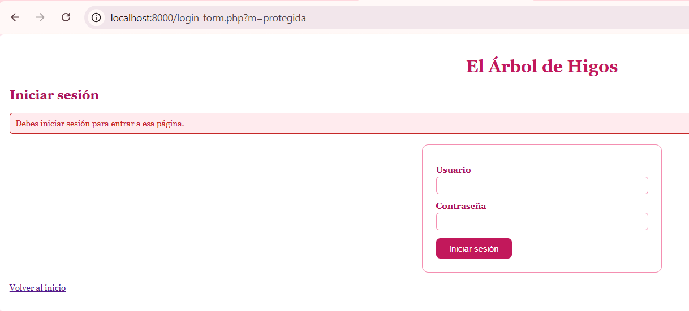

---

## Prueba 12 — Errores de PHP y del navegador
🌸🌸🌸🌷🌸🌸💐🌸🌸🌷🌸🌸💐💐

**Qué hice:** revisé la consola del navegador y el registro del servidor mientras usaba el módulo.

**Resultado obtenido:** sin errores en el uso normal. Los mensajes que aparecen en las pruebas de fallo son los que el código deja a propósito, sin datos sensibles.

---

## Prueba 13 — Comparación antes y después
🌸🌸🌸🌷🌸🌸💐🌸🌸🌷🌸🌸💐💐

| Función | Antes | Después |
|---|---|---|
| Lista del administrador con Fetch | Funciona; SQL dentro del endpoint | Funciona igual; SQL en el modelo |
| Página pública de reseñas | Funciona; SQL y HTML en el mismo archivo | Funciona igual; SQL en el modelo y HTML en la vista |
| Formato del JSON | `ok`, `puedeAdministrar`, `total`, `datos` | Idéntico |
| Roles y permisos | Comprobados en cada archivo | Idénticos |
| Consulta duplicada | En dos archivos | Una sola vez, en el modelo |

---
