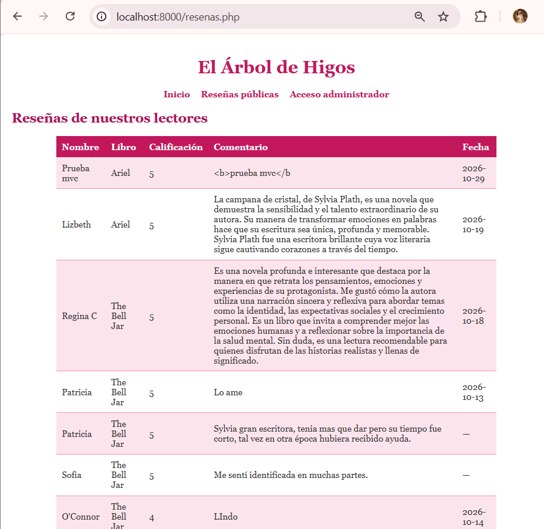
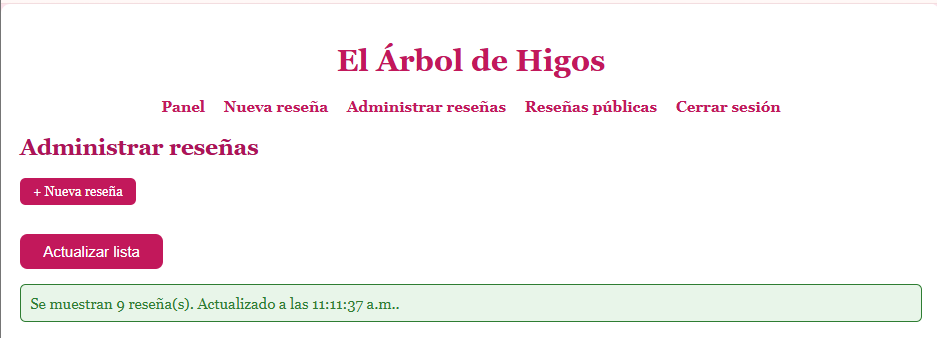
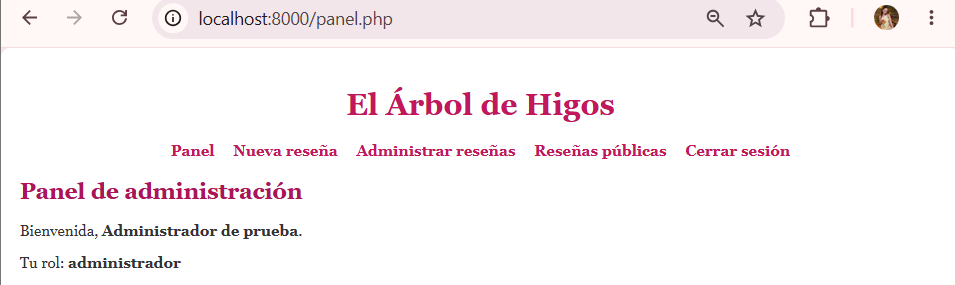
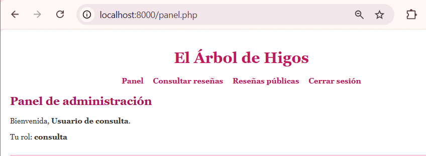
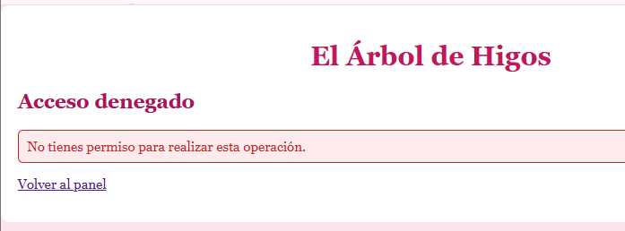
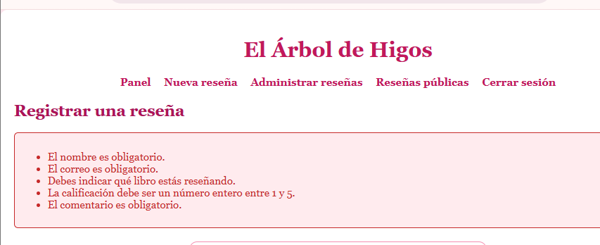
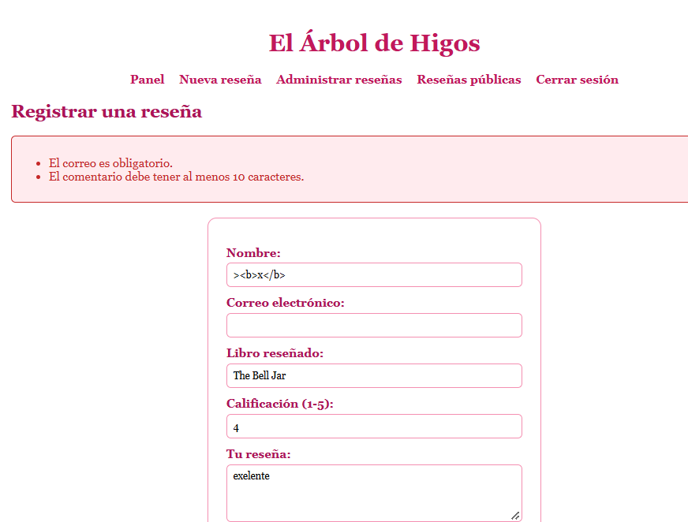
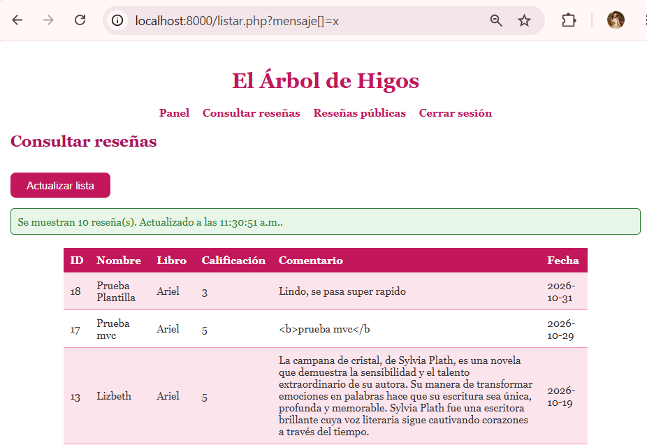
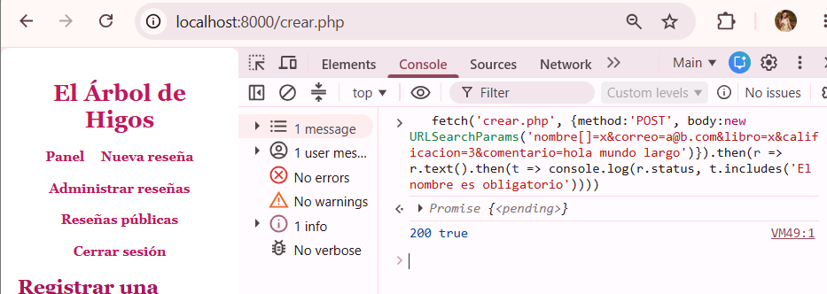
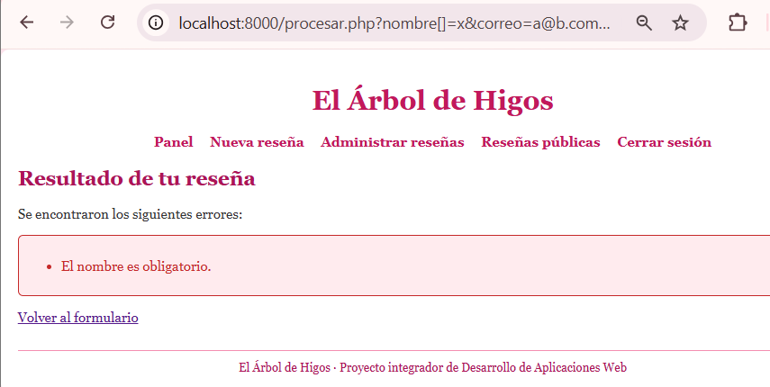

<table style="width:100%; border:none; margin-bottom:20px;">
<tr>
<td width="120" align="center" style="border:none;">

</td>
<td align="right" style="border:none; padding: 20px 10px;">
<h1 style="color:#c2185b; font-family: Georgia, serif; letter-spacing: 2px; margin-bottom:5px;"> 💐💐💐💐 ÁRBOL DE HIGOS 💐💐💐💐</h1>
<p style="color:#ad1457; font-style: italic; font-size: 15px; margin:0;">Semana 12 — Componentes y plantillas</p>
<p style="color:#e91e8c; font-size: 13px; margin:0;">Desarrollo de Aplicaciones Web</p>
</td>
</tr>
</table>

<br>

<table style="width:100%; border-collapse: collapse;">
<tr style="background-color:#c2185b; color:#ffffff;">
<td style="padding:8px;"><b>Alumna</b></td>
<td style="padding:8px;">Patricia Segura Resendiz</td>
</tr>
<tr style="background-color:#fce4ec;">
<td style="padding:8px;"><b>Institución</b></td>
<td style="padding:8px;">Instituto Tecnológico Superior de Rioverde</td>
</tr>
<tr style="background-color:#c2185b; color:#ffffff;">
<td style="padding:8px;"><b>Carrera</b></td>
<td style="padding:8px;">Ingeniería en Sistemas Computacionales</td>
</tr>
<tr style="background-color:#fce4ec;">
<td style="padding:8px;"><b>Docente</b></td>
<td style="padding:8px;">Ing. José de Jesús Collazo Reyes</td>
</tr>
<tr style="background-color:#c2185b; color:#ffffff;">
<td style="padding:8px;"><b>Entorno</b></td>
<td style="padding:8px;">WampServer · Apache 2.4.59 · PHP 8.2.18 · MySQL 8.0.42</td>
</tr>
</table>

<br>

<h2 style="color:#c2185b; border-bottom: 3px solid #f48fb1; padding-bottom: 6px;">🌸🌸🌸🌸🌷🌸🌸💐🌸🌸🌷🌸🌸💐💐
Objetivo</h2>

<blockquote style="border-left: 4px solid #f48fb1; background:#fff0f5; padding: 10px 15px; color:#333;">
Dejar de copiar el encabezado, el menú, los mensajes y el pie en cada página, y ponerlos en un solo lugar: una plantilla general y componentes reutilizables que mantengan la misma apariencia, y un menú que cambie según el rol, sin debilitar nada de lo anterior (MVC, Fetch, login y permisos).
</blockquote>

<br>

<h2 style="color:#c2185b; border-bottom: 3px solid #f48fb1; padding-bottom: 6px;">🌷🌸🌸🌸🌷🌸🌸💐🌸🌸🌷🌸🌸💐💐
 Punto de partida y análisis</h2>

<blockquote style="border-left: 4px solid #f48fb1; background:#fff0f5; padding: 10px 15px; color:#333;">
Copié la Semana 11 a <code>semana12</code> y comprobé que todo funcionara antes de empezar. Después revisé mis páginas para encontrar qué se repetía y lo documenté en <code>analisis_componentes.md</code>: la estructura del documento y el encabezado estaban copiados en todas las páginas; el menú solo existía en dos (las demás tenían enlaces sueltos y distintos); los mensajes de éxito y de error estaban escritos de forma diferente en cada página; no existía un pie de página; y los campos de formulario se repetían en el alta y en la edición.
</blockquote>

<div align="center">

<p style="color:#c2185b; font-style:italic; font-size:13px;">Proyecto funcionando antes de empezar</p>
</div>

<br>

<h2 style="color:#c2185b; border-bottom: 3px solid #f48fb1; padding-bottom: 6px;">💗🌸🌸🌸🌷🌸🌸💐🌸🌸🌷🌸🌸💐💐
 La plantilla</h2>

<table style="width:100%; border-collapse: collapse;">
<tr style="background-color:#c2185b; color:#ffffff;"><th style="padding:8px; text-align:left;">Archivo</th><th style="padding:8px; text-align:left;">Qué hace</th></tr>
<tr style="background-color:#fce4ec;"><td style="padding:8px;"><code>layouts/header.php</code></td><td style="padding:8px;">Inicia la sesión, abre el documento, enlaza el CSS y muestra el título y el menú</td></tr>
<tr style="background-color:#ffffff;"><td style="padding:8px;"><code>layouts/menu.php</code></td><td style="padding:8px;">Menú que cambia según la sesión y el rol</td></tr>
<tr style="background-color:#fce4ec;"><td style="padding:8px;"><code>layouts/mensajes.php</code></td><td style="padding:8px;">Funciones <code>mostrarMensaje()</code> y <code>mostrarErrores()</code></td></tr>
<tr style="background-color:#ffffff;"><td style="padding:8px;"><code>layouts/footer.php</code></td><td style="padding:8px;">Pie de página y carga de los scripts de la página</td></tr>
<tr style="background-color:#fce4ec;"><td style="padding:8px;"><code>componentes/campo.php</code></td><td style="padding:8px;">Funciones <code>campoFormulario()</code> y <code>campoAreaTexto()</code></td></tr>
<tr style="background-color:#ffffff;"><td style="padding:8px;"><code>helpers/entrada.php</code></td><td style="padding:8px;">Lectura segura de los datos recibidos</td></tr>
</table>

<blockquote style="border-left: 4px solid #f48fb1; background:#fff0f5; padding: 10px 15px; color:#333; margin-top:10px;">
Cada página incluye <code>header.php</code> y <code>footer.php</code> y escribe su contenido entre los dos. Elegí este esquema, en lugar de una plantilla que recibe el nombre de la vista, porque así <b>ninguna ruta de <code>require</code> depende de un dato externo</b>: todos los nombres de archivo los escribo yo en el código. La página define <code>$tituloPagina</code> y, si lo necesita, <code>$scripts</code>.
</blockquote>

```php
<?php
require_once "autorizacion.php";

$tituloPagina = "Panel";
require __DIR__ . "/app/views/layouts/header.php";
?>

        <h2>Panel de administración</h2>
        ...

<?php require __DIR__ . "/app/views/layouts/footer.php"; ?>
```

<div align="center">
<table style="width:100%;">
<tr>
<td align="center" width="50%"><p style="font-size:12px; color:#c2185b;">Página pública, sin sesión</p></td>
<td align="center" width="50%"><p style="font-size:12px; color:#c2185b;">Lista del administrador</p></td>
</tr>
</table>
</div>

<br>

<h2 style="color:#c2185b; border-bottom: 3px solid #f48fb1; padding-bottom: 6px;">🌺🌸🌸🌸🌷🌸🌸💐🌸🌸🌷🌸🌸💐💐
 Menú según el rol</h2>

<table style="width:100%; border-collapse: collapse;">
<tr style="background-color:#c2185b; color:#ffffff;"><th style="padding:8px; text-align:left;">Estado</th><th style="padding:8px; text-align:left;">Opciones</th></tr>
<tr style="background-color:#fce4ec;"><td style="padding:8px;">Sin sesión</td><td style="padding:8px;">Inicio, Reseñas públicas, Acceso administrador</td></tr>
<tr style="background-color:#ffffff;"><td style="padding:8px;"><code>administrador</code></td><td style="padding:8px;">Panel, Nueva reseña, Administrar reseñas, Reseñas públicas, Cerrar sesión</td></tr>
<tr style="background-color:#fce4ec;"><td style="padding:8px;"><code>consulta</code></td><td style="padding:8px;">Panel, Consultar reseñas, Reseñas públicas, Cerrar sesión</td></tr>
</table>

<blockquote style="border-left: 4px solid #f48fb1; background:#fff0f5; padding: 10px 15px; color:#333; margin-top:10px;">
El menú mejora la experiencia, pero <b>no es una barrera</b>. Lo comprobé: con la cuenta de consulta escribí la dirección de <code>crear.php</code>, que no aparece en su menú, y el servidor siguió respondiendo "Acceso denegado". Cada página protegida sigue comprobando sesión y rol por su cuenta.
</blockquote>

<div align="center">
<table style="width:100%;">
<tr>
<td align="center" width="33%"><p style="font-size:12px; color:#c2185b;">Menú del administrador</p></td>
<td align="center" width="33%"><p style="font-size:12px; color:#c2185b;">Menú de consulta</p></td>
<td align="center" width="33%"><p style="font-size:12px; color:#a33a2e;">Sigue denegado por la dirección</p></td>
</tr>
</table>
</div>

<br>

<h2 style="color:#c2185b; border-bottom: 3px solid #f48fb1; padding-bottom: 6px;">💕🌸🌸🌸🌷🌸🌸💐🌸🌸🌷🌸🌸💐💐
 Mensajes y campos reutilizables</h2>

<blockquote style="border-left: 4px solid #f48fb1; background:#fff0f5; padding: 10px 15px; color:#333;">
<b>Mensajes.</b> El componente solo acepta los tipos <code>exito</code>, <code>error</code> y <code>advertencia</code>; un tipo desconocido se trata como error y nunca se imprime tal cual, y el texto siempre se escapa. Así los avisos se ven igual en todas las páginas y ninguno puede mostrar consultas, rutas o contraseñas.
<br><br>
<b>Campos de formulario.</b> <code>campoFormulario()</code> genera la etiqueta y el campo con el valor ya escapado, y solo acepta los tipos <code>text</code>, <code>email</code> y <code>number</code>. Dejé el campo de contraseña del login escrito a mano a propósito: un componente que escribiera un campo de contraseña con su valor de vuelta sería una mala idea. Ningún componente ejecuta consultas SQL.
</blockquote>

<div align="center">
<table style="width:100%;">
<tr>
<td align="center" width="50%"><p style="font-size:12px; color:#a33a2e;">Errores de validación con el componente</p></td>
<td align="center" width="50%"><p style="font-size:12px; color:#c2185b;">Un valor con HTML se ve como texto</p></td>
</tr>
</table>
</div>

<br>

<h2 style="color:#c2185b; border-bottom: 3px solid #f48fb1; padding-bottom: 6px;">🌸🌸🌸🌸🌷🌸🌸💐🌸🌸🌷🌸🌸💐💐
 Integración con MVC y Fetch</h2>

<blockquote style="border-left: 4px solid #f48fb1; background:#fff0f5; padding: 10px 15px; color:#333;">
El <b>endpoint JSON no usa la plantilla</b>: si incluyera el encabezado HTML, <code>listar.js</code> no podría leerlo. Lo comprobé abriendo el endpoint y con <code>grep</code>, que confirmó que ni el endpoint, ni el controlador, ni el modelo mencionan los archivos de <code>layouts</code>. La vista de reseñas públicas sí usa la plantilla, y el controlador y el modelo siguen sin conocer nada de HTML.
</blockquote>

<div align="center">

<p style="color:#c2185b; font-style:italic; font-size:13px;">El endpoint sigue respondiendo solo JSON</p>
</div>

<br>

<h2 style="color:#c2185b; border-bottom: 3px solid #f48fb1; padding-bottom: 6px;">🌷🌸🌸🌸🌷🌸🌸💐🌸🌸🌷🌸🌸💐💐
 Páginas migradas y pendientes</h2>

<table style="width:100%; border-collapse: collapse;">
<tr style="background-color:#c2185b; color:#ffffff;"><th style="padding:8px; text-align:left;">Página</th><th style="padding:8px; text-align:left;">Estado</th></tr>
<tr style="background-color:#fce4ec;"><td style="padding:8px;"><code>panel.php</code>, <code>listar.php</code>, <code>crear.php</code>, <code>editar.php</code>, <code>login_form.php</code>, <code>procesar.php</code>, vista de reseñas públicas</td><td style="padding:8px;">Usan la plantilla (siete páginas)</td></tr>
<tr style="background-color:#ffffff;"><td style="padding:8px;"><code>api/resenas.php</code></td><td style="padding:8px;">Fuera a propósito: responde JSON</td></tr>
<tr style="background-color:#fce4ec;"><td style="padding:8px;"><code>index.php</code></td><td style="padding:8px;">Pendiente: <code>script.js</code> busca el título por su <code>id</code> y cambiarlo sin cuidado podría romper el saludo</td></tr>
<tr style="background-color:#ffffff;"><td style="padding:8px;">"Acceso denegado" de <code>autorizacion.php</code></td><td style="padding:8px;">Pendiente: escribe su propio HTML</td></tr>
</table>

<br>

<h2 style="color:#c2185b; border-bottom: 3px solid #f48fb1; padding-bottom: 6px;">💐🌸🌸🌸🌷🌸🌸💐🌸🌸🌷🌸🌸💐💐
 Archivos creados o modificados</h2>

<blockquote style="border-left: 4px solid #f48fb1; background:#fff0f5; padding: 10px 15px; color:#333;">
<b>Nuevos:</b> los cuatro archivos de <code>layouts</code>, <code>componentes/campo.php</code>, <code>helpers/entrada.php</code>, <code>analisis_componentes.md</code> y <code>pruebas_plantilla.md</code>.
<br><br>
<b>Modificados:</b> <code>panel.php</code>, <code>listar.php</code>, <code>crear.php</code>, <code>editar.php</code>, <code>login_form.php</code>, <code>procesar.php</code>, <code>app/views/resenas/publicas.php</code> y <code>estilos.css</code> (estilos del pie y de los mensajes de advertencia).
</blockquote>

<br>

<h2 style="color:#c2185b; border-bottom: 3px solid #f48fb1; padding-bottom: 6px;">🌺🌸🌸🌸🌷🌸🌸💐🌸🌸🌷🌸🌸💐💐
 Tablas de la base de datos</h2>

<blockquote style="border-left: 4px solid #f48fb1; background:#fff0f5; padding: 10px 15px; color:#333;">
Solo <code>resenas</code> y <code>usuarios</code> (para el login). No cambié ninguna estructura.
</blockquote>

<br>

<h2 style="color:#c2185b; border-bottom: 3px solid #f48fb1; padding-bottom: 6px;">💕 Pruebas realizadas</h2>

<blockquote style="border-left: 4px solid #f48fb1; background:#fff0f5; padding: 10px 15px; color:#333;">
Hice las 14 pruebas de la guía: abrir varias páginas con la plantilla, comprobar encabezado, menú y pie, los estilos, el menú según el rol, los mensajes de éxito y de error, las vistas, el Fetch, que el endpoint no devuelva HTML, la ruta protegida sin sesión, la acción restringida sin permiso, la consola y que las funciones principales sigan operando. El detalle con sus capturas está en <code>pruebas_plantilla.md</code>.
</blockquote>

<br>

<h2 style="color:#c2185b; border-bottom: 3px solid #f48fb1; padding-bottom: 6px;">🌷🌸🌸🌸🌷🌸🌸💐🌸🌸🌷🌸🌸💐💐
 Errores encontrados</h2>

<table style="width:100%; border-collapse: collapse;">
<tr style="background-color:#fce4ec;"><td style="padding:8px;"><b>Error 1 — Qué ocurrió</b></td><td style="padding:8px;">Al reescribir <code>listar.php</code> y <code>login_form.php</code> vi que hacían <code>array_key_exists($_GET["mensaje"], ...)</code>. Una dirección como <code>?mensaje[]=x</code> provoca un error fatal en PHP 8.</td></tr>
<tr style="background-color:#ffffff;"><td style="padding:8px;"><b>Causa</b></td><td style="padding:8px;">El valor de la URL puede ser un arreglo y no un texto, y yo daba por hecho que era texto.</td></tr>
<tr style="background-color:#fce4ec;"><td style="padding:8px;"><b>Solución</b></td><td style="padding:8px;">Comprobar con <code>is_string()</code> antes de usarlo. Lo verifiqué abriendo la dirección con el arreglo.</td></tr>
<tr style="background-color:#ffffff;"><td colspan="2" style="padding:4px;"></td></tr>
<tr style="background-color:#fce4ec;"><td style="padding:8px;"><b>Error 2 — Qué ocurrió</b></td><td style="padding:8px;"><code>procesar.php</code>, <code>crear.php</code> y <code>editar.php</code> hacían <code>trim($_POST["nombre"])</code>. Un envío como <code>nombre[]=x</code> provoca un error fatal que muestra datos técnicos.</td></tr>
<tr style="background-color:#ffffff;"><td style="padding:8px;"><b>Causa</b></td><td style="padding:8px;">Igual: el dato puede no ser texto. Ese fallo existía desde la Semana 06 y mi auditoría de la Semana 08 no lo vio, porque revisé consultas y salida HTML, pero no qué pasa cuando un dato llega con un tipo inesperado.</td></tr>
<tr style="background-color:#fce4ec;"><td style="padding:8px;"><b>Solución</b></td><td style="padding:8px;">Un ayudante, <code>textoDato()</code> / <code>textoPost()</code>, que trata cualquier cosa que no sea texto como vacío; así PHP responde con el mensaje de validación normal.</td></tr>
</table>

<div align="center">
<table style="width:100%;">
<tr>
<td align="center" width="33%"><p style="font-size:12px; color:#c2185b;">Aviso como arreglo, ya sin error</p></td>
<td align="center" width="33%"><p style="font-size:12px; color:#c2185b;">Valor que no es texto en un formulario</p></td>
<td align="center" width="33%"><p style="font-size:12px; color:#c2185b;">Lo mismo en procesar.php</p></td>
</tr>
</table>
</div>

<p style="color:#c2185b; font-size:13px;">[Patricia: si tuviste algún otro problema real esta semana (una ruta mal escrita, una página en blanco, un menú que no cambiaba), agrégalo aquí con el formato: qué ocurrió, causa, solución. Si no lo hubo, borra este recuadro.]</p>

<br>

<h2 style="color:#c2185b; border-bottom: 3px solid #f48fb1; padding-bottom: 6px;">💗🌸🌸🌸🌷🌸🌸💐🌸🌸🌷🌸🌸💐💐
 Limitaciones</h2>

<blockquote style="border-left: 4px solid #f48fb1; background:#fff0f5; padding: 10px 15px; color:#333;">
<code>index.php</code> y la página de "Acceso denegado" aún no usan la plantilla. La comprobación de rol sigue duplicada entre <code>autorizacion.php</code> y <code>autorizacion_json.php</code>. Los pendientes de seguridad de la Semana 08 (token CSRF y límite de intentos del login) siguen sin hacerse.
</blockquote>

<br>

<h2 style="color:#c2185b; border-bottom: 3px solid #f48fb1; padding-bottom: 6px;">🌸🌸🌸🌸🌷🌸🌸💐🌸🌸🌷🌸🌸💐💐
 Reflexión final</h2>

<p style="color:#c2185b; font-size:13px;">[Durante esta actividad aprendí que tener el encabezado y el menú en un solo lugar facilita mucho la organización del proyecto, porque permite reutilizarlos en todas las páginas sin tener que escribir el mismo código varias veces. También entendí que el menú solo sirve para facilitar la navegación, pero no sustituye la comprobación del servidor, ya que es necesario verificar que el usuario tenga permiso para acceder a cada sección. El endpoint no utiliza la plantilla porque su función es responder directamente con datos, sin mostrar una página visual en HTML. Por último, los dos errores que encontré al reescribir las páginas me enseñaron que debo revisar cuidadosamente las rutas, los nombres de los archivos y la forma en que incluyo los componentes, porque un pequeño error puede provocar que una página no funcione correctamente.</p>

<br>