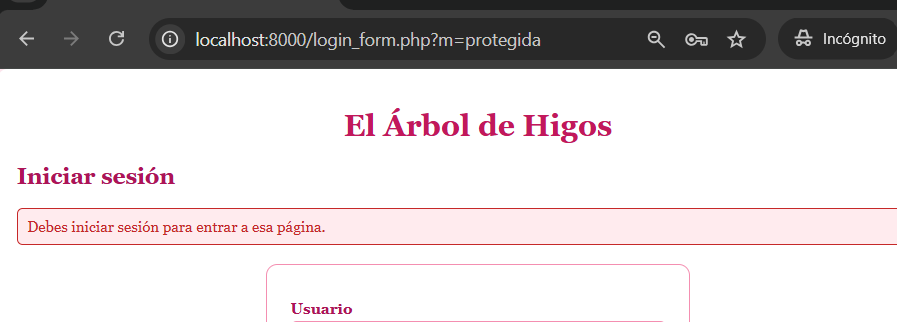
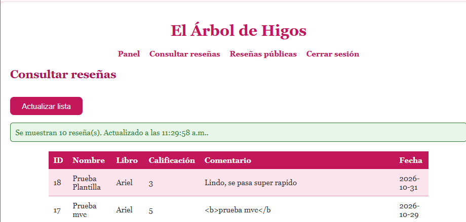
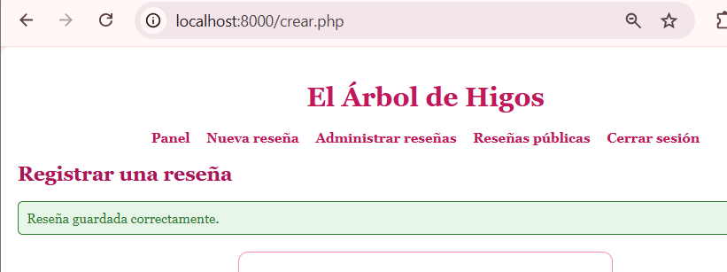
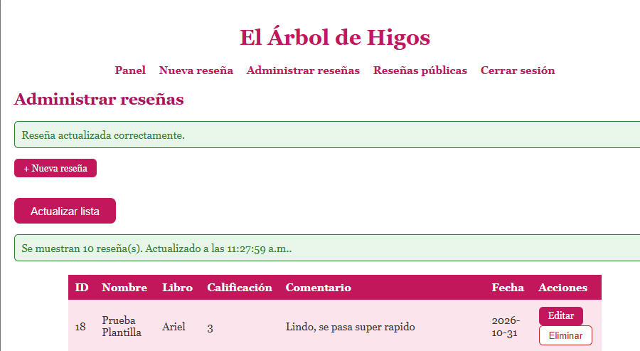
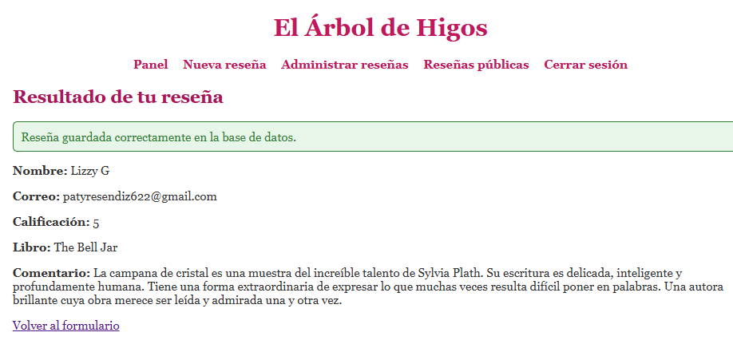

# Pruebas de la plantilla y los componentes — Semana 12

**Proyecto:**💐💐💐💐 El Árbol de Higos 💐💐💐💐
**Alumna:** Patricia Segura Resendiz

Las pruebas se hicieron sobre la aplicación real, con el servidor de PHP corriendo desde `semana12` y las cuentas de demostración `admin_prueba` y `consulta_prueba`. Las pruebas sin sesión se hicieron en una ventana de incógnito.

## Páginas que usan la plantilla 
🌸🌸🌸🌷🌸🌸💐🌸🌸🌷🌸🌸💐💐

`panel.php`, `listar.php`, `crear.php`, `editar.php`, `login_form.php`, `procesar.php` y la vista de reseñas públicas (`app/views/resenas/publicas.php`).

**Fuera de la plantilla, a propósito:**

| Archivo | Por qué |
|---|---|
| `api/resenas.php` | Responde JSON; el encabezado HTML lo rompería |
| `index.php` | Su script (`script.js`) busca el título por su `id`; queda pendiente migrarlo con cuidado |
| La página de "Acceso denegado" de `autorizacion.php` | Escribe su propio HTML; queda pendiente |

---

## Resumen 
🌸🌸🌸🌷🌸🌸💐🌸🌸🌷🌸🌸💐💐

| N.º | Prueba | Resultado |
|---:|---|---|
| 1 | Abrir varias páginas que usan la plantilla | Correcta |
| 2 | Encabezado, menú y pie se muestran correctamente | Correcta |
| 3 | Los estilos se cargan | Correcta |
| 4 | Navegar entre los módulos | Correcta |
| 5 | Iniciar sesión con una cuenta de demostración | Correcta |
| 6 | El menú respeta el rol | Correcta |
| 7 | Mensajes de éxito y de error | Correcta |
| 8 | Las vistas muestran los datos correctamente | Correcta |
| 9 | Ejecutar la operación que usa Fetch | Correcta |
| 10 | El endpoint JSON no devuelve HTML accidental | Correcta |
| 11 | Ruta protegida sin sesión | Correcta |
| 12 | Acción restringida con una cuenta sin permiso | Correcta |
| 13 | Revisar la consola y los errores de PHP | Correcta |
| 14 | Las funciones principales siguen operando | Correcta |

---

## Pruebas 1, 2 y 3 — Páginas, estructura y estilos

🌸🌸🌸🌷🌸🌸💐🌸🌸🌷🌸🌸💐
**Qué hice:** abrí varias páginas que usan la plantilla, con y sin sesión.

**Resultado esperado:** todas muestran el mismo encabezado, menú y pie, con el mismo estilo.

**Resultado obtenido:** la página pública, el panel, la lista y el formulario de acceso comparten el encabezado con el nombre de la tienda, el menú, el contenido y el pie. Los estilos cargan en todas, porque el enlace a `estilos.css` está en un solo lugar (`header.php`).

---

## Pruebas 4, 5 y 6 — Navegación, login y menú según el rol 
🌸🌸🌸🌷🌸🌸💐🌸🌸🌷🌸🌸💐💐

**Qué hice:** inicié sesión con las dos cuentas y recorrí el menú.

**Resultado esperado:** el menú cambia según la sesión y el rol.

| Estado | Opciones del menú |
|---|---|
| Sin sesión | Inicio, Reseñas públicas, Acceso administrador |
| `administrador` | Panel, Nueva reseña, Administrar reseñas, Reseñas públicas, Cerrar sesión |
| `consulta` | Panel, Consultar reseñas, Reseñas públicas, Cerrar sesión |

**Resultado obtenido:** el menú se comportó como en la tabla. La lista de la cuenta de consulta no muestra la columna de acciones ni "+ Nueva reseña".

---

## Prueba 7 — Mensajes de éxito y de error

🌸🌸🌸🌷🌸🌸💐🌸🌸🌷🌸🌸💐💐

**Qué hice:** provoqué mensajes de éxito, de validación y de fallo.

**Resultado obtenido:** todos usan el componente de mensajes, con tipos permitidos (`exito`, `error`, `advertencia`) y el texto siempre escapado. Un tipo desconocido se trata como error y nunca se imprime tal cual.

---

## Prueba 8 — Las vistas muestran los datos correctamente 
🌸🌸🌸🌷🌸🌸💐🌸🌸🌷🌸🌸💐💐

**Qué hice:** revisé la lista y el formulario de edición.

**Resultado obtenido:** el formulario de edición trae los valores actuales de la reseña, y los campos se generan con el componente `campoFormulario()`, que escapa cada valor. Probé escribir `"><b>x</b>` en el nombre: el campo muestra ese texto literal y no rompe el formulario.

---

## Pruebas 9 y 10 — Fetch y endpoint JSON 
🌸🌸🌸🌷🌸🌸💐🌸🌸🌷🌸🌸💐💐

**Qué hice:** usé "Actualizar lista" y abrí el endpoint directamente con sesión.

**Resultado esperado:** la lista se actualiza con Fetch, y el endpoint responde JSON puro.

**Resultado obtenido:** el endpoint sigue respondiendo únicamente JSON, sin encabezado ni menú. Además comprobé con `grep` que ni el endpoint, ni el controlador, ni el modelo mencionan la plantilla.

---

## Pruebas 11 y 12 — Sin sesión y sin permiso

🌸🌸🌸🌷🌸🌸💐🌸🌸🌷🌸🌸💐💐

**Qué hice:** abrí `listar.php` sin sesión, y `crear.php` con la cuenta de consulta.

**Resultado obtenido:** sin sesión me mandó al login con el aviso de que debo iniciar sesión. Con la cuenta de consulta salió "Acceso denegado", aunque el enlace a "Nueva reseña" ya no aparece en su menú. El menú es solo comodidad: la autorización la sigue imponiendo el servidor.

---

## Pruebas 13 y 14 — Errores y funciones principales 
🌸🌸🌸🌷🌸🌸💐🌸🌸🌷🌸🌸💐💐

**Qué hice:** revisé la consola del navegador y probé las funciones principales con la plantilla: login, lista con Fetch, alta, edición y la página pública.

**Resultado obtenido:** sin errores en el uso normal. El CRUD, el login y los roles siguen funcionando igual que antes de usar la plantilla.

---

## Errores encontrados al reescribir las páginas

🌸🌸🌸🌷🌸🌸💐🌸🌸🌷🌸🌸💐💐

Al reescribir las páginas para usar la plantilla encontré dos fallos que ya existían en mi código y que habían pasado todas las revisiones anteriores:

| Fallo | Causa | Corrección |
|---|---|---|
| `listar.php` y `login_form.php` hacían `array_key_exists($_GET["mensaje"], ...)`. Una dirección como `?mensaje[]=x` provoca un error fatal en PHP 8 | El valor de la URL puede ser un arreglo y no un texto | Comprobar con `is_string()` antes de usarlo |
| `procesar.php`, `crear.php` y `editar.php` hacían `trim($_POST["nombre"])`. Un envío como `nombre[]=x` provoca un error fatal que muestra datos técnicos | Mismo problema: el dato puede no ser texto | Ayudante `textoDato()` / `textoPost()`, que trata cualquier cosa que no sea texto como vacío |

Comprobé las dos correcciones con las pruebas correspondientes. 

Estos fallos pasaron desapercibidos en la auditoría de la Semana 08, porque revisé consultas y salida HTML pero no qué pasa cuando un dato llega con un tipo inesperado.
