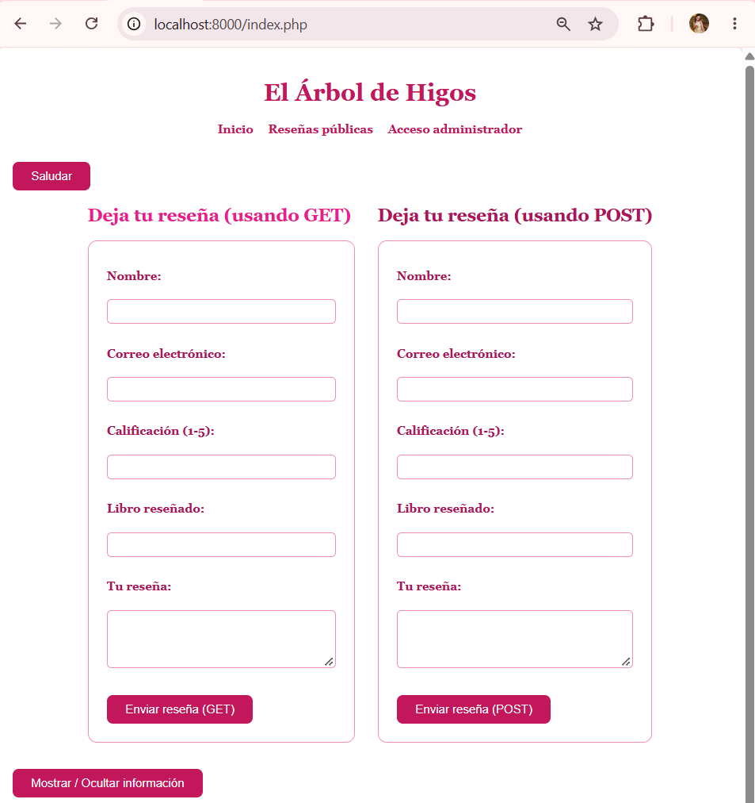
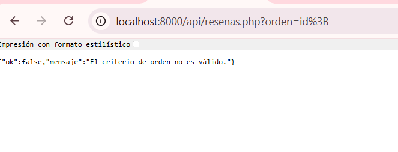
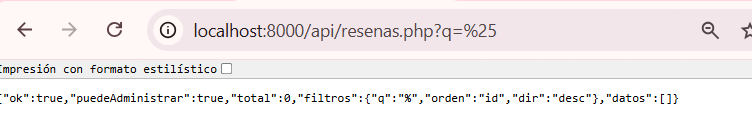
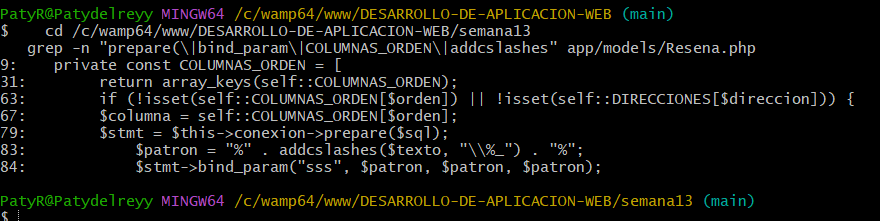
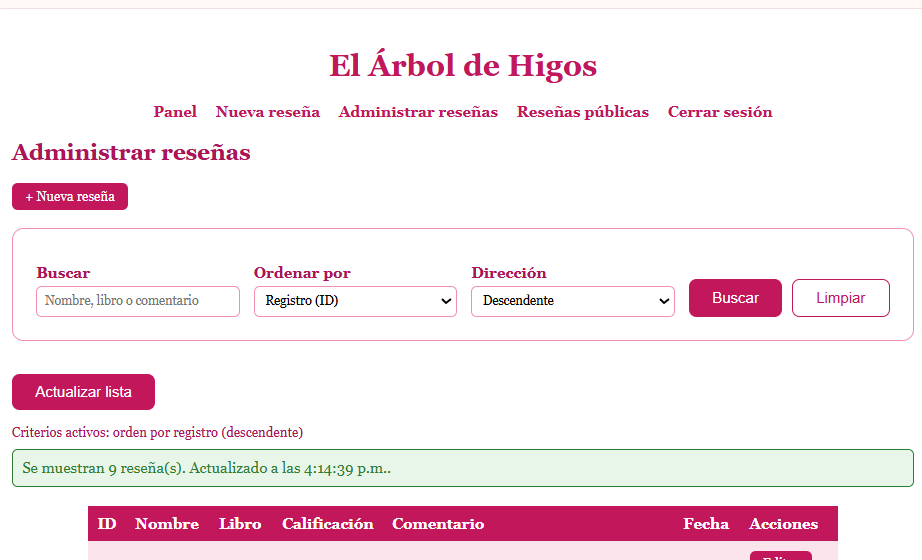
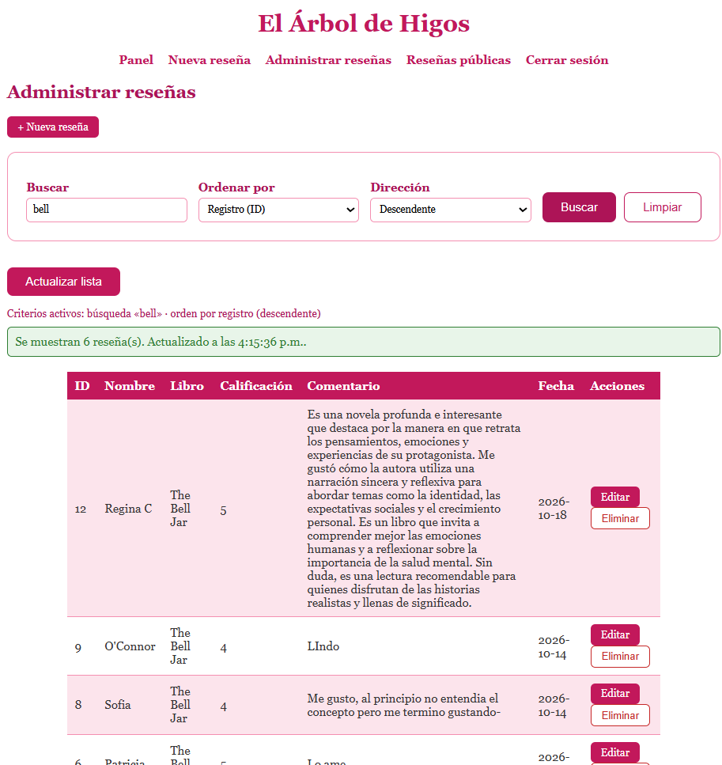
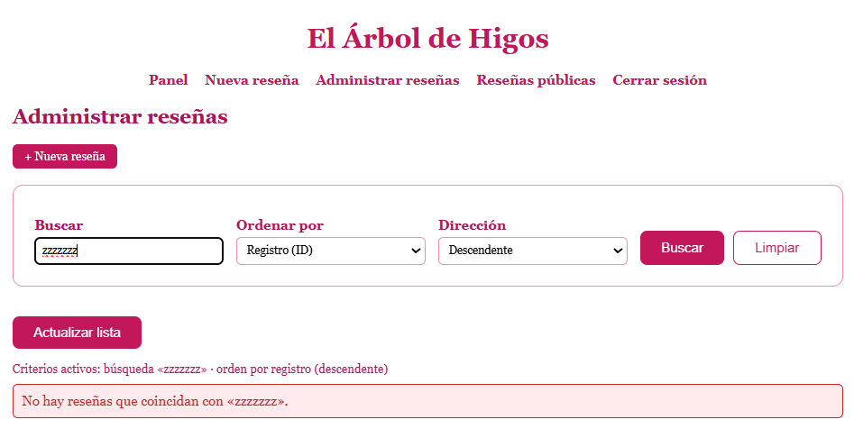
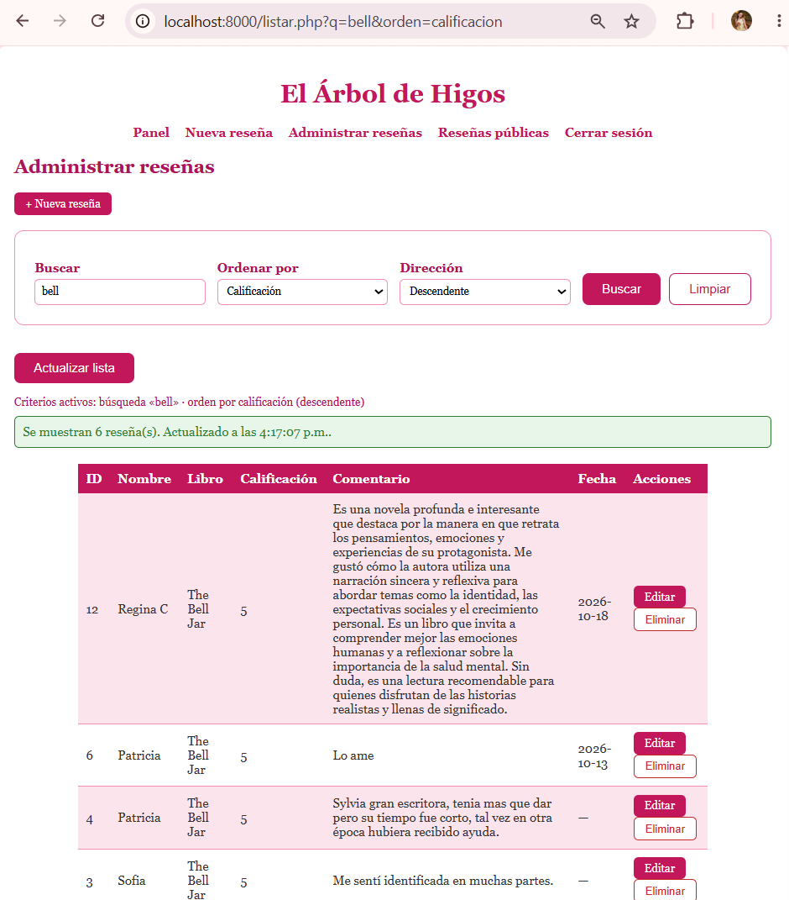
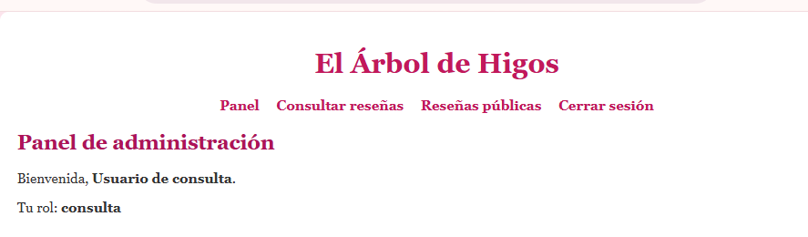
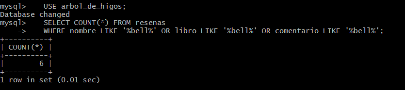

<table style="width:100%; border:none; margin-bottom:20px;">
<tr>
<td width="120" align="center" style="border:none;">

</td>
<td align="right" style="border:none; padding: 20px 10px;">
<h1 style="color:#c2185b; font-family: Georgia, serif; letter-spacing: 2px; margin-bottom:5px;">EL ÁRBOL DE HIGOS</h1>
<p style="color:#ad1457; font-style: italic; font-size: 15px; margin:0;">Semana 13 — Funciones avanzadas</p>
<p style="color:#e91e8c; font-size: 13px; margin:0;">Desarrollo de Aplicaciones Web</p>
</td>
</tr>
</table>

<br>

<table style="width:100%; border-collapse: collapse;">
<tr style="background-color:#c2185b; color:#ffffff;">
<td style="padding:8px;"><b>Alumna</b></td>
<td style="padding:8px;">Patricia Segura Resendiz</td>
</tr>
<tr style="background-color:#fce4ec;">
<td style="padding:8px;"><b>Institución</b></td>
<td style="padding:8px;">Instituto Tecnológico Superior de Rioverde</td>
</tr>
<tr style="background-color:#c2185b; color:#ffffff;">
<td style="padding:8px;"><b>Carrera</b></td>
<td style="padding:8px;">Ingeniería en Sistemas Computacionales</td>
</tr>
<tr style="background-color:#fce4ec;">
<td style="padding:8px;"><b>Docente</b></td>
<td style="padding:8px;">Ing. José de Jesús Collazo Reyes</td>
</tr>
<tr style="background-color:#c2185b; color:#ffffff;">
<td style="padding:8px;"><b>Entorno</b></td>
<td style="padding:8px;">WampServer · Apache 2.4.59 · PHP 8.2.18 · MySQL 8.0.42</td>
</tr>
</table>

<br>

<h2 style="color:#c2185b; border-bottom: 3px solid #f48fb1; padding-bottom: 6px;">🌸🌸🌸🌸🌷🌸🌸💐🌸🌸🌷 Objetivo</h2>

<blockquote style="border-left: 4px solid #f48fb1; background:#fff0f5; padding: 10px 15px; color:#333;">
Agregar a mi tienda una función avanzada que responda a una necesidad real: poder <b>buscar y ordenar</b> las reseñas. La lista crece con cada reseña nueva y antes solo se podía ver completa, sin forma de encontrar una reseña concreta. Y hacerlo sin debilitar nada de lo anterior.
</blockquote>

<br>

<h2 style="color:#c2185b; border-bottom: 3px solid #f48fb1; padding-bottom: 6px;">🌸🌸🌸🌷🌸🌸💐🌸🌸🌷🌸🌸💐💐🌷 Punto de partida</h2>

<blockquote style="border-left: 4px solid #f48fb1; background:#fff0f5; padding: 10px 15px; color:#333;">
Copié la Semana 12 a <code>semana13</code> y comprobé que el login, la lista con Fetch, la plantilla y el CRUD funcionaran antes de empezar. Después documenté el diseño en <code>diseno_funcion.md</code> <b>antes</b> de programar.
</blockquote>

<div align="center">

<p style="color:#c2185b; font-style:italic; font-size:13px;">Proyecto funcionando antes de empezar</p>
</div>

<br>

<h2 style="color:#c2185b; border-bottom: 3px solid #f48fb1; padding-bottom: 6px;">💗🌸🌸🌸🌷🌸🌸💐🌸🌸🌷🌸🌸💐💐 Los parámetros y sus reglas</h2>

<table style="width:100%; border-collapse: collapse;">
<tr style="background-color:#c2185b; color:#ffffff;"><th style="padding:8px; text-align:left;">Parámetro</th><th style="padding:8px; text-align:left;">Regla</th><th style="padding:8px; text-align:left;">Si no se cumple</th></tr>
<tr style="background-color:#fce4ec;"><td style="padding:8px;"><code>q</code></td><td style="padding:8px;">Texto de 0 a 50 caracteres; busca en nombre, libro y comentario</td><td style="padding:8px;">400</td></tr>
<tr style="background-color:#ffffff;"><td style="padding:8px;"><code>orden</code></td><td style="padding:8px;">Solo <code>id</code>, <code>nombre</code>, <code>libro</code>, <code>calificacion</code> o <code>fecha</code></td><td style="padding:8px;">400</td></tr>
<tr style="background-color:#fce4ec;"><td style="padding:8px;"><code>dir</code></td><td style="padding:8px;">Solo <code>asc</code> o <code>desc</code></td><td style="padding:8px;">400</td></tr>
</table>

<blockquote style="border-left: 4px solid #f48fb1; background:#fff0f5; padding: 10px 15px; color:#333; margin-top:10px;">
Un parámetro inválido se <b>rechaza</b> con un 400; no se corrige en silencio. Así la interfaz nunca muestra un resultado que no corresponde a lo que el usuario pidió.
</blockquote>

<br>

<h2 style="color:#c2185b; border-bottom: 3px solid #f48fb1; padding-bottom: 6px;">🌺🌸🌸🌸🌷🌸🌸💐🌸🌸🌷🌸🌸💐💐 Cómo está construida</h2>

<table style="width:100%; border-collapse: collapse;">
<tr style="background-color:#c2185b; color:#ffffff;"><th style="padding:8px; text-align:left;">Pieza</th><th style="padding:8px; text-align:left;">Responsabilidad</th></tr>
<tr style="background-color:#fce4ec;"><td style="padding:8px;">Modelo <code>Resena::buscar()</code></td><td style="padding:8px;">Arma y ejecuta la consulta preparada; vuelve a comprobar el orden</td></tr>
<tr style="background-color:#ffffff;"><td style="padding:8px;">Controlador <code>listarJson()</code></td><td style="padding:8px;">Valida los tres parámetros y responde 400 si algo no cumple</td></tr>
<tr style="background-color:#fce4ec;"><td style="padding:8px;">Endpoint <code>api/resenas.php</code></td><td style="padding:8px;">Comprueba sesión, método y rol, y pasa <code>$_GET</code> al controlador</td></tr>
<tr style="background-color:#ffffff;"><td style="padding:8px;"><code>listar.php</code> y <code>listar.js</code></td><td style="padding:8px;">Formulario de búsqueda y orden; Fetch; tabla con <code>textContent</code></td></tr>
</table>

<blockquote style="border-left: 4px solid #f48fb1; background:#fff0f5; padding: 10px 15px; color:#333; margin-top:10px;">
Construí la función de adentro hacia afuera: primero el modelo y el controlador, que probé directamente en el endpoint, y solo después la interfaz. Así, si algo fallaba, sabía que el problema no era el JavaScript.
</blockquote>

<br>

<h2 style="color:#c2185b; border-bottom: 3px solid #f48fb1; padding-bottom: 6px;">💕🌸🌸🌸🌷🌸🌸💐🌸🌸🌷🌸🌸💐💐 Las decisiones de seguridad</h2>

<blockquote style="border-left: 4px solid #f48fb1; background:#fff0f5; padding: 10px 15px; color:#333;">
<b>El nombre de la columna nunca sale de lo que llega.</b> Los parámetros preparados protegen valores, pero no sirven para el nombre de una columna. Por eso, para ordenar, el usuario solo elige una clave y el servidor la busca en una lista cerrada (<code>COLUMNAS_ORDEN</code>) y usa <b>su propio texto</b>. Un intento como <code>orden=id;--</code> no llega al SQL: se rechaza antes.
<br><br>
<b>El texto buscado va como parámetro.</b> Y se escapan los comodines de <code>LIKE</code> (<code>%</code>, <code>_</code> y <code>\</code>), porque si alguien buscara <code>%</code> y no se escapara, recibiría toda la tabla.
<br><br>
<b>Dos comprobaciones.</b> El controlador valida para responder 400, y el modelo vuelve a comprobar el orden: si algún día alguien reutiliza el modelo sin pasar por el controlador, el modelo no confía.
<br><br>
<b>El navegador limita la búsqueda a 50 caracteres, pero eso no protege.</b> Lo comprobé quitando el límite desde las herramientas de desarrollador: el servidor rechazó la búsqueda igual.
<br><br>
<b>La interfaz muestra los criterios que devolvió el servidor</b>, no lo que escribió el usuario, y el texto buscado se pinta con <code>textContent</code>.
</blockquote>

```php
// El nombre de la columna sale de la lista, nunca de la petición
$columna = self::COLUMNAS_ORDEN[$orden];

// El texto va como parámetro, con los comodines escapados
$patron = "%" . addcslashes($texto, "\\%_") . "%";
$stmt->bind_param("sss", $patron, $patron, $patron);
```

<div align="center">
<table style="width:100%;">
<tr>
<td align="center" width="50%"><p style="font-size:12px; color:#a33a2e;">Orden fuera de la lista, rechazado</p></td>
<td align="center" width="50%"><p style="font-size:12px; color:#c2185b;">El comodín se busca como carácter</p></td>
</tr>
<tr>
<td align="center" width="50%"><p style="font-size:12px; color:#a33a2e;">El servidor valida sin el límite del navegador</p></td>
<td align="center" width="50%"><p style="font-size:12px; color:#c2185b;">Consultas preparadas en el modelo</p></td>
</tr>
</table>
</div>

<br>

<h2 style="color:#c2185b; border-bottom: 3px solid #f48fb1; padding-bottom: 6px;">🌸🌸🌸🌸🌷🌸🌸💐🌸🌸🌷🌸🌸💐💐 La función en funcionamiento</h2>

<div align="center">
<table style="width:100%;">
<tr>
<td align="center" width="50%"><p style="font-size:12px; color:#c2185b;">Formulario de búsqueda y orden</p></td>
<td align="center" width="50%"><p style="font-size:12px; color:#c2185b;">Búsqueda sin recargar la página</p></td>
</tr>
<tr>
<td align="center" width="50%"><p style="font-size:12px; color:#c2185b;">Orden por calificación</p></td>
<td align="center" width="50%"><p style="font-size:12px; color:#c2185b;">Sin resultados</p></td>
</tr>
<tr>
<td align="center" width="50%"><p style="font-size:12px; color:#c2185b;">Los criterios sobreviven a recargar</p></td>
<td align="center" width="50%"><p style="font-size:12px; color:#c2185b;">La cuenta de consulta también puede buscar</p></td>
</tr>
</table>

<p style="color:#c2185b; font-style:italic; font-size:13px;">El total del endpoint coincide con un COUNT directo en MySQL</p>
</div>

<br>

<h2 style="color:#c2185b; border-bottom: 3px solid #f48fb1; padding-bottom: 6px;">🌸🌸🌸🌷🌸🌸💐🌸🌸🌷🌸🌸💐💐🌷 Integración con el resto del proyecto</h2>

<table style="width:100%; border-collapse: collapse;">
<tr style="background-color:#c2185b; color:#ffffff;"><th style="padding:8px; text-align:left;">Parte del proyecto</th><th style="padding:8px; text-align:left;">Cómo se integra</th></tr>
<tr style="background-color:#fce4ec;"><td style="padding:8px;">MVC</td><td style="padding:8px;">La consulta vive en el modelo, la validación en el controlador y el endpoint solo coordina</td></tr>
<tr style="background-color:#ffffff;"><td style="padding:8px;">Plantilla y componentes</td><td style="padding:8px;"><code>listar.php</code> sigue usando el encabezado, el menú y el pie</td></tr>
<tr style="background-color:#fce4ec;"><td style="padding:8px;">Fetch API</td><td style="padding:8px;">La búsqueda reutiliza la misma petición de la lista</td></tr>
<tr style="background-color:#ffffff;"><td style="padding:8px;">Roles y permisos</td><td style="padding:8px;">El endpoint exige sesión y uno de los dos roles; ambos pueden buscar porque es de solo lectura</td></tr>
<tr style="background-color:#fce4ec;"><td style="padding:8px;">Seguridad</td><td style="padding:8px;">Consultas preparadas, lista permitida y salida con <code>textContent</code></td></tr>
</table>

<br>

<h2 style="color:#c2185b; border-bottom: 3px solid #f48fb1; padding-bottom: 6px;">💐🌸🌸🌸🌷🌸🌸💐🌸🌸🌷🌸🌸💐💐 Archivos creados o modificados</h2>

<blockquote style="border-left: 4px solid #f48fb1; background:#fff0f5; padding: 10px 15px; color:#333;">
<b>Modificados:</b> <code>app/models/Resena.php</code>, <code>app/controllers/ResenaController.php</code>, <code>api/resenas.php</code>, <code>listar.php</code>, <code>listar.js</code> y <code>estilos.css</code>.
<br><br>
<b>Nuevos:</b> <code>diseno_funcion.md</code>, <code>pruebas_funcion.md</code>.
<br><br>
<b>Tablas:</b> solo <code>resenas</code>, en modo lectura. No cambié ninguna estructura.
</blockquote>

<br>

<h2 style="color:#c2185b; border-bottom: 3px solid #f48fb1; padding-bottom: 6px;">🌺🌸🌸🌸🌷🌸🌸💐🌸🌸🌷🌸🌸💐💐 Pruebas realizadas</h2>

<blockquote style="border-left: 4px solid #f48fb1; background:#fff0f5; padding: 10px 15px; color:#333;">
Hice las 12 pruebas de la guía: búsqueda con datos válidos, comparación con la base de datos, un criterio sin resultados, parámetros vacíos o inválidos, valores fuera de lo permitido (incluido un intento de inyección en el orden), consultas con parámetros, texto mostrado de forma segura, permisos, mensajes que no revelan información, y que el CRUD y lo anterior sigan funcionando. El detalle con sus capturas está en <code>pruebas_funcion.md</code>.
</blockquote>

<br>

<h2 style="color:#c2185b; border-bottom: 3px solid #f48fb1; padding-bottom: 6px;">💕🌸🌸🌸🌷🌸🌸💐🌸🌸🌷🌸🌸💐💐 Errores encontrados</h2>

<p style="color:#c2185b; font-size:13px;">[Patricia: escribe aquí los problemas reales que tuviste esta semana, con el formato: qué ocurrió, causa, solución y cómo volviste a probar. Si no tuviste ninguno, escribe: "No se detectaron errores; cada parte se comprobó por el endpoint antes de pasar a la interfaz." Borra este recuadro.]</p>

<br>

<h2 style="color:#c2185b; border-bottom: 3px solid #f48fb1; padding-bottom: 6px;">💗🌸🌸🌸🌷🌸🌸💐🌸🌸🌷🌸🌸💐💐 Limitaciones</h2>

<blockquote style="border-left: 4px solid #f48fb1; background:#fff0f5; padding: 10px 15px; color:#333;">
<b>No implementé paginación.</b> Con pocas reseñas no hace falta, pero si crecieran mucho, la lista las traería todas.
<br><br>
<b>La búsqueda usa <code>LIKE '%texto%'</code></b>, que no aprovecha un índice y recorre la tabla. Con las reseñas de una tienda pequeña es suficiente; para muchos datos habría que usar otra técnica.
<br><br>
<b>Busca en tres campos fijos</b> (nombre, libro y comentario) y no resalta las coincidencias.
<br><br>
<b>La página pública de reseñas no tiene búsqueda:</b> la función es para la administración.
</blockquote>

<br>

<h2 style="color:#c2185b; border-bottom: 3px solid #f48fb1; padding-bottom: 6px;">🌸🌸🌸🌸🌷🌸🌸💐🌸🌸🌷🌸🌸💐💐Reflexión final</h2>

<p style="color:#c2185b; font-size:13px;">Aprendí que los parámetros preparados sirven para proteger los datos que se envían a una consulta, pero no se pueden utilizar directamente para cambiar el nombre de una columna, por eso tuve que validar la columna permitida desde el código. También entendí que es importante escapar los comodines de `LIKE`, porque pueden hacer que una búsqueda encuentre más resultados de los esperados. El servidor debe rechazar los datos incorrectos con un error 400 en lugar de corregirlos automáticamente, ya que así se evita aceptar información que no cumple con las reglas. Por último, aprendí que el límite de 50 caracteres del navegador no es suficiente para proteger el sistema, porque se puede modificar fácilmente; por eso el servidor también debe validar la información. Con esto comprendí que la seguridad no depende solamente de lo que ve el usuario, sino también de las validaciones que se realizan internamente./p>

<br>