# Pruebas de la función avanzada — Semana 13

**Proyecto:**  💐💐💐💐 El Árbol de Higos 💐💐💐💐
**Función:** búsqueda y ordenamiento de la lista de reseñas
**Alumna:** Patricia Segura Resendiz

Las pruebas se hicieron sobre la aplicación real, con el servidor de PHP corriendo desde `semana13` y las cuentas de demostración `admin_prueba` y `consulta_prueba`. Primero se probó el endpoint directamente (para descartar que un fallo fuera de la interfaz) y después la interfaz.

## Dónde se aplica cada comprobación
🌸🌸🌸🌷🌸🌸💐🌸🌸🌷🌸🌸💐💐

| Comprobación | Dónde |
|---|---|
| Sesión (401) y método (405) | `api/resenas.php` y `autorizacion_json.php` |
| Rol (403) | `exigirRolJson()` |
| Tipo, longitud y codificación de `q`; valores permitidos de `orden` y `dir` | `ResenaController::listarJson()` (responde 400) |
| Segunda comprobación de `orden` y `dir` | `Resena::buscar()` (el modelo no confía en quien lo llame) |
| Texto de búsqueda como parámetro y escape de `%` y `_` | `Resena::buscar()`: consulta preparada y `addcslashes()` |
| Nombre de la columna del `ORDER BY` | Lista permitida `COLUMNAS_ORDEN`: nunca sale de la petición |
| Texto mostrado como texto | `textContent` en `listar.js` |

---

## Resumen
🌸🌸🌸🌷🌸🌸💐🌸🌸🌷🌸🌸💐💐

| N.º | Prueba | Resultado |
|---:|---|---|
| 1 | Ejecutar la función con datos válidos | Correcta |
| 2 | El resultado coincide con la base de datos | Correcta |
| 3 | Un criterio que no produce resultados | Correcta |
| 4 | Parámetro vacío o inválido | Correcta |
| 5 | Valores fuera de las opciones permitidas | Correcta |
| 6 | Las consultas usan parámetros | Correcta |
| 7 | Los datos dinámicos se muestran de forma segura | Correcta |
| 8 | Usuario sin permiso | Correcta |
| 9 | No se revela información sensible | Correcta |
| 10 | El CRUD y las funciones anteriores siguen funcionando | Correcta |
| 11 | Revisar los errores de PHP y de la consola | Correcta |
| 12 | Documentar las correcciones realizadas | Correcta |

---

## Prueba 1 — Datos válidos
🌸🌸🌸🌷🌸🌸💐🌸🌸🌷🌸🌸💐💐

**Qué hice:** busqué `bell`, ordené por calificación y ordené por nombre, primero por el endpoint y después desde la interfaz.

**Resultado esperado:** solo vuelven las reseñas que contienen el texto, en el orden pedido.

**Resultado obtenido:** el endpoint respondió con las coincidencias y con el campo `filtros` que muestra qué criterios aplicó el servidor. En la interfaz la tabla se filtró sin recargar la página y la dirección de la barra pasó a `?q=bell`.

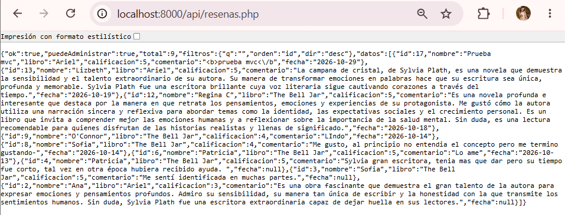
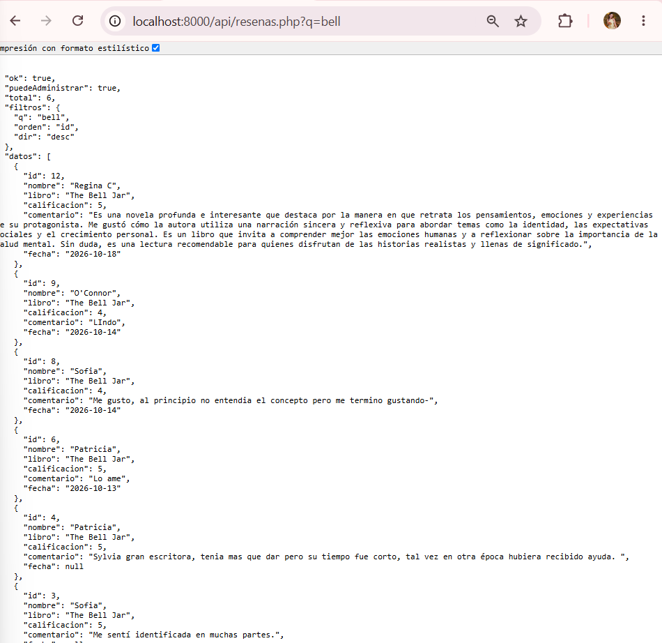
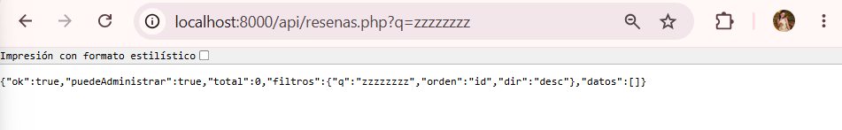
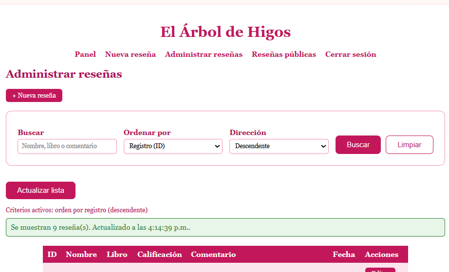

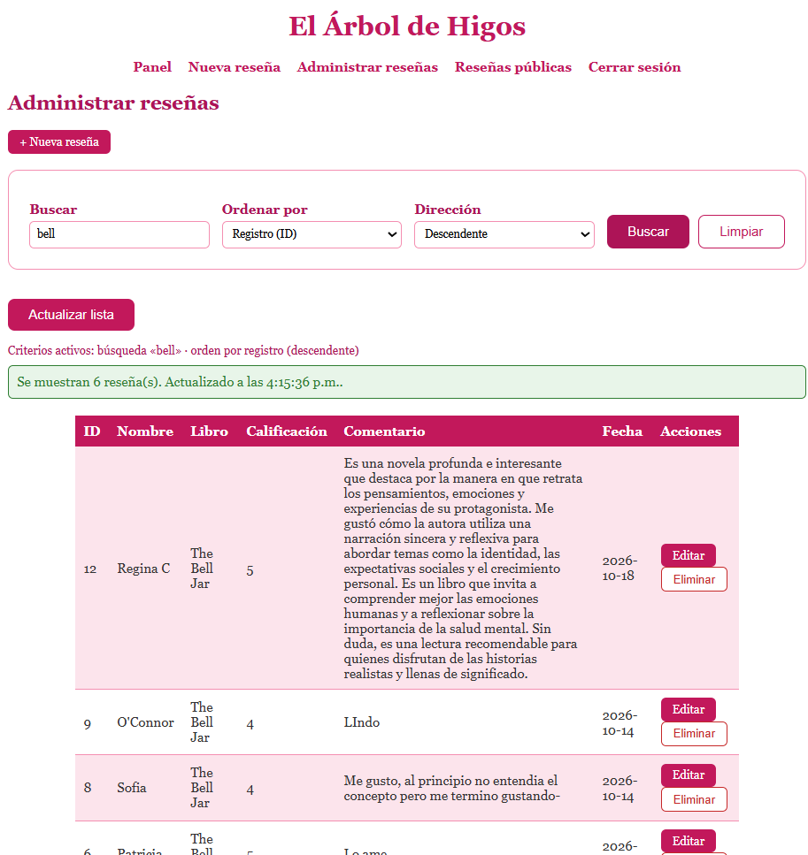
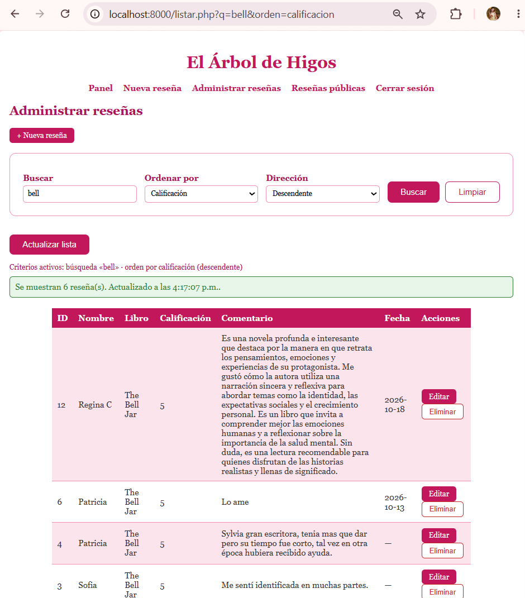

---

## Prueba 2 — El resultado coincide con la base de datos
🌸🌸🌸🌷🌸🌸💐🌸🌸🌷🌸🌸💐💐

**Qué hice:** comparé el `total` que devolvió el endpoint para `q=bell` con un `COUNT(*)` ejecutado directamente en MySQL con las mismas condiciones.

**Resultado obtenido:** los dos números coinciden.

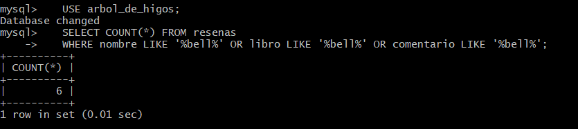

---

## Prueba 3 — Sin resultados
🌸🌸🌸🌷🌸🌸💐🌸🌸🌷🌸🌸💐💐

**Qué hice:** busqué `zzzzzzzz`.

**Resultado esperado:** no es un error: una lista vacía con un mensaje claro.

**Resultado obtenido:** el endpoint respondió `"ok":true`, `"total":0` y `"datos":[]`, y la interfaz mostró "No hay reseñas que coincidan con «zzzzzzzz»".

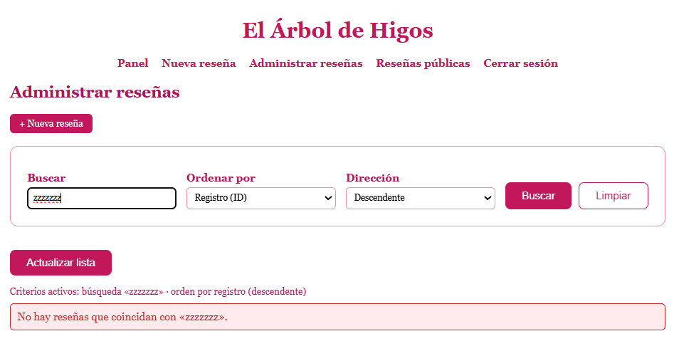

---

## Pruebas 4 y 5 — Parámetros vacíos, inválidos o fuera de lo permitido
🌸🌸🌸🌷🌸🌸💐🌸🌸🌷🌸🌸💐💐

| Entrada | Resultado |
|---|---|
| Sin parámetros | Usa los valores por defecto (orden por ID descendente), igual que antes |
| `orden=id;--` (intento de inyección en el orden) | `400`: "El criterio de orden no es válido." No devuelve reseñas |
| `dir=sideways` | `400` |
| `q` de 51 caracteres | `400`: "La búsqueda no puede tener más de 50 caracteres." |
| `q[]=x` (parámetro repetido) | `400` |
| `q=%` (un comodín escrito por el usuario) | Busca el carácter `%` literal; devuelve 0 reseñas y no toda la tabla |

El punto más importante es el orden: los parámetros preparados protegen **valores**, no nombres de columna. Por eso el nombre de la columna no se arma con lo que llega: el usuario solo elige una clave y el servidor usa **su propio texto** de la lista `COLUMNAS_ORDEN`.

Además comprobé que el servidor valida aunque el navegador no: con las herramientas de desarrollador quité el atributo `maxlength` del campo, escribí más de 50 caracteres y el servidor rechazó la búsqueda. El límite del navegador es comodidad, no protección.

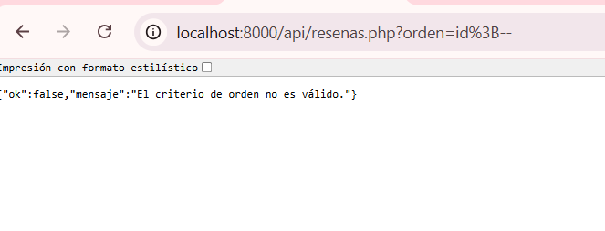
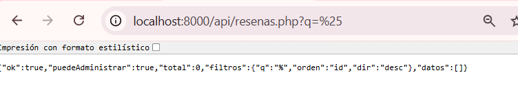
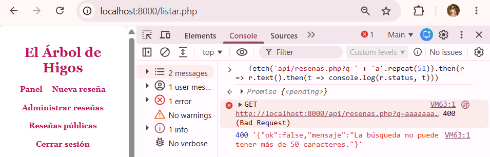

---

## Prueba 6 — Consultas con parámetros
🌸🌸🌸🌷🌸🌸💐🌸🌸🌷🌸🌸💐💐

**Qué hice:** busqué en el modelo las consultas, las listas permitidas y el escape.

**Resultado obtenido:** `Resena::buscar()` usa `prepare()` y `bind_param()` para el texto, `addcslashes()` para escapar `\`, `%` y `_`, y la lista `COLUMNAS_ORDEN` para el nombre de la columna.

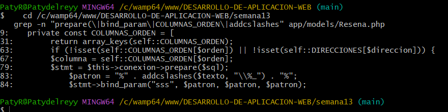

---

## Prueba 7 — Datos mostrados de forma segura
🌸🌸🌸🌷🌸🌸💐🌸🌸🌷🌸🌸💐💐

**Qué hice:** busqué `<b>x</b>` y `' OR 1=1 --`.

**Resultado obtenido:** el texto buscado se ve literal en el mensaje, sin negritas, porque se muestra con `textContent`. La búsqueda `' OR 1=1 --` se trata como un texto cualquiera: devolvió 0 resultados y no toda la tabla.

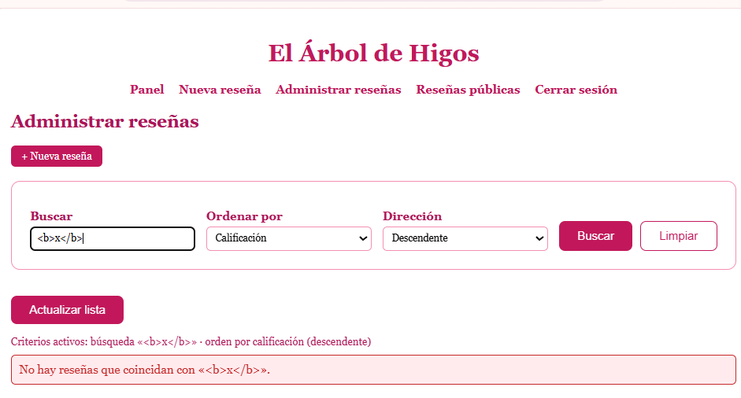

---

## Pruebas 8 y 9 — Permisos e información sensible
🌸🌸🌸🌷🌸🌸💐🌸🌸🌷🌸🌸💐💐

**Qué hice:** probé la búsqueda con la cuenta de consulta y el endpoint sin sesión.

**Resultado obtenido:** la cuenta de consulta puede buscar y ordenar (es de solo lectura), pero la tabla no muestra la columna de acciones. Sin sesión, el endpoint responde `401` en JSON. Los mensajes de error son siempre generales: ninguno revela consultas, rutas ni datos del servidor.

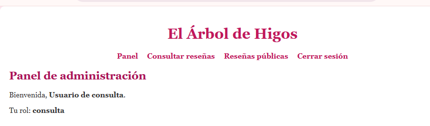

---

## Pruebas 10, 11 y 12 — Lo anterior sigue funcionando
🌸🌸🌸🌷🌸🌸💐🌸🌸🌷🌸🌸💐💐

**Resultado obtenido:** después de buscar, crear, editar y eliminar una reseña de prueba siguen funcionando, y los botones de la tabla (que dibuja JavaScript) conservan su confirmación. La consola del navegador no muestra errores en el uso normal.

Las correcciones realizadas durante la práctica están descritas en `evidencia.md`.
