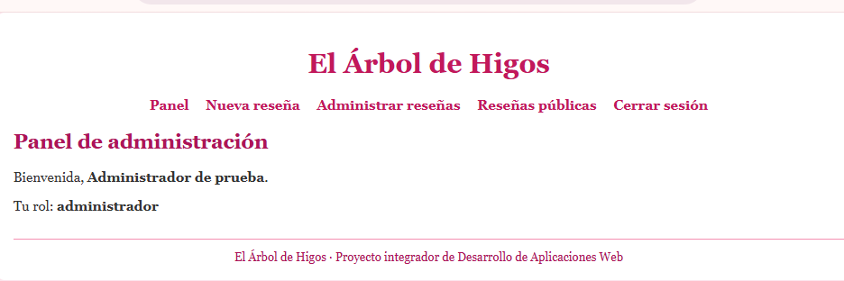
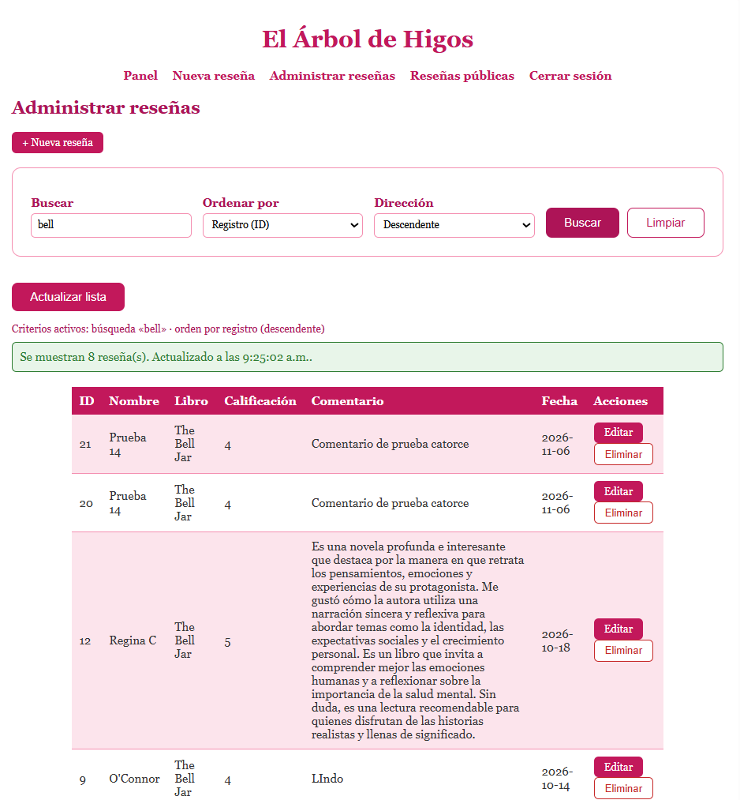
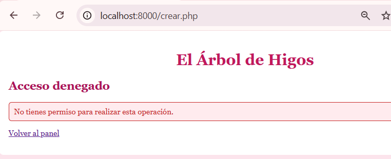
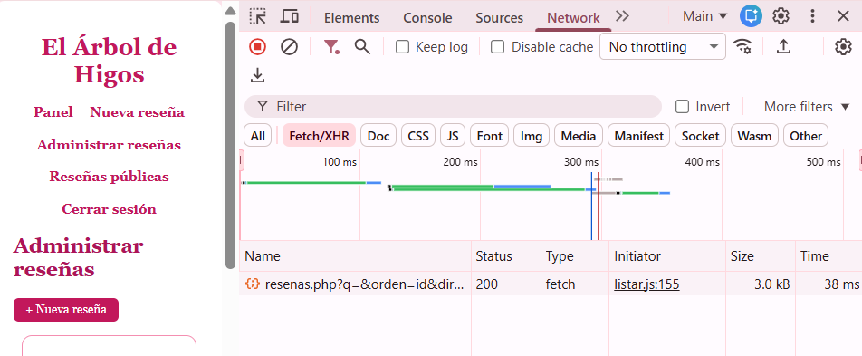

<table style="width:100%; border:none; margin-bottom:20px;">
<tr>
<td width="120" align="center" style="border:none;">

</td>
<td align="right" style="border:none; padding: 20px 10px;">
<h1 style="color:#c2185b; font-family: Georgia, serif; letter-spacing: 2px; margin-bottom:5px;">💐💐💐💐 EL ÁRBOL DE HIGOS 💐💐💐💐</h1>
<p style="color:#ad1457; font-style: italic; font-size: 15px; margin:0;">Semana 15 — Presentación del proyecto final</p>
<p style="color:#e91e8c; font-size: 13px; margin:0;">Desarrollo de Aplicaciones Web</p>
</td>
</tr>
</table>

<br>

<table style="width:100%; border-collapse: collapse;">
<tr style="background-color:#c2185b; color:#ffffff;">
<td style="padding:8px;"><b>Alumna</b></td>
<td style="padding:8px;">Patricia Segura Resendiz</td>
</tr>
<tr style="background-color:#fce4ec;">
<td style="padding:8px;"><b>Institución</b></td>
<td style="padding:8px;">Instituto Tecnológico Superior de Rioverde</td>
</tr>
<tr style="background-color:#c2185b; color:#ffffff;">
<td style="padding:8px;"><b>Carrera</b></td>
<td style="padding:8px;">Ingeniería en Sistemas Computacionales</td>
</tr>
<tr style="background-color:#fce4ec;">
<td style="padding:8px;"><b>Docente</b></td>
<td style="padding:8px;">Ing. José de Jesús Collazo Reyes</td>
</tr>
<tr style="background-color:#c2185b; color:#ffffff;">
<td style="padding:8px;"><b>Entorno</b></td>
<td style="padding:8px;">WampServer · Apache 2.4.59 · PHP 8.2.18 · MySQL 8.0.42</td>
</tr>
<tr style="background-color:#fce4ec;">
<td style="padding:8px;"><b>Versión final</b></td>
<td style="padding:8px;">Carpeta <code>semana14</code></td>
</tr>
</table>

<br>

<h2 style="color:#c2185b; border-bottom: 3px solid #f48fb1; padding-bottom: 6px;">🌸🌷🌸🌸🌸
 Objetivo</h2>

<blockquote style="border-left: 4px solid #f48fb1; background:#fff0f5; padding: 10px 15px; color:#333;">
Dejar el proyecto listo para presentarlo funcionando: documentado (README, descripción e informe final).
</blockquote>

<br>

<h2 style="color:#c2185b; border-bottom: 3px solid #f48fb1; padding-bottom: 6px;">🌷🌷🌸🌸🌸
 Qué entrego esta semana</h2>

<table style="width:100%; border-collapse: collapse;">
<tr style="background-color:#c2185b; color:#ffffff;"><th style="padding:8px; text-align:left;">Entregable</th><th style="padding:8px; text-align:left;">Dónde está</th></tr>
<tr style="background-color:#fce4ec;"><td style="padding:8px;">Descripción del proyecto</td><td style="padding:8px;"><code>semana15/descripcion_proyecto.md</code></td></tr>
<tr style="background-color:#ffffff;"><td style="padding:8px;">Informe final</td><td style="padding:8px;"><code>semana15/informe_final.md</code></td></tr>
<tr style="background-color:#fce4ec;"><td style="padding:8px;">README con instalación y ejecución</td><td style="padding:8px;"><code>README.md</code> (raíz del repositorio)</td></tr>
<tr style="background-color:#ffffff;"><td style="padding:8px;">Base de datos preparada, sin datos</td><td style="padding:8px;"><code>semana14/esquema.sql</code> (generado con <code>mysqldump --no-data</code>)</td></tr>
<tr style="background-color:#fce4ec;"><td style="padding:8px;">Datos de demostración ficticios</td><td style="padding:8px;"><code>semana14/datos_demo.sql</code></td></tr>
<tr style="background-color:#ffffff;"><td style="padding:8px;">Cuentas con distintos roles</td><td style="padding:8px;"><code>admin_prueba</code> (administrador) y <code>consulta_prueba</code> (consulta); contraseñas fuera del repositorio</td></tr>
<tr style="background-color:#fce4ec;"><td style="padding:8px;">Resultados de las pruebas de la Práctica 14</td><td style="padding:8px;"><code>semana14/plan_pruebas.md</code> y <code>registro_errores.md</code></td></tr>
<tr style="background-color:#ffffff;"><td style="padding:8px;">Versión final en GitHub</td><td style="padding:8px;">Rama <code>main</code>; versión estable marcada con la etiqueta <code>semana14-inicio</code></td></tr>
</table>

<br>

<h2 style="color:#c2185b; border-bottom: 3px solid #f48fb1; padding-bottom: 6px;">💗🌷🌸🌸🌸
 Estructura utilizada</h2>

```text
semana14/
├── app/
│   ├── models/          Resena.php — consultas a la tabla
│   ├── controllers/     ResenaController.php — valida y coordina
│   ├── views/
│   │   ├── layouts/     header.php, menu.php, mensajes.php, footer.php
│   │   ├── componentes/ campo.php
│   │   └── resenas/     publicas.php
│   └── helpers/         entrada.php (textoDato, textoPost)
├── api/                 resenas.php — endpoint JSON
├── conexion.php         lee config.php (que no está en el repositorio)
├── config.ejemplo.php   plantilla sin secretos
├── proteger.php, autorizacion.php, autorizacion_json.php
├── index, panel, listar, crear, editar, eliminar,
│   login_form, login, logout, procesar, resenas   (.php)
├── listar.js, script.js, estilos.css
└── esquema.sql, datos_demo.sql
```

<br>

<h2 style="color:#c2185b; border-bottom: 3px solid #f48fb1; padding-bottom: 6px;">🌺🌷🌸🌸🌸
 Tablas de la base de datos</h2>

<table style="width:100%; border-collapse: collapse;">
<tr style="background-color:#c2185b; color:#ffffff;"><th style="padding:8px; text-align:left;">Tabla</th><th style="padding:8px; text-align:left;">Campos</th></tr>
<tr style="background-color:#fce4ec;"><td style="padding:8px;"><code>resenas</code></td><td style="padding:8px;"><code>id</code> (PK, AUTO_INCREMENT), <code>nombre</code> NOT NULL, <code>correo</code>, <code>libro</code> NOT NULL, <code>calificacion</code> INT, <code>comentario</code> TEXT, <code>fecha</code> DATE</td></tr>
<tr style="background-color:#ffffff;"><td style="padding:8px;"><code>usuarios</code></td><td style="padding:8px;"><code>id</code> (PK), <code>nombre</code>, <code>usuario</code> UNIQUE, <code>correo</code> UNIQUE, <code>password_hash</code> VARCHAR(255), <code>activo</code> (1 o 0), <code>creado_en</code>, <code>rol</code> con CHECK (<code>administrador</code> o <code>consulta</code>)</td></tr>
</table>

<br>

<h2 style="color:#c2185b; border-bottom: 3px solid #f48fb1; padding-bottom: 6px;">💕🌷🌸🌸🌸
 Explicación del proyecto (las preguntas de la guía)</h2>

<table style="width:100%; border-collapse: collapse;">
<tr style="background-color:#c2185b; color:#ffffff;"><th style="padding:8px; text-align:left; width:28%;">Pregunta</th><th style="padding:8px; text-align:left;">Respuesta con archivos y funciones</th></tr>

<tr style="background-color:#fce4ec;"><td style="padding:8px;"><b>1. ¿Qué problema resuelve?</b></td><td style="padding:8px;">Una librería pequeña necesita saber qué opinan sus lectores y administrar esas opiniones sin que cualquiera pueda modificarlas. Cualquiera deja una reseña; solo las cuentas autorizadas consultan, editan o eliminan. Todavía no tiene catálogo ni carrito.</td></tr>

<tr style="background-color:#ffffff;"><td style="padding:8px;"><b>2. ¿Cómo está organizada?</b></td><td style="padding:8px;">Las páginas están en la raíz de <code>semana14</code>. La lógica del módulo de consulta está en <code>app/</code> (modelo, controlador, vistas) y el endpoint en <code>api/</code>. La conexión lee <code>config.php</code>, que no está en GitHub.</td></tr>

<tr style="background-color:#fce4ec;"><td style="padding:8px;"><b>3. ¿Dónde uso PHP?</b></td><td style="padding:8px;">Validación en <code>procesar.php</code>, <code>crear.php</code> y <code>editar.php</code>; login y sesión en <code>login.php</code>, <code>proteger.php</code> y <code>logout.php</code>; permisos en <code>autorizacion.php</code>; consultas en <code>Resena.php</code>; JSON en <code>api/resenas.php</code>.</td></tr>

<tr style="background-color:#ffffff;"><td style="padding:8px;"><b>4. ¿Cómo uso CSS?</b></td><td style="padding:8px;"><code>estilos.css</code>: paleta rosa (<code>#fce4ec</code>, <code>#c2185b</code>, <code>#ad1457</code>, <code>#f48fb1</code>), Flexbox en <code>.formularios-container</code> y <code>.menu</code>, <code>@media (max-width:600px)</code> para pantallas pequeñas y clases <code>.mensaje-error</code> / <code>.mensaje-exito</code> / <code>.btn-enlace</code>.</td></tr>

<tr style="background-color:#fce4ec;"><td style="padding:8px;"><b>5. ¿Qué hace JavaScript?</b></td><td style="padding:8px;"><code>script.js</code> (inicio): saludo, cambio del título, mostrar/ocultar y validación del formulario GET con <code>preventDefault()</code>. <code>listar.js</code> (panel): <code>fetch</code> al endpoint, dibujo de la tabla con <code>textContent</code>, búsqueda y manejo de errores.</td></tr>

<tr style="background-color:#ffffff;"><td style="padding:8px;"><b>6. ¿Cómo se guardan y consultan los datos?</b></td><td style="padding:8px;">En MySQL (<code>arbol_de_higos</code>), con <code>mysqli</code>. Todo valor del usuario va en consultas preparadas: <code>prepare()</code> con <code>?</code> y <code>bind_param()</code>.</td></tr>

<tr style="background-color:#fce4ec;"><td style="padding:8px;"><b>7. ¿Cómo funciona el CRUD?</b></td><td style="padding:8px;"><code>crear.php</code> valida y hace <code>INSERT</code>; la lista lee con <code>SELECT</code> por el endpoint; <code>editar.php</code> valida el id, busca el registro y hace <code>UPDATE ... WHERE id = ?</code>; <code>eliminar.php</code> solo acepta POST y hace <code>DELETE ... WHERE id = ?</code>, con <code>affected_rows</code>.</td></tr>

<tr style="background-color:#ffffff;"><td style="padding:8px;"><b>8. ¿Cómo funciona el login?</b></td><td style="padding:8px;"><code>login.php</code> busca al usuario con consulta preparada, comprueba <code>activo = 1</code> y verifica con <code>password_verify()</code>. Si falla, siempre el mismo mensaje. Si entra: <code>session_regenerate_id(true)</code> y guarda id, nombre, usuario y rol en <code>$_SESSION</code>.</td></tr>

<tr style="background-color:#fce4ec;"><td style="padding:8px;"><b>9. ¿Cómo se aplican roles y permisos?</b></td><td style="padding:8px;">El rol está en <code>usuarios.rol</code> y se lee de la base al iniciar sesión. <code>crear.php</code>, <code>editar.php</code> y <code>eliminar.php</code> llaman <code>exigirRol(["administrador"])</code> antes de cualquier consulta; si no, 403. El menú usa <code>tieneRol()</code>, pero eso es comodidad, no seguridad.</td></tr>

<tr style="background-color:#ffffff;"><td style="padding:8px;"><b>10. ¿Qué medidas de seguridad implementé?</b></td><td style="padding:8px;">Consultas preparadas; validación en PHP; <code>htmlspecialchars()</code> y <code>textContent</code>; <code>password_hash()</code>; permisos en el servidor; lista permitida para el orden (<code>COLUMNAS_ORDEN</code>); <code>error_log()</code> con mensaje general; <code>config.php</code> en <code>.gitignore</code>; <code>textoDato()</code> para valores que no son texto.</td></tr>

<tr style="background-color:#fce4ec;"><td style="padding:8px;"><b>11. ¿Cómo funciona Fetch API?</b></td><td style="padding:8px;"><code>listar.js</code> hace <code>fetch('api/resenas.php?q=...&orden=...&dir=...')</code>. El endpoint comprueba sesión (401), método (405) y rol (403), y responde JSON con <code>ok</code>, <code>puedeAdministrar</code>, <code>total</code>, <code>filtros</code> y <code>datos</code>. <code>listar.js</code> revisa <code>respuesta.ok</code> a mano. El endpoint tiene su propia autorización porque las páginas redirigen al login y <code>fetch()</code> recibiría HTML.</td></tr>

<tr style="background-color:#ffffff;"><td style="padding:8px;"><b>12. ¿Qué hacen modelo, controlador y vista?</b></td><td style="padding:8px;">Modelo (<code>Resena.php</code>): solo consultas, no imprime nada. Controlador (<code>ResenaController.php</code>): valida <code>q</code>, <code>orden</code> y <code>dir</code>, atrapa errores y decide la respuesta. Vista (<code>publicas.php</code>): presenta los datos escapados.</td></tr>

<tr style="background-color:#fce4ec;"><td style="padding:8px;"><b>13. ¿Qué componentes reutilizables hice?</b></td><td style="padding:8px;"><code>header.php</code>, <code>menu.php</code> (cambia por rol), <code>mensajes.php</code> (<code>mostrarMensaje()</code> con tipos permitidos), <code>footer.php</code> y <code>campo.php</code>. Siete páginas los usan; el endpoint JSON no.</td></tr>

<tr style="background-color:#ffffff;"><td style="padding:8px;"><b>14. ¿Qué función avanzada agregué?</b></td><td style="padding:8px;">Búsqueda y ordenamiento de la lista. <code>Resena::buscar()</code> usa <code>LIKE ?</code> con <code>addcslashes()</code> para escapar <code>%</code> y <code>_</code>. El <code>ORDER BY</code> usa <code>COLUMNAS_ORDEN</code>: el usuario elige una clave y el servidor usa su propio texto. Parámetros inválidos responden 400.</td></tr>

<tr style="background-color:#fce4ec;"><td style="padding:8px;"><b>15. ¿Qué errores encontré?</b></td><td style="padding:8px;">Ver la sección de errores más abajo y <code>semana14/registro_errores.md</code>.</td></tr>

<tr style="background-color:#ffffff;"><td style="padding:8px;"><b>16. ¿Qué mejoraría?</b></td><td style="padding:8px;">Token CSRF y límite de intentos en el login; migrar crear, editar, eliminar y login a MVC; unificar <code>autorizacion.php</code> y <code>autorizacion_json.php</code>; gestión de usuarios; paginación; y el catálogo con carrito.</td></tr>
</table>

<br>

<h2 style="color:#c2185b; border-bottom: 3px solid #f48fb1; padding-bottom: 6px;">🌸🌷🌸🌸🌸
 Recorrido de la demostración</h2>

<blockquote style="border-left: 4px solid #f48fb1; background:#fff0f5; padding: 10px 15px; color:#333;">
El recorrido que presento sigue los pasos de la guía: nombre y propósito; inicio y navegación; login con el administrador; menú según el rol; consulta y búsqueda; crear; editar; eliminar (cancelar y confirmar); la petición Fetch en la pestaña Network; la función avanzada, incluidos un orden inválido (<code>orden=id;--</code>, que responde 400) y un comodín (<code>q=%</code>, que no devuelve toda la tabla); cerrar sesión y abrir una página privada; y la estructura MVC y de componentes en el código. En la parte de seguridad, con la cuenta de consulta intento abrir <code>crear.php</code>, enviar un POST de eliminar y pasar <code>?rol=administrador</code>: el servidor rechaza los tres.
</blockquote>

<br>

<h2 style="color:#c2185b; border-bottom: 3px solid #f48fb1; padding-bottom: 6px;">💐🌷🌸🌸🌸
 Evidencias de funcionamiento</h2>

<div align="center">

<p style="color:#c2185b; font-style:italic; font-size:13px;">Panel con el rol administrador y su menú completo</p>
<br>

<p style="color:#c2185b; font-style:italic; font-size:13px;">Lista con una búsqueda aplicada, cargada con Fetch</p>
<br>

<p style="color:#c2185b; font-style:italic; font-size:13px;">La cuenta de consulta recibe "Acceso denegado" al abrir crear.php</p>
<br>

<p style="color:#c2185b; font-style:italic; font-size:13px;">La petición Fetch a resenas.php y su respuesta JSON</p>
</div>

<br>

<h2 style="color:#c2185b; border-bottom: 3px solid #f48fb1; padding-bottom: 6px;">🌺🌷🌸🌸🌸
 Resultado de las pruebas</h2>

<blockquote style="border-left: 4px solid #f48fb1; background:#fff0f5; padding: 10px 15px; color:#333;">
Esta semana no agregué pruebas nuevas: los resultados son los de la Práctica 14. Ejecuté un plan de <b>45 casos</b> (formularios 6, login 6, seguridad 6, CRUD 8, roles 5, Fetch 5, arquitectura 3 y búsqueda 6) y los <b>45 resultaron correctos</b>. El detalle de cada caso está en <code>semana14/plan_pruebas.md</code>.
</blockquote>

<br>

<h2 style="color:#c2185b; border-bottom: 3px solid #f48fb1; padding-bottom: 6px;">🌷🌷🌸🌸🌸
 Errores encontrados y soluciones</h2>

<h3 style="color:#ad1457;">Esta semana</h3>

<table style="width:100%; border-collapse: collapse;">
<tr style="background-color:#c2185b; color:#ffffff;"><th style="padding:8px; text-align:left;">Qué ocurrió</th><th style="padding:8px; text-align:left;">Cómo lo detecté</th><th style="padding:8px; text-align:left;">Solución</th></tr>
<tr style="background-color:#fce4ec;"><td style="padding:8px;">Mi proyecto <b>no tenía <code>README.md</code></b> en el repositorio</td><td style="padding:8px;">Me di cuenta al revisar los entregables de la guía</td><td style="padding:8px;">Lo creé en la raíz y lo subí; comprobé con <code>git ls-files README.md</code></td></tr>
<tr style="background-color:#ffffff;"><td style="padding:8px;"><code>descripcion_proyecto.md</code> e <code>informe_final.md</code> quedaron dentro de <code>semana15/img/</code></td><td style="padding:8px;"><code>git ls-files</code> mostró la ruta con <code>img</code></td><td style="padding:8px;">Los moví con <code>git mv</code>, que conserva el historial, y volví a comprobar</td></tr>
<tr style="background-color:#fce4ec;"><td style="padding:8px;">El esquema de la base de datos debía subirse sin datos reales</td><td style="padding:8px;">Riesgo de subir reseñas, correos o hashes de contraseñas</td><td style="padding:8px;">Lo generé con <code>mysqldump --no-data</code> y comprobé con <code>grep -c "INSERT INTO"</code> que diera 0</td></tr>
</table>

<h3 style="color:#ad1457; margin-top:15px;">Del semestre (<code>registro_errores.md</code>)</h3>

<table style="width:100%; border-collapse: collapse;">
<tr style="background-color:#c2185b; color:#ffffff;"><th style="padding:8px;">Semana</th><th style="padding:8px; text-align:left;">Error</th><th style="padding:8px; text-align:left;">Solución</th></tr>
<tr style="background-color:#fce4ec;"><td style="padding:8px; text-align:center;">7</td><td style="padding:8px;"><code>listar.php</code> abría sin sesión: faltaba <code>proteger.php</code></td><td style="padding:8px;">Agregarlo como primera línea y verificar con <code>grep</code></td></tr>
<tr style="background-color:#ffffff;"><td style="padding:8px; text-align:center;">8</td><td style="padding:8px;">La página pública ejecutaba el HTML de un visitante</td><td style="padding:8px;"><code>htmlspecialchars()</code></td></tr>
<tr style="background-color:#fce4ec;"><td style="padding:8px; text-align:center;">8</td><td style="padding:8px;">Credenciales en el repositorio y errores técnicos en pantalla</td><td style="padding:8px;"><code>config.php</code> en <code>.gitignore</code> y <code>try/catch</code> con <code>error_log()</code></td></tr>
<tr style="background-color:#ffffff;"><td style="padding:8px; text-align:center;">12</td><td style="padding:8px;"><code>mensaje[]=x</code> y <code>nombre[]=x</code> provocaban errores fatales; mi auditoría de la Semana 8 no los vio</td><td style="padding:8px;"><code>is_string()</code> y <code>textoDato()</code></td></tr>
<tr style="background-color:#fce4ec;"><td style="padding:8px; text-align:center;">14</td><td style="padding:8px;">Errores de mi propio plan de pruebas (una prueba con la cuenta equivocada, un comando mal escrito y un total mal contado)</td><td style="padding:8px;">Se corrigieron y se repitió la prueba</td></tr>
</table>

<br>

<h2 style="color:#c2185b; border-bottom: 3px solid #f48fb1; padding-bottom: 6px;">💗🌷🌸🌸🌸
 Limitaciones que reconozco</h2>

<blockquote style="border-left: 4px solid #f48fb1; background:#fff0f5; padding: 10px 15px; color:#333;">
No tiene token CSRF; el login no limita los intentos; solo el módulo de consulta de reseñas sigue MVC; la comprobación de rol está duplicada entre las páginas y el endpoint; no hay gestión de usuarios (los roles se asignan en MySQL); la lista no tiene paginación; <code>index.php</code> y la página de "Acceso denegado" no usan la plantilla; y no hay catálogo ni carrito.
</blockquote>

<br>

<h2 style="color:#c2185b; border-bottom: 3px solid #f48fb1; padding-bottom: 6px;">🌸🌷🌸🌸🌸
 Reflexión final</h2>

<blockquote style="border-left: 4px solid #f48fb1; background:#fff0f5; padding: 10px 15px; color:#333;">
Empecé el semestre con una página de PHP que mostraba un libro y un total, y termino con una aplicación que guarda reseñas, decide quién puede hacer qué y se puede probar. Lo que más aprendí no fue una tecnología, sino una forma de trabajar: avanzar en pasos chicos, comprobar cada uno, guardar cada avance con un commit y registrar con honestidad lo que salió mal. Aprendí que una aplicación que funciona no es necesariamente segura: lo vi con el HTML que se ejecutaba en la página pública, con los valores que no son texto que pasaron dos revisiones, y con mi propio plan de pruebas. Y aprendí que ocultar un botón no protege nada: lo que protege es que el servidor responda 403.
</blockquote>

<br>
